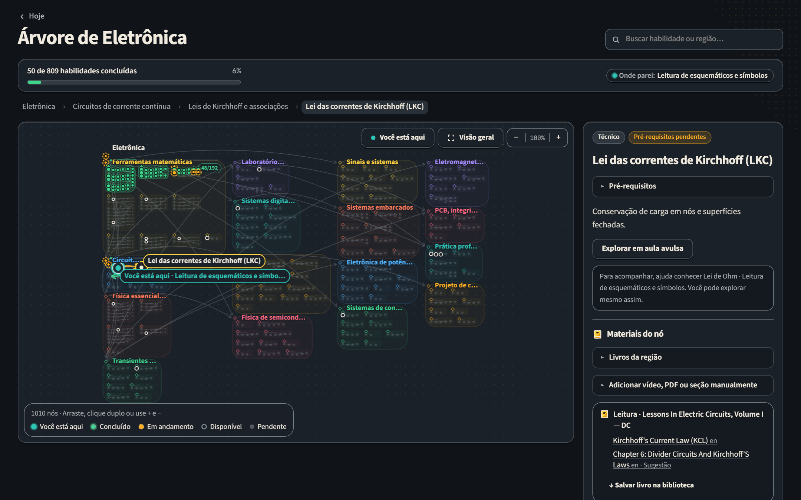
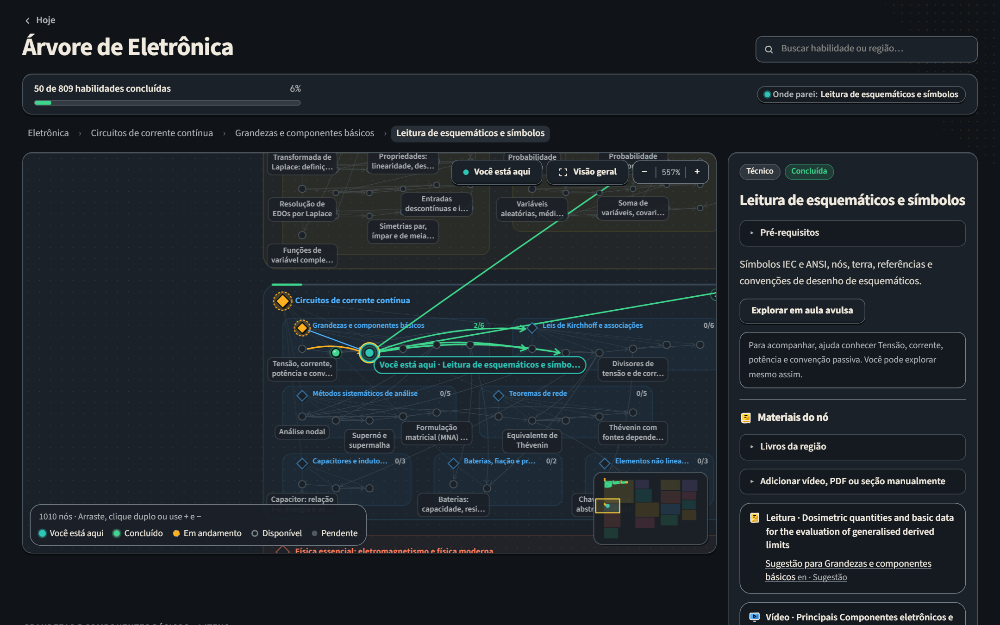
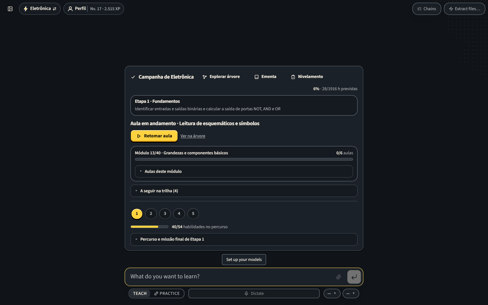
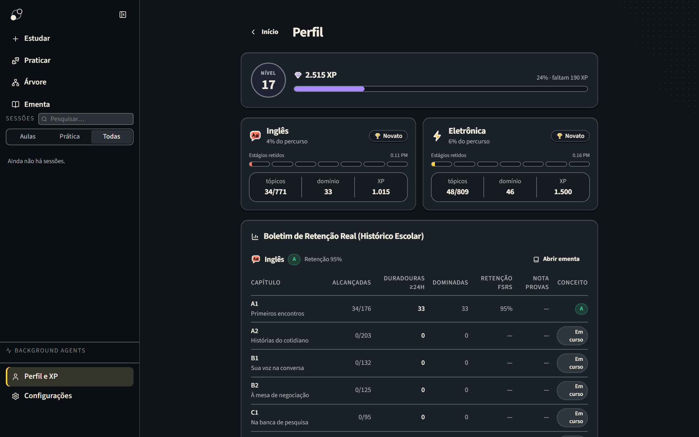
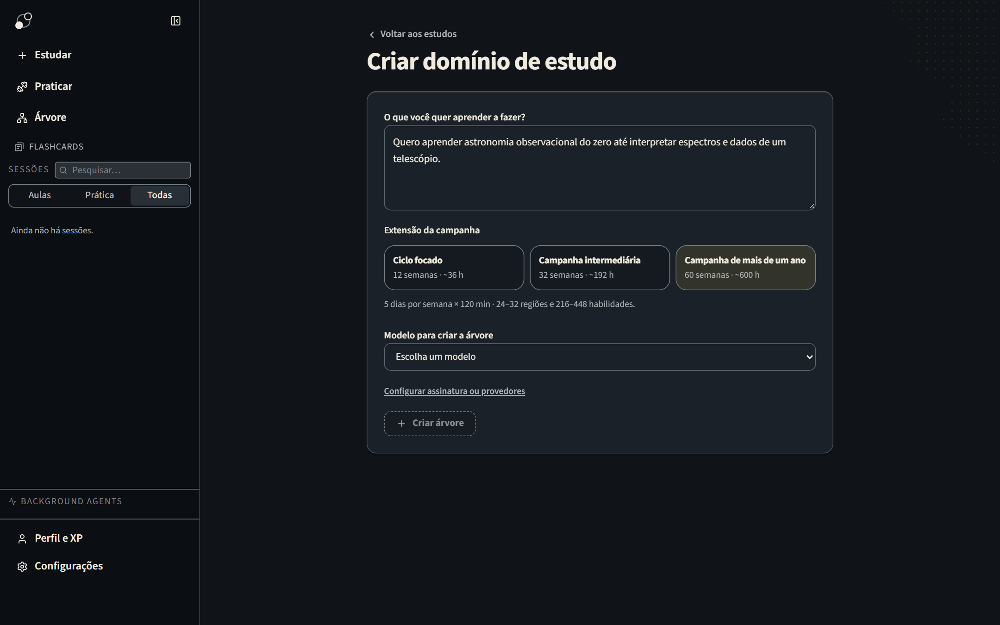
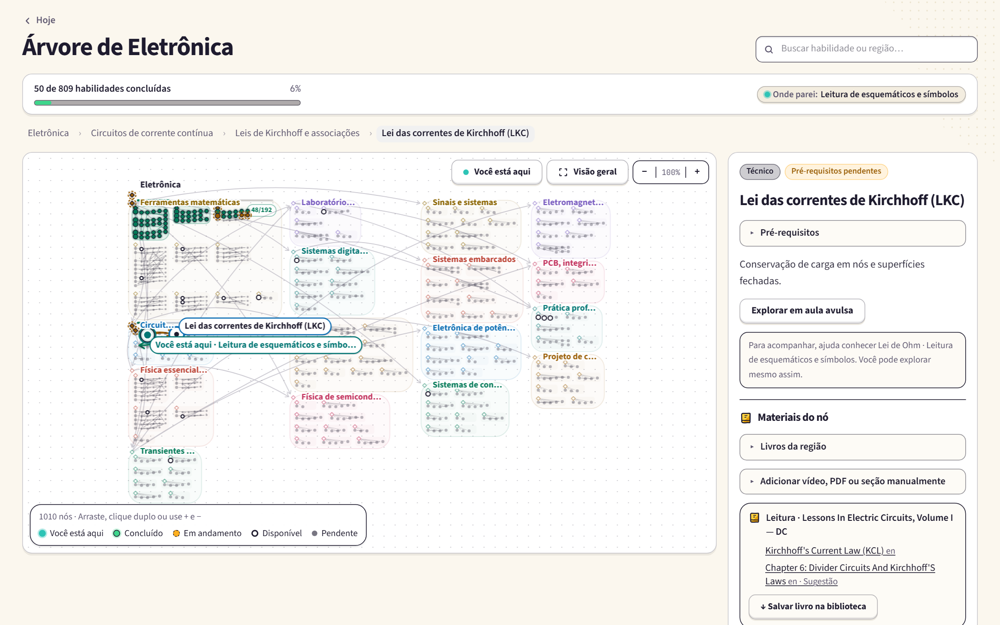

<div align="center">

# TrilhaAtlas

**Open-source, local-first AI tutor with interactive skill trees, knowledge graphs, FSRS spaced repetition, textbooks, PDF page citations, and YouTube lessons.**

[](LICENSE)
[](content/curricula/LICENSE)
[](tsconfig.json)
[](package.json)
[](https://github.com/open-spaced-repetition/ts-fsrs)
[](#run-it-locally)

*Turn any subject into a structured, year-long adaptive learning path — from fundamentals to research-level mastery — stored privately on your machine.*

[Screenshots](#interface--screenshots) · [Features](#why-trilhaatlas) · [Quick Start](#run-it-locally) · [How It Works](#how-it-works) · [Research](#research-behind-the-design) · [Em Português](#em-português)

</div>

---

<p align="center">
  <picture>
    <source media="(prefers-color-scheme: dark)" srcset="docs/assets/trilhaatlas-map.png" />
    <source media="(prefers-color-scheme: light)" srcset="docs/assets/trilhaatlas-map-light.png" />
    
  </picture>
</p>

<p align="center">
  <em>Interactive Electronics skill tree (809 core skills / 1,010 nodes) shown with simulated progress, semantic prerequisite links, and linked textbook & video shelf. Adapts automatically to GitHub dark and light mode.</em>
</p>

---

## Why TrilhaAtlas?

Most AI chat tools forget what you mastered last week, skip prerequisites, or hand out answers without building long-term retention. **TrilhaAtlas** combines a deterministic **curriculum knowledge graph**, **Bayesian Knowledge Tracing (BKT)**, and **FSRS spaced repetition** with an active AI tutor grounded in real textbooks, PDFs, and YouTube lectures.

| Pillar | What you get |
| --- | --- |
| **Interactive Skill Tree & Knowledge Graph** | Zoomable canvas showing every area, unit, topic, and prerequisite dependency. Bundled with **Electronics** (809 skills, ~1,916 h) and **English** (771 skills, ~1,510 h) — or generate a custom curriculum for any subject. |
| **FSRS Spaced Repetition & Active Recall** | Deterministic **BKT × FSRS** learner model schedules reviews before you forget, tracks real retention per chapter, and adapts your daily study plan. |
| **Books, PDF Reader & YouTube Lessons** | Every curriculum region links to open textbooks, YouTube video timestamps, and your own local PDF/EPUB files. The tutor cites exact physical PDF pages and can inspect figures and cropped regions. |
| **Local-First Domain Memory** | Isolated per-domain SQLite memory (FTS5 + local embeddings) recalls past sessions, mistakes, and preferences without sending your whole history to the cloud. |
| **Interactive Labs & Guided Practice** | Hands-on circuit labs, timelines, diagrams, pronunciation practice, worked → faded → independent exams, and automatic sibling reinforcement when repeated mistakes reveal a gap. |
| **Bring Your Own Subscription or API Key** | Sign in with ChatGPT, connect OpenAI / Anthropic / OpenRouter API keys, or opt into Claude Code CLI. Full token usage and focused study-time tracking per model. |
| **Anki & Obsidian Ready** | Built-in FSRS flashcard plugin with export support for **AnkiConnect**, **`.apkg`**, and **Obsidian Spaced Repetition** Markdown vaults. |

---

## Interface & Screenshots

### Multi-LOD Skill Tree — Overview to Close-Up & Interactive Minimap

Zoom out to track mastery across all regions at a glance (completed skills in emerald, active progress in amber, available frontier highlighted, pending skills recessed). Zoom in to inspect unit progress counters, 2-line skill cards, semantic prerequisite/unlock curves, cel-shaded status glyphs, and an interactive minimap.



### Guided Daily Campaign & Adaptive Study Plan

Each domain opens with one clear next step — balancing due reviews, campaign chapters, placement shortcuts, and free-form exploration in a clean cel-shaded interface.



### Retention Report Card, XP, Study Time & Token Analytics

Track real FSRS retention by chapter, account level and XP calibrated via Monte Carlo simulation, daily study time, and transparent token usage broken down by model.



### Generate a Custom Skill Tree for Any Subject

Open the domain switcher and choose **Criar domínio de estudo**. Describe the observable skill you want to reach, pick a campaign pace (from a 12-week focused cycle to a 60-week multi-year path), and TrilhaAtlas outlines regions, prerequisites, exercises, and matching books & videos.



### Hand-Crafted Cel-Shading Themes: Cel Noite & Cel Papel

Designed for long reading sessions with WCAG AA/AAA contrast, deterministic hand-drawn SVG icons, Source Sans 3 prose, JetBrains Mono code, and CMU Serif titles.

| Cel Noite (Dark) | Cel Papel (Light) |
| --- | --- |
|  |  |

---

## How It Works

### 1. Start with a bundled curriculum or generate your own

- **Generate with AI:** Open the domain menu on the home screen and select **Criar domínio de estudo** (e.g., *"Learn observational astronomy from scratch to interpreting telescope spectra"*). TrilhaAtlas validates prerequisite acyclicity and reachability before installing the domain atomically.
- **Hand-author or import:** Copy the starter [map-reading example](examples/study-domain/map-reading/00-map.json) and follow the [Domain authoring guide](docs/authoring-domains.md).
- **Connect your AI provider:** Sign in with your ChatGPT subscription during setup or configure providers under **Settings → Providers** ([OpenAI sign-in guide](https://developers.openai.com/cookbook/articles/sign-in-with-chatgpt)). Enable background access if you want automatic memory consolidation and reinforcement between lessons.

### 2. Study with grounded readings, PDFs & YouTube

Every generated or curated region includes optional readings and video lessons. Matching tables of contents and video timestamps link directly to the relevant skill. Attach a local PDF or EPUB to any region to read inside the app, crop figures/diagrams for the tutor, and jump directly to cited physical pages during a lesson.

### 3. Adaptive reinforcement when a concept gets stuck

If two distinct graded quiz checks reveal a recurring difficulty on a skill whose prerequisites are already met, the background model can propose a short optional reinforcement lesson. The app validates the patch, appends it to the domain ledger beside the original skill, and surfaces it on both the skill map and the daily campaign card — preserving all existing progress, XP, and history.

---

## Run It Locally

### Prerequisites

- **Node.js 24+** (Node 26 recommended) and **npm**

### Quick Start

```sh
git clone https://github.com/Chummy26/TrilhaAtlas.git
cd TrilhaAtlas
npm ci
npm run plugins:setup
npm run dev
```

Open **http://localhost:3000** and choose a study domain (**Eletrônica**, **Inglês**, or create your own). You can explore the skill tree and linked resources before connecting an AI model. To start AI-guided lessons, open **Settings → Providers**, connect a provider, and pick your models.

> **Language note:** The study interface and lesson guidance are currently in **Brazilian Portuguese (pt-BR)**, with multi-domain support and English study content included.

> **Privacy & local-first storage:** All study records, conversations, skill progress, and SQLite domain memories live locally on your machine. AI calls only send the relevant lesson context to the provider you choose.

See the [Development guide](docs/development.md), [Desktop release guide](docs/desktop-release.md), and [Integration architecture](docs/impl/integration.md) for details.

---

## Research Behind the Design

TrilhaAtlas translates peer-reviewed cognitive science and intelligent tutoring research directly into code:

- **Knowledge Tracing (BKT):** Corbett & Anderson modeled how learner mastery evolves with practice. TrilhaAtlas updates per-skill mastery estimates from graded evidence. [Knowledge Tracing](https://doi.org/10.1007/BF01099821)
- **Test-Enhanced Learning & Spaced Repetition:** Roediger & Karpicke demonstrated how retrieval practice strengthens long-term retention. Short checks and FSRS scheduling drive delayed review. [Test-Enhanced Learning](https://pubmed.ncbi.nlm.nih.gov/16507066/)
- **Structured Conversational Memory:** Hindsight separates raw source experiences from derived observations, informing per-domain evidence retrieval across sessions. [Hindsight, ACL 2026](https://aclanthology.org/2026.acl-demo.27/)
- **Worked-Example Fading:** Atkinson, Renkl & Merrill studied transitioning from worked examples to faded steps and independent transfer. [Transitioning From Studying Examples to Solving Problems](https://doi.org/10.1037/0022-0663.95.4.774)
- **Guardrailed AI Tutoring:** Bastani et al. showed that unguarded AI answers can harm learning, motivating targeted hint ladders and independent follow-up problems. [Generative AI without guardrails can harm learning](https://doi.org/10.1073/pnas.2422633122)

---

## Upstream & Related Projects

- **Application base:** Derived from Amos Blomqvist's [learnharness](https://github.com/amosblomqvist/learnharness), including its study interface, chat workspace, and agent infrastructure.
- **Libraries & code adapted:** Uses [ts-fsrs](https://github.com/open-spaced-repetition/ts-fsrs) for FSRS scheduling and adapts recall-query logic from [Hindsight](https://github.com/vectorize-io/hindsight). See [THIRD_PARTY_NOTICES.md](THIRD_PARTY_NOTICES.md).
- **Design references:** Informed by [Open Mastery](https://github.com/bxxd/open-mastery), [BloomTutor](https://github.com/Li-Evan/BloomTutor), [DeepTutor](https://github.com/HKUDS/DeepTutor), and [OpenMAIC](https://github.com/THU-MAIC/OpenMAIC). See [Pedagogy and memory notes](docs/impl/memoria-pedagogia.md).

---

## Em Português

**TrilhaAtlas** é um tutor de estudos de código aberto e *local-first* com **árvore de habilidades interativa**, **repetição espaçada (FSRS)**, **memória persistente por domínio**, leitura de **livros/PDFs com citação de página física**, **aulas em vídeo do YouTube**, **laboratórios interativos** e exportação de flashcards para **Anki** e **Obsidian**. Já vem com trilhas extensas de **Eletrônica** (809 habilidades) e **Inglês** (771 habilidades) e permite gerar currículos completos para qualquer tema com o modelo de IA da sua preferência.

---

## Contributing & License

A concrete curriculum improvement is a great first contribution: missing prerequisite links, misplaced chapters, broken video links, or new open-licensed study domains. [Open an issue](https://github.com/Chummy26/TrilhaAtlas/issues) · [Contributing guide](CONTRIBUTING.md)

TrilhaAtlas builds on Amos Blomqvist's [learnharness](https://github.com/amosblomqvist/learnharness). The application code is licensed under [AGPL-3.0](LICENSE) and bundled curriculum data under [CC BY-SA 4.0](content/curricula/LICENSE). See [THIRD_PARTY_NOTICES.md](THIRD_PARTY_NOTICES.md).
