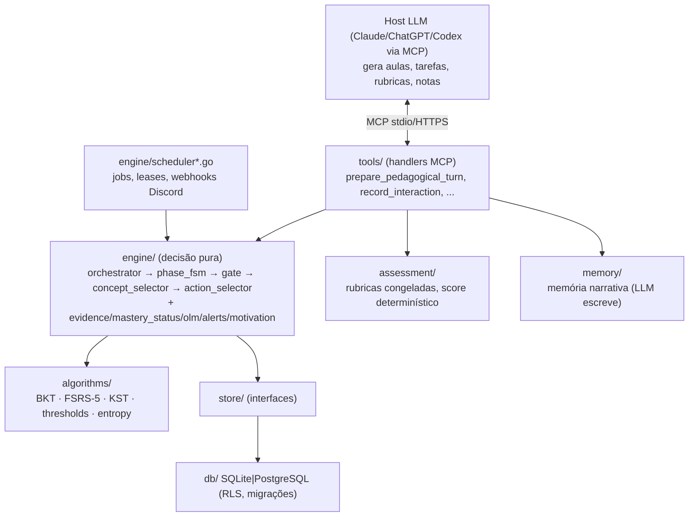

# tutor-mcp (ArnaudGuiovanna): motor pedagógico determinístico para portar ao nosso app

> **Escopo.** Análise do repositório <https://github.com/ArnaudGuiovanna/tutor-mcp>, clonado em
> `_refs/extra/ArnaudGuiovanna__tutor-mcp`. Foi só lido: nada foi executado, instalado ou compilado.
> O foco é o que dá para portar para o nosso fork do learnharness (TypeScript, Next.js 16, Electron 44, AGPL-3.0).
>
> **Data da análise:** 2026-11-18.
>
> **Snapshot analisado:**
> - commit `549110b535615997ce98dedf7c58e8ba82f082cf`, de 2026-11-16;
> - mensagem: "fix: remediate GitHub security findings and dependency updates".
>
> **Caminhos.** Todos os caminhos de arquivo neste relatório são relativos a
> `C:\Users\nicoolas\Pictures\learnharness\_refs\extra\ArnaudGuiovanna__tutor-mcp\`, exceto quando indicado.

---

## 0. TL;DR

1. **O que é.** Um servidor MCP em Go, versão 1.26.11, com cerca de 1.215 arquivos.
   - No GitHub, em 2026-11-18: 537 commits, 106 stars e 14 forks.
   - Está marcado como *alpha*. O servidor está na v0.7.4, e o cliente Tauri "Tutor ACP" na 0.0.12.
   - O servidor transforma qualquer LLM num tutor. A proposta central, nas palavras do README, é *"Generative teaching. Deterministic pedagogy."*:
     - o LLM gera explicações, tarefas e rubricas;
     - um motor puro e auditável decide **o que** estudar, **quando** revisar e **quando** algo conta como dominado.
2. **Licença: MIT** (`LICENSE`, © 2026 Arnaud Guiovanna).
   - É compatível com AGPL-3.0: podemos incorporar e modificar o código.
   - A única obrigação é manter o aviso de copyright e a permissão MIT nos arquivos portados e num `THIRD_PARTY_NOTICES`. Detalhes na §2.
3. **O núcleo portável é pequeno, puro e bem testado.**
   - **`algorithms/`** (cerca de 700 linhas): BKT, FSRS-5, KST e thresholds.
   - **Arquivos de decisão em `engine/`** (cerca de 6.600 linhas): gate, seletores, FSM, placement, evidências, OLM, qualidade do grafo, motivação e nudges.
   - **Interface:** quase tudo é função pura, com relógio injetado (`now`) e sem I/O. Isso permite traduzir 1:1 para TS e portar os testes Go para `node:test`.
4. **A tripla de sinais (a peça conceitual mais valiosa).** `engine/mastery_status.go` separa três eixos independentes por conceito:
   - **Estimado:** BKT P(L) ≥ 0,85.
   - **Retido:** recall *diferido* de pelo menos 24 h desde a última exposição, sem dica, ligado a uma avaliação aprovada, e FSRS R_agora ≥ 0,5.
   - **Demonstrado:** a última avaliação somativa confiável (MASTERY_CHALLENGE ou TRANSFER_PROBE) passou.
   - Há ainda um quarto nível, **Transferido**: Demonstrado mais um perfil de transferência *ready* ou *robust*.
   - Uma probabilidade alta de BKT, sozinha, nunca vira "dominado". Esse é exatamente o antídoto para "a IA dita o ritmo".
5. **O pipeline de decisão** (`engine/orchestrator.go`) roda em sete passos:
   1. **Phase FSM:** DIAGNOSTIC, INSTRUCTION ou MAINTENANCE.
   2. **Gate:** escape por OVERLOAD; filtro de pré-requisitos com o teto "não verificado" de 0,84; anti-repetição; lock de misconception.
   3. **Rotas prioritárias:** esquecimento crítico, recall vencido (com cota), mastery challenge e manutenção demonstrada.
   4. **ConceptSelector:** `rel_eff × (1−m) × bônus`, ou `(1−R) × rel` na manutenção.
   5. **ActionSelector:** cascata misconception > retenção > faixas de P(L) > rotação Challenge → Feynman → Transfer.
   6. **Ajustes:** alívio de dificuldade após 3 falhas seguidas e EvidenceController.
   7. **Enriquecimento:** brief de motivação e tutor mode.
6. **Recomendação.**
   - **Portar** o pipeline e as políticas *de adaptação* do FSRS:
     - rating derivado de fatos verificáveis;
     - sucesso no mesmo dia não infla a estabilidade;
     - diagnóstico frio que falha não cria card.
   - **Não portar** `fsrs.go`, que é FSRS-5. No lugar, usar o **`ts-fsrs` 6.0.0** (MIT, publicado em 2026-10-28, com FSRS-7 por padrão e Node ≥ 24), como já decidido em `docs/research/r2-knowledge-tracing-srs-kst.md`.
   - **Portar `individual_bkt.go`** só como estimador opcional/offline. No runtime atual ele nem altera os parâmetros pessoais (§5.2).
7. **Riscos principais.**
   - **Escala.** O motor foi pensado para domínios de 10 a 50 conceitos; a demo usa 18. No nosso grafo de milhares de nós é preciso:
     - orquestrar por *região/subgrafo*;
     - pré-computar fechos transitivos;
     - usar placement hierárquico.
   - **Histerese numérica ineficaz** com os parâmetros de referência. Uma única falha no ponto fixo do BKT (≈0,9385) leva P(L) a ≈0,675, abaixo do piso de saída 0,70 (§9.1).
   - **Constantes heurísticas sem calibração empírica.** O próprio autor admite isso.

---

## 1. Por que este repositório importa para as nossas metas

| Meta do usuário | O que o tutor-mcp oferece |
|---|---|
| 1. Grafo massivo + expansão por IA + lógica formalmente correta | **Grafo de pré-requisitos com fronteira KST.** Ver `algorithms/kst.go` e `engine/gate.go`. |
| | **Auditoria determinística do grafo gerado pela IA.** `engine/graph_quality.go` detecta ciclos, duplicatas, nós vagos, componentes desconexos e profundidade. Também gera um `LLMRepairPrompt` para a IA consertar o grafo. |
| | **Placement adaptativo por bisseção de profundidade.** Ver `engine/placement.go`. |
| | **Invariantes explícitos e fáceis de formalizar.** Funções puras e GateResult com exatamente 1 modo ativo. São bons candidatos para Lean 4 ou testes de propriedade. |
| 2. Memória/modelo do aluno (onde está, para onde vai, pontos fracos) | **Open Learner Model.** `engine/olm.go` tem buckets, *focus concept* e tendências metacognitivas. `engine/olm_global.go` tem a visão multi-domínio. |
| | **Alertas com urgência.** Ver `engine/alert.go`. |
| | **Misconceptions ativas/resolvidas.** Janela de 3 interações. |
| | **Memória narrativa** (`memory/`). Não é SOTA, mas serve de referência de escopo. |
| 3. Sessões por domínio | **Tudo escopado por `DomainID`.** O `ConceptState` é por (learner, domain, concept), e conceitos homônimos em domínios distintos não colidem. Ver `models/learner.go`, `NewConceptStateInDomain`. |
| 4. Flashcards | **Agenda FSRS por conceito.** |
| | **Política de rating "a partir de fatos verificáveis".** Ver `tools/interaction_apply.go`, `fsrsRatingForObservation`. |
| | **Badges de recall mantido** em 7, 30 e 90 dias (`CHANGELOG.md`). |
| 5. XP/níveis/rankings | **Eventos de evidência com níveis de confiança.** Ver §10.6: em vez de "fez N exercícios", é possível pontuar estimado, retido, demonstrado e transferido. |
| 9. Didática não cansativa | **Regras de prompt.** "Never more than one question at a time" e "silence is a choice" (motivação só quando há gatilho). |
| | **Um único ângulo motivacional por mensagem.** |
| | **Tutor mode.** O modo `lighter`/`scaffolding` responde ao afeto do aluno. |
| | **OVERLOAD.** Pausa a sessão depois de 45 min. |
| | **Alívio de dificuldade após 3 falhas.** |
| "Evitar que a IA dite o ritmo" | **Contrato de decisão congelado antes de o LLM gerar o conteúdo.** |
| | **Modo de update BKT escolhido pelo runtime**, a partir do tipo de atividade. |
| | **Rubrica congelada antes da resposta.** |
| | **Pré-requisito só destrava com evidência verificada.** |
| | **Prova de "dominado" exige avaliação somativa.** |

---

## 2. Licença e compatibilidade com AGPL-3.0

- **Licença.** `LICENSE` é MIT padrão: "Copyright (c) 2026 Arnaud Guiovanna". Cada `.go` traz `SPDX-License-Identifier: MIT`.
- **Compatibilidade.** MIT é permissiva e compatível com GPL/AGPL: código MIT pode virar parte de uma obra AGPL-3.0. Uma tradução para TypeScript é obra derivada.
- **Obrigações** ao portar:
  1. manter o aviso de copyright e o texto da permissão MIT. Usar um cabeçalho em cada arquivo portado, por exemplo:
     ```ts
     // Portions derived from tutor-mcp (https://github.com/ArnaudGuiovanna/tutor-mcp)
     // Copyright (c) 2026 Arnaud Guiovanna — MIT License (see THIRD_PARTY_NOTICES.md)
     // Modifications Copyright (c) 2026 <nós> — AGPL-3.0-or-later
     // SPDX-License-Identifier: AGPL-3.0-or-later AND MIT
     ```
  2. incluir o texto MIT completo em `THIRD_PARTY_NOTICES.md` na raiz do learnharness.
- **Assets.** `docs/assets/logos/` tem LICENSE próprio (logos de terceiros: Claude, OpenAI, Gemini, Mistral). **Não copiar.**
- **Cliente desktop.** `client/` (Tauri/Rust) agrega notices de terceiros (Codex, NSIS, WebView2...). Também não vamos usar.

---

## 3. Arquitetura

### 3.1 Visão geral



Camadas e o que nos interessa:

| Pasta | Conteúdo | Portar? |
|---|---|---|
| `algorithms/` | BKT, BKT individualizado, FSRS-5, KST, thresholds, entropia binária | **Sim**, exceto o FSRS (usar `ts-fsrs`) |
| `engine/` (arquivos de decisão) | Orquestrador, FSM, gate, seletores, placement, evidências, OLM, alertas, motivação, nudges, qualidade do grafo | **Sim** |
| `engine/scheduler*.go`, `saas_*.go`, `replay.go` | Jobs, leases, multi-tenant, webhooks, replay de auditoria | Não; no máximo como ideia |
| `models/` | Tipos (`ConceptState`, `Interaction`, `Activity`, `Alert`, `Domain`, `PedagogicalContract`...) | **Sim, como interfaces TS/zod** |
| `tools/` | Handlers MCP | Ler para entender a cola. Portar só `fsrsRatingForObservation`, `updateBKTWithFixedParameters`, `buildIndividualBKTProfile` e o contrato do turno |
| `assessment/` | Parser estrito de rubricas e score exato | Opcional (P2): a ideia de "rubrica congelada" sim; o código, adaptar |
| `memory/` | Memória narrativa com escopos memory/pending/session/concept/archive e orçamento de 40 KiB | Só referência; a meta 2 tem relatório próprio (`r4-memoria-contexto-sota.md`) |
| `db/`, `auth/`, `adminapi/`, `cmd/`, `deploy/`, `client/`, `ui/` | Infra SaaS, OAuth, Tauri, site | **Não** |

### 3.2 O loop de aprendizagem (como o host usa o motor)

O loop vem de `tools/instructions.go` (texto `ServerInstructions`) e `tools/prompt.go` (`systemPrompt`):

1. **`get_learner_state` / `start_learning_session`.**
2. **`prepare_pedagogical_turn(mode="activity")`.**
   - Chama `engine.OrchestrateWithPhase`, depois `ApplyEvidenceController`, `ComputeTutorMode` e `MotivationEngine.Build` (`tools/activity.go:226`, 347, 420 e 490).
   - Devolve `decision.pedagogical_contract` com estes campos: `decision_id`, `policy_version`, `bkt_update_mode`, `recommended_activity_type`, `constraints`, `llm_instruction`, `learner_explanation` e `audit_rationale`.
3. **O LLM gera a atividade.** Para tarefas que contam como evidência:
   - `prepare_assessment_attempt(decision_id, task, rubric)` **congela** tarefa e rubrica antes de mostrar;
   - `submit_assessment_attempt` grava a resposta **antes** da correção.
4. **`record_interaction`** aplica BKT e FSRS e grava um snapshot pedagógico com o estado antes, a observação e o estado depois. É a cola em `tools/interaction_apply.go`.
5. **`record_learning_event(kind=feedback|instruction)`** registra que houve ensino ou feedback. Isso reinicia a janela de "recall diferido", mas não dá ganho de BKT nem de FSRS (`docs/learning-events.md`).
6. **Fechamento:** `record_affect` e depois `record_session_close`, com recap e "implementation intention".

**No nosso app não precisamos de MCP**, porque somos o host. O orquestrador vira uma função chamada pelo servidor Next antes de cada turno do agente pi. O `PedagogicalContract` entra como segmento do system prompt (§10).

---

## 4. Modelo de dados mínimo (para virar `src/core/contracts/mastery.ts`)

Os tipos abaixo são TS equivalentes aos de `models/learner.go`, `models/domain.go` e `models/regulation.go`. Só ficam os campos usados pelo motor.

```ts
export type Phase = 'DIAGNOSTIC' | 'INSTRUCTION' | 'MAINTENANCE';

export type ActivityType =
  | 'DIAGNOSTIC_ASSESSMENT' // sonda fria: medir antes de ensinar (observation_only)
  | 'NEW_CONCEPT' | 'PRACTICE' | 'RECALL_EXERCISE' | 'DEBUGGING_CASE'
  | 'DEBUG_MISCONCEPTION' | 'FEYNMAN_PROMPT'          // learning_opportunity
  | 'MASTERY_CHALLENGE' | 'TRANSFER_PROBE'            // observation_only (somativas)
  | 'REST' | 'CLOSE_SESSION' | 'SETUP_DOMAIN';

export type BKTUpdateMode = 'observation_only' | 'learning_opportunity';

export interface ConceptState {           // models.ConceptState
  domainId: string; concept: string;
  // FSRS
  stability: number; difficulty: number; elapsedDays: number; scheduledDays: number;
  reps: number; lapses: number; cardState: 'new'|'learning'|'review'|'relearning';
  lastReview?: string; nextReview?: string;  // ISO
  // BKT
  pMastery: number; pLearn: number; pForget: number; pSlip: number; pGuess: number;
  updatedAt: string;
}
// Defaults (NewConceptStateInDomain): pMastery 0.1 (bootstrap de instrução), stability 1,
// cardState 'new', BKT ref = {pLearn .15, pForget .05, pSlip .10, pGuess .20}
// (models/collective_weights.go: BKTReferenceParams).

export interface Interaction {             // models.Interaction
  id: string; domainId: string; sessionId: string; concept: string;
  activityType: ActivityType; success: boolean;
  hintsRequested: number; confidence?: number; responseTimeSec?: number;
  errorType?: 'SYNTAX_ERROR'|'LOGIC_ERROR'|'KNOWLEDGE_GAP'|string;
  misconceptionType?: string; misconceptionDetail?: string;
  assessmentAttemptId?: string;            // vazio = observação "não verificada"
  selfInitiated?: boolean; createdAt: string;
  bktSlipUsed?: number; bktGuessUsed?: number; // replay determinístico
}

export interface AssessmentAttempt {       // models.AssessmentAttempt (subset)
  id: string; concept: string; activityType: ActivityType; decisionId?: string;
  status: 'prepared'|'submitted'|'evaluated'|'cancelled';
  rubric: Rubric; score?: number; passed?: boolean;
  submittedAt?: string; evaluatedAt?: string; priorExposureAt?: string;
  evaluationMethod: 'host_llm'|'deterministic'|'human_review'|'external';
  trustedEvaluation: boolean; curriculumInvalidatedVersion: number;
}
export interface TransferRecord { concept: string; dimension: 'near'|'far'|'debugging'|'teaching'|'creative';
  score: number; assessmentAttemptId: string; createdAt: string; }

export interface Alert { type: 'FORGETTING'|'ZPD_DRIFT'|'OVERLOAD'|'MASTERY_READY'|'CALIBRATION_DIVERGING'
  |'AFFECT_NEGATIVE'|'TRANSFER_BLOCKED'|'PLATEAU'|'DEPENDENCY_INCREASING';
  concept?: string; urgency: 'critical'|'warning'|'info'; retention?: number;
  hoursUntilCritical?: number; errorRate?: number; recommendedAction: string; }

export interface Activity { type: ActivityType; concept: string; difficultyTarget: number;
  format: string; estimatedMinutes: number; rationale: string; promptForLLM: string; }

export interface KnowledgeSpace { concepts: string[]; prerequisites: Record<string, string[]>; }

export interface DomainState { id: string; name: string; personalGoal: string; graph: KnowledgeSpace;
  graphVersion: number; goalRelevance?: { forGraphVersion: number; relevance: Record<string, number> };
  phase: Phase | ''; phaseChangedAt?: string; phaseEntryEntropy: number; highStakes: boolean;
  lastValueAxis?: string; valueFramings?: Partial<Record<'financial'|'employment'|'intellectual'|'innovation', string>>; }
```

---

## 5. Algoritmos de base (`algorithms/`)

### 5.1 BKT com observação e transição separadas (`algorithms/bkt.go`, 71 linhas)

Esta é a mudança-chave do autor (política `2026-09-observation-v2`): a inferência a partir da resposta fica **separada** da transição de aprendizagem.

- **Observação.** O posterior bayesiano usa slip e guess; não há termo de learn nem de forget:
  - correta: `P(L|✓) = (1−s)·p / ((1−s)·p + g·(1−p))`
  - incorreta: `P(L|✗) = s·p / (s·p + (1−g)·(1−p))`
  - o denominador é limitado por baixo em `1e-9`, para evitar NaN em entradas degeneradas.
  - Em forma de *odds*, cada resposta multiplica as chances por uma razão de verossimilhança, e por isso **as observações comutam**:
    - correta: `LR = (1−s)/g = 4,5`;
    - incorreta: `LR = s/(1−g) = 0,125`.
- **Transição** (uma oportunidade de aprendizagem): `p' = p·(1−PForget) + (1−p)·PLearn`.
  - O `PForget` aqui é **por transição**, não depende do tempo. O esquecimento no tempo é papel do FSRS.
- **Política de update por tipo de atividade** (`engine/bkt_policy.go`, `BKTUpdateModeForActivity`):
  - `NEW_CONCEPT`, `PRACTICE`, `RECALL_EXERCISE`, `DEBUGGING_CASE`, `DEBUG_MISCONCEPTION` e `FEYNMAN_PROMPT` são `learning_opportunity`: observa e depois transiciona.
  - Todo o resto (`DIAGNOSTIC_ASSESSMENT`, `MASTERY_CHALLENGE`, `TRANSFER_PROBE`, desconhecidos) é `observation_only`.
- **Regra das dicas** (`tools/bkt_parameter_policy.go`, `updateBKTWithFixedParameters`):
  - um **sucesso com dica não aplica a observação** "correta";
  - só aplica a transição, quando o modo é learning_opportunity.
  - Falha com dica aplica a observação normalmente.

Port em TS (implementação nossa, equivalente):

```ts
const EPS = 1e-9;
const clamp = (v: number, lo: number, hi: number) => Math.min(hi, Math.max(lo, v));
export function bktObserve(s: BKTState, correct: boolean): BKTState {
  const p = s.pMastery;
  const num = correct ? (1 - s.pSlip) * p : s.pSlip * p;
  const den = Math.max(EPS, correct ? num + s.pGuess * (1 - p) : num + (1 - s.pGuess) * (1 - p));
  return { ...s, pMastery: clamp(num / den, 0, 1) };
}
export const bktTransition = (s: BKTState): BKTState =>
  ({ ...s, pMastery: clamp(s.pMastery * (1 - s.pForget) + (1 - s.pMastery) * s.pLearn, 0, 1) });

export function applyBkt(s: BKTState, mode: BKTUpdateMode, success: boolean, hints: number) {
  const posterior = (!success || hints <= 0) ? bktObserve(s, success) : s;
  return mode === 'learning_opportunity'
    ? { state: bktTransition(posterior), posterior: posterior.pMastery, transitionApplied: true }
    : { state: posterior, posterior: posterior.pMastery, transitionApplied: false };
}
```

**Números de referência**, com params `.15/.05/.10/.20`. Calculei e conferi contra os testes `algorithms/bkt_*_test.go`:

| Cenário | P(L) |
|---|---|
| Bootstrap 0,10 e PRACTICE correta ×1, ×2, ×3, ×4, ×5 | 0,417, 0,760, 0,898, 0,930, 0,937 |
| Ponto fixo sob acertos contínuos (learning_opportunity) | **≈0,9385** (teto de fato) |
| Ponto fixo, depois 1 falha em PRACTICE/RECALL | ≈0,675 |
| Ponto fixo, depois 1 falha em MASTERY_CHALLENGE (observation_only) | ≈0,656 |
| Diagnóstico frio errado a partir de 0,10 | 0,0137 (antes da separação: 16,1%) |
| Placement: prior 0,5, acerto sem dica / 2 acertos / 1 erro | 0,818 / 0,953 / 0,111 |

**Testes a portar:**
- `algorithms/bkt_test.go`, que fixa 0,8318/0,3722 para observar e depois transicionar a partir de 0,5 com params .3/.05/.1/.2;
- `algorithms/bkt_observation_test.go`, que verifica posteriors exatos de 1/3 e 1/73, que learn/forget não afetam a observação e que nada satura com respostas alternadas em 40 passos.

### 5.2 BKT individualizado (`algorithms/individual_bkt.go`, 214 linhas)

**O que faz.** `BKTObserveIndividualized(state, profile, correct, errorType)` ajusta PLearn, PSlip e PGuess:

- **Peso pela quantidade de evidência:** `w = min(1, obs/20)`. Sem observações, mas com algum sinal, `w = 0,5`.
- **Coeficientes lineares** (todas as constantes estão no topo do arquivo):
  - `ΔPLearn = w·(0,06·strongStable + 0,04·stability − 0,07·error − 0,05·hints − 0,06·overconf)`
  - `ΔPSlip = w·(−0,06·strongStable − 0,05·stability + 0,06·error + 0,04·hints + 0,05·overconf)`, com teto 0,5
  - `ΔPGuess = w·(−0,04·strongStable − 0,02·stability + 0,04·error + 0,06·hints + 0,05·overconf)`, com teto 0,5
  - `strongStable = success·(0,75 + 0,25·confidence)`
  - `overconf = max(overconfRate, clamp((conf−0,75)·4)·error)`
- **Ajuste por `errorType` em respostas erradas:**
  - `SYNTAX_ERROR`: +0,15 em slip;
  - `KNOWLEDGE_GAP`: −0,10 em guess (piso 0,05) e −0,03·w em learn;
  - `LOGIC_ERROR`: +0,03·w em slip.
- **Por fim** aplica só `BKTObserve`. As transições efetivas reportadas ficam zeradas.
- **Perfil de entrada.** Vem de `tools/pedagogical_models.go`, `buildIndividualBKTProfile`, sobre as interações:
  - `successRate`, `hintsRate` e `avgConfidence`;
  - `overconfidenceRate`: falhas com confiança ≥ 0,75;
  - `stability`: FSRS S/10, limitado a [0,1].

**Uso real hoje** (`docs/bkt-parameter-policy.md`, política `2026-10-parameters-v6`):

- **Domínios pessoais** (local/hobby) usam os **4 parâmetros de referência fixos**.
- O individualizado só roda como **fonte independente** para calibrar **pesos coletivos** de formações institucionais: mediana de pelo menos 30 alunos com pelo menos 5 observações cada.
- O autor chama isso de "heurística, não um ajuste estatístico".

**Recomendação para nós** (usuário único):
- portar o arquivo e os testes (`algorithms/individual_bkt_test.go`), mas **não colocar no caminho de update**;
- usar como *diagnóstico/telemetria* ("sugestão de slip/guess por nó");
- calibrar de verdade com EM/MLE offline por domínio, como propõe o R2 (§8 daquele relatório).

### 5.3 FSRS-5 (`algorithms/fsrs.go`, 293 linhas) e a política de adaptação

**O que `fsrs.go` implementa.**

- FSRS-5 com os 19 pesos default (iguais aos do go-fsrs v3.3.1):
  - `R(t) = (1 + (19/81)·t/S)^(−0,5)`;
  - `I(r) = S/(19/81)·(r^(−2) − 1)`, o que com r = 0,9 dá **I = S**;
  - intervalo máximo de 36.500 dias.
- Tem branch de mesmo dia (`nextShortTermStability`) e teto de estabilidade pós-lapso.
- **Agenda em dias inteiros.**
- Inclui o helper `DaysUntilRetrievability`, que inverte a curva para calcular "horas até crítico".
- **Testes de conformidade** em `algorithms/fsrs_conformance_test.go`:
  - card novo com Good: D = 5,2824, S = 3,173, intervalo de 3 dias; com Easy: S = 15,69, 16 dias;
  - monotonia de rating;
  - entradas NaN ou Inf permanecem finitas.

**Recomendação.**
- Não portar a matemática. O `ts-fsrs` (MIT) está em **6.0.0** desde 2026-10-28 (consultei o npm registry hoje).
  - O `DefaultScheduler()` usa **FSRS-7** por padrão, com intervalos fracionários.
  - A API é `scheduler.newCard`, `.preview` e `.review({card, grade, now})`.
  - Exige Node ≥ 24; o Electron 44 do learnharness embute Node 24.x (ver R2).
- **Portar as políticas de adaptação**, que são o valor real e ficam em `tools/interaction_apply.go`:
  1. **Rating a partir de fatos verificáveis**, nunca da "confiança" livre do LLM (`fsrsRatingForObservation`):
     ```ts
     function ratingFor(o: {success:boolean; hints:number; scored:boolean; score?:number;
                            passingScore?:number; maxTotal?:number; calibratedPrediction?:number}): Rating {
       if (!o.success) return Rating.Again;
       if (o.hints > 0) return Rating.Hard;
       if (o.scored && o.passingScore! > 0 && o.score! - o.passingScore! < 0.10 * o.maxTotal!) return Rating.Hard; // passou "raspando"
       if (o.scored && o.score! >= o.maxTotal! && (o.calibratedPrediction ?? 0) >= 0.9) return Rating.Easy;  // nota cheia + previu ≥0,9
       return Rating.Good;
     }
     ```
  2. **Diagnóstico frio errado num card novo não cria card** (`failedColdDiagnostic`). Medir conhecimento prévio não gera memória a agendar.
  3. **Sucesso no mesmo dia num card em `review` não altera S, D, agenda nem lastReview** (`sameDaySuccessKeepsMemoryState`). Repetição massiva não é evidência de memória de longo prazo. Falha no mesmo dia continua sendo aplicada.
     - No FSRS-7, que modela revisões intradiárias, **reavaliar** essa regra. Vale manter um teste do tipo "10 acertos seguidos na mesma sessão não empurram a 1ª revisão para semanas".
  4. **Timestamp FSRS = momento da submissão da resposta**, não da correção (`docs/learning-events.md`).
     - Resposta mais antiga que a última processada não reescreve o card (`fsrs_update_applied: false`).
  5. **Placement escreve só P(L)**; nunca toca campos FSRS (`engine/placement.go`, `ApplyPlacementEstimates`).
  6. **Recall-eligible** só vale se o card já chegou a `review`/`relearning` (`engine/recall_eligibility.go`). Não se pede para "lembrar" algo nunca adquirido.
  7. **"Verificado por espaçamento"** (`SpacedSuccessVerified`) exige estas três condições:
     - card em `review`;
     - `elapsedDays ≥ 1`;
     - lastReview definido.

### 5.4 KST e thresholds (`algorithms/kst.go`, `algorithms/thresholds.go`)

**Fronteira externa** (`ComputeFrontier`): conceitos com `m < 0,85` cujos pré-requisitos têm **todos** `m ≥ 0,85`. Os estados de conceito (`ConceptStatus`) são `done`, `locked` ou `current`.

**Thresholds únicos**, constantes de compilação:

| Constante | Valor | Uso |
|---|---|---|
| `MasteryThreshold` (BKT = KST = Mid) | 0,85 | Roteamento: tira da fronteira, entra em MAINTENANCE, abre a rotação de alta maestria. É condição de "Estimado". |
| `RetentionAlertWarningThreshold` | 0,40 | Alerta FORGETTING (warning) |
| `RetentionAlertCriticalThreshold` | 0,30 | FORGETTING crítico (prioridade máxima no gate) |
| `RetentionRecallRoutingThreshold` | 0,50 | ActionSelector troca por RECALL; "Retido" exige R ≥ 0,5; o OLM marca "fragile" abaixo disso |
| `FSRSDesiredRetention` | 0,90 | Agenda; também conta como "vencido" quando não há `nextReview` |
| `UnverifiedPrerequisiteMasteryCap` (gate.go) | 0,84 | Pré-requisito sem evidência verificada nunca destrava sucessor |
| `DefaultMasteryExitThreshold` (phase_config.go) | 0,70 | Piso de histerese de MAINTENANCE (ver §9.1) |

**Recomendação:** centralizar tudo num `thresholds.ts` versionado (`policyVersion`) e gravar a versão em cada decisão.

### 5.5 Entropia (`algorithms/entropy.go`)

`H(p) = −p·log2(p) − (1−p)·log2(1−p)`. Só serve para auditoria da fase DIAGNOSTIC (`MeanBinaryEntropyOverGraph`). Não decide transições.

---

## 6. O motor de decisão (`engine/`)

### 6.1 Orquestrador (`engine/orchestrator.go`, 1.073 linhas): ordem exata das rotas

**Pré-carga** (`fetchPipelineFixtures`). Lê:
- estados do domínio, `EffectiveGoalRelevance`, misconceptions ativas, os 20 conceitos recentes e as 50 interações recentes do domínio;
- as observações qualificadas de diagnóstico desde `phaseChangedAt`, seguidas de `ReplayPlacement`;
- `EvidenceSnapshot` (tentativas avaliadas e transferências) e `ComputeAlertsWithEvidenceAt`;
- `verifiedConcepts`: aprovação em avaliação **ou** sucesso FSRS espaçado;
- as 50 decisões recentes.

**Depois, em `OrchestrateWithPhase`:**

1. **Fase atual:** se vazia, vira `INSTRUCTION`. Se `ReviewOnly`, força `MAINTENANCE`; senão calcula `EvaluatePhase(...)`.
2. **`runPipeline`** com **1 retry** quando dá `NoFringe`:
   - INSTRUCTION cai para MAINTENANCE;
   - MAINTENANCE cai para INSTRUCTION;
   - DIAGNOSTIC fica.
3. **Persistência da fase por CAS** (`CompareAndSwapDomainPhase`), feita **só** depois de o pipeline produzir uma atividade. `PreviewOnly` não persiste.

**Dentro de `runPipeline`, a primeira regra que casar vence:**

```mermaid
flowchart TD
  A[ApplyGate] -->|EscapeAction OVERLOAD| Z1[CLOSE_SESSION]
  A --> B{FORGETTING crítico?<br/>fase≠DIAG}
  B -->|sim| Z2[conceito c/ menor R → ActionSelector (vira RECALL)]
  B -->|não| C{recall vencido?<br/>RecallDue + cota}
  C -->|sim| Z3[RECALL_EXERCISE 'spaced_retrieval'<br/>exceto se misconception → DEBUG_MISCONCEPTION]
  C -->|não| D{MASTERY_READY ∧ ¬Demonstrado<br/>∧ cadência 5}
  D -->|sim| Z4[MASTERY_CHALLENGE 45 min]
  D -->|não| E{MAINTENANCE ∧ tudo demonstrado<br/>∧ nada vencido}
  E -->|não transferido| Z5[TRANSFER_PROBE na 1ª dimensão faltante]
  E -->|demonstração > 60 dias| Z6[MASTERY_CHALLENGE de refresh]
  E -->|completo| Z7[REST 'maintenance_complete']
  E -->|não se aplica| F{gate NoCandidate?}
  F -->|sim e recall vencido| Z3
  F -->|sim| NF[NoFringe → retry de fase]
  F -->|não| G[ConceptSelector no pool do gate]
  G -->|NoFringe| G2[relaxa anti-repetição (window=0) e repete; depois recall; depois NoFringe]
  G --> H[ActionSelector] --> I[override por ActionRestriction (misconception)] --> J[easeDifficultyAfterFailureStreak] --> K[Activity + PromptForLLM]
```

Constantes do orquestrador:

| Constante | Valor | Efeito |
|---|---|---|
| `RecallInterleaveInstructionActivities` | 2 | Em INSTRUCTION, no máximo 1 recall a cada 2 atividades: se houve RECALL nas 2 interações mais recentes, o recall vencido espera. MAINTENANCE não tem cota. |
| `RecallMinimumSpacing` | 10 min | Card revisado há menos de 10 min não volta a ser recall |
| `MasteryChallengeCadence` | 5 | Nenhum MASTERY_CHALLENGE (ou TRANSFER_PROBE na manutenção) entre as últimas 5 interações/decisões |
| `MaintenanceChallengeRefreshAge` | 60 dias | Refaz o desafio de maestria |
| `recentInteractionWindow` / `recentServedWindow` | 50 / 50 | Janelas de leitura |

**`RecallDue`:**
- **Condição de vencimento:** `RecallEligible` e mais uma de duas: `nextReview ≤ now`, ou ausência de `nextReview` com R < 0,9.
- **Atraso relativo:** `(now − nextReview) / max(1 dia, scheduledDays)`.
- **Ranking:** pelo atraso relativo; depois menor R; depois o ID.

Depois do orquestrador, `tools/activity.go` aplica mais três camadas:
- `ApplyEvidenceController` (§6.7);
- injeção das misconceptions ativas no `PromptForLLM`, com a instrução "não mencione explicitamente; desenhe o exercício para o aluno confrontar";
- `ComputeTutorMode` e o brief de motivação.

### 6.2 Phase FSM (`engine/phase_fsm.go` 195 linhas, `engine/phase_config.go` 81)

**Função:** `EvaluatePhase(current, obs, cfg)`, pura.

**Transições:**
- **DIAGNOSTIC → INSTRUCTION.** Acontece quando o placement classificou todos os conceitos (`PlacementUnclassified == 0`) ou quando o orçamento `NDiagnosticMax = 12` itens se esgotou. A entropia aparece só na justificativa.
- **INSTRUCTION → MAINTENANCE.** Acontece quando todos os conceitos *goal-relevant* (`rel > GoalRelevantCutoff = 0`) têm P(L) ≥ 0,85.
- **MAINTENANCE → INSTRUCTION.** Acontece quando algum goal-relevant tem P(L) < `MasteryExitThreshold = 0,70`. Conceitos sem estado contam como abaixo. Entre 0,70 e 0,85 a fase fica (histerese), e o conceito recebe prática dentro de MAINTENANCE: o seletor usa o piso 0,70.
- **Retenção baixa não muda a fase.** Isso é tratado por recall dentro da fase, o que corrigiu uma oscilação antiga.

Domínios novos nascem em `DIAGNOSTIC` (`init_domain`).

`PhaseConfig`:

```ts
{ nDiagnosticMax: 12, goalRelevantCutoff: 0, antiRepeatWindow: 3, masteryExitThreshold: 0.70 }
```

### 6.3 Placement adaptativo, ou diagnóstico (`engine/placement.go`, 461 linhas)

**Parâmetros:**
- prior não informativo de 0,5 para todos os conceitos (não o bootstrap 0,1);
- faixa ambígua (0,15; 0,85);
- no máximo 2 itens diretos por conceito;
- orçamento de 12.

**Algoritmo:**

1. **Replay determinístico.** O estado é reconstruído a cada chamada, com `ReplayPlacement`, a partir das observações qualificadas desde a entrada em DIAGNOSTIC:
   - avaliadas;
   - ligadas a uma tentativa;
   - sem dica;
   - do tipo `DIAGNOSTIC_ASSESSMENT`.
2. **Propagação.** Para cada observação:
   - aplica `BKTObserve` ao conceito testado;
   - se acerto, aplica também a **todos os ancestrais**;
   - se erro, aplica a **todos os descendentes**.
   - O fecho transitivo vem de `prerequisiteClosure`. Como as observações comutam, a ordem não importa.
3. **Classificação.** Um conceito está classificado quando atinge 2 itens diretos, ou quando foi observado e saiu da faixa (≤ 0,15 ou ≥ 0,85).
4. **Próximo item** (`NextConcept`):
   - pega o conceito de **profundidade mediana** (mediana inferior) entre os não classificados e permitidos;
   - nessa profundidade, escolhe o que alcança mais parentes não classificados;
   - desempata por ordem lexical.
   - O efeito é uma bisseção na cadeia de pré-requisitos.
5. **Persistência.** `ApplyPlacementEstimates` grava só P(L), dentro da mesma transação do registro do diagnóstico. Pula conceitos com evidência "estrangeira": interação anterior de outro tipo, com dica ou não avaliada.
6. **Conceitos com P(L) não finito** ficam como `Unplaceable`: nunca são servidos e não seguram a fase.

Uma falha classifica em 1 item; um acerto classifica em 2.

**Armadilha documentada pelo autor:** uma aresta errada no grafo propaga acerto ou erro para um conceito nunca testado.

### 6.4 Gate (`engine/gate.go`, 455 linhas)

**Assinatura:** `ApplyGate(GateInput) → GateResult`, pura.

**Modos de saída.** O resultado tem **exatamente um** dos três modos (há um `Validate()`, útil como invariante formal):
- `EscapeAction`;
- `NoCandidate`;
- `AllowedConcepts` mais `ActionRestriction`.

Regras em ordem:

1. **OVERLOAD**: um alerta de sessão com mais de 45 min gera a escape action `CLOSE_SESSION`. Vence todas as outras regras.
2. **Filtro de pré-requisitos** (ignorado em DIAGNOSTIC). Um conceito passa se todo pré-requisito tem `PrerequisiteRoutingMastery ≥ 0,85`. Isso significa:
   - se o pré-requisito **não** está em `VerifiedConcepts`, o valor é `min(P(L), 0,84)`;
   - "verificado" quer dizer aprovação em avaliação avaliada **ou** sucesso FSRS com pelo menos 1 dia de intervalo;
   - logo, alguns acertos declarados não destravam o próximo nó **na mesma sessão**, a menos que haja uma avaliação aprovada.
   - Pré-requisito sem estado ou com NaN reprova.
3. **Anti-repetição.** Exclui os `N = 3` conceitos mais recentes, com N limitado a `len(concepts)−1`. Não exclui nestes casos:
   - o conceito tem alerta FORGETTING;
   - o conceito tem misconception ativa;
   - o conceito está "começado" (`0,10 < m < 0,85`) e **não** foi o assunto das 2 últimas interações. Isso consolida antes de espalhar e força uma intercalação.
   - Se a anti-repetição esvaziar o pool, ela é relaxada.
4. **FORGETTING crítico.** Se algum conceito do pool tem FORGETTING crítico, o pool fica restrito a esses conceitos.
5. **Lock de misconception.** Conceito com misconception ativa só pode receber `DEBUG_MISCONCEPTION`.
   - Misconception **não** fura o filtro de pré-requisitos; o caso é registrado como "domínio mal configurado".
   - Uma misconception está "ativa" se aparece em alguma das 3 últimas interações do conceito (`db/misconceptions.go`, `MisconceptionResolutionWindow = 3`).

### 6.5 ConceptSelector (`engine/concept_selector.go`, 580 linhas)

**INSTRUCTION.** Atua sobre a fronteira externa (`externalFringeVerified`): `m < 0,85` e pré-requisitos ≥ 0,85, com o teto 0,84 para não verificados. Conceitos sem estado contam como `m = 0`.

`score = relEff(c) × (1 − m) × (1 + 1,5·[0,10 < m < 0,85])`

Termos da fórmula:
- **`relEff(c)`** é o máximo entre `rel(c)` e o `rel` de todo conceito que **requer c transitivamente**. Assim um pré-requisito herda a urgência das metas que ele destrava.
- O BFS é feito sobre o grafo **completo** do domínio, não o filtrado pelo gate.
- **O bônus de consolidação** (×2,5 para conceitos "começados") evita espalhar o aluno por vários nós meio-aprendidos.
- **Desempate:** alfabético. A fronteira é pré-ordenada e o `>` é estrito.

**Contrato de `goalRelevance`:**
- `nil` dá peso uniforme 1,0.
- Um vetor presente sem o conceito **exclui** o conceito.
- Mas `Domain.EffectiveGoalRelevance()` (`models/domain.go`) dá aos conceitos novos de um vetor **desatualizado** (`forGraphVersion < graphVersion`) o peso médio dos existentes, limitado a [0,1; 1].

**MAINTENANCE.** `score = (1 − R_agora) × rel` sobre conceitos com `m ≥ piso` (0,70 vindo da histerese).
- Card `new` tem urgência 0.
- Há um filtro pelo domínio ativo: corrige um bug antigo de vazamento entre domínios.

**DIAGNOSTIC.** Usa `placement.NextConcept(allowed)`.

**Revisão sob pedido** (`SelectReviewConceptAt`, intenção "review"):
- `score = (1 − R) + 2·[misconception] + 0,15·[m < 0,85] + 0,05·[houve interação]`.
- `constrainReviewAction` força RECALL quando R < 0,5, e PRACTICE nos demais casos.

### 6.6 ActionSelector (`engine/action_selector.go`, 341 linhas)

`SelectActionForPhaseAt(phase, concept, cs, misconception, history, now)`. A primeira regra que casar vence:

| # | Condição | Atividade | dificuldade alvo / formato / min |
|---|---|---|---|
| 0 | fase DIAGNOSTIC | `DIAGNOSTIC_ASSESSMENT` | 0,50 / `cold_assessment` / 8 |
| 1 | estado nil ou P(L) NaN/Inf | `REST` | registro de corrupção |
| 2 | misconception ativa | `DEBUG_MISCONCEPTION` | 0,55 / `misconception_targeted` / 12 |
| 3 | `RecallEligible` ∧ R_agora < 0,50 | `RECALL_EXERCISE` | 0,65 / `cold_retrieval` / 8 |
| 4 | m < 0,30 | `NEW_CONCEPT` | 0,55 / `introduction` / 15 |
| 5 | m < 0,70 | `PRACTICE` | 0,55 / `practice_standard` / 10 |
| 6 | m < 0,85 | `PRACTICE` | 0,55 / `practice_zpd` / 12 |
| 7 | m ≥ 0,85 com menos de 3 interações acima do limiar | `PRACTICE` | evita o pingue-pongue em volta de 0,85 |
| 8 | m ≥ 0,85, estável | rotação: 1º `MASTERY_CHALLENGE` (0,75/45 min) → `FEYNMAN_PROMPT` (0,50/15) → `TRANSFER_PROBE` (0,65/20) → recomeça | — |

**`InteractionsAboveBKT`** (`db/phase.go:353`) conta as interações consecutivas mais recentes cujo P(L) **antes** já era ≥ 0,85. É tempo acima do limiar, não sequência de acertos.

**Alívio por falha** (`easeDifficultyAfterFailureStreak`). Com alerta `ZPD_DRIFT` (3 falhas seguidas), a dificuldade cai 0,20, num intervalo de [0,30; 0,85]. O alívio **não** vale para estas atividades:
- diagnóstico, challenge e transfer, porque baixar a dificuldade fabricaria evidência;
- recall e debug de misconception, porque eles são a nota FSRS.

A dificuldade é **uma instrução de geração heurística**, não uma probabilidade calibrada (IRT foi removido).

### 6.7 EvidenceController (`engine/evidence_controller.go`, 97 linhas)

Só atua em PRACTICE, MASTERY_CHALLENGE, FEYNMAN_PROMPT e TRANSFER_PROBE, e só quando o conceito tem P(L) ≥ 0,85. Recall e debug de misconception nunca são substituídos.

As regras, em ordem:
- transferência `blocked` vira `FEYNMAN_PROMPT` (`transfer_repair`, 15 min);
- transferência `unobserved` vira `TRANSFER_PROBE` (`transfer_novel_context`, 20 min);
- `MASTERY_CHALLENGE` com qualidade de evidência `weak` vira `PRACTICE` (`varied_evidence_probe`).

O arquivo também tem **`BuildActivityPrompt`**, os templates de instrução ao LLM por tipo. Pontos-chave:
- **Diagnóstico:** pedir a resposta antes de qualquer explicação, dica, exemplo ou feedback.
- **Mastery challenge e transfer:** congelar a tarefa e a rubrica antes; pelo menos 2 critérios; `passing_score` ≥ 60% do máximo.

### 6.8 Alertas (`engine/alert.go`, 308 linhas)

`ComputeAlertsWithEvidenceAt(states, recent, evidence, sessionStart, now)` gera quatro alertas de aprendizagem:

- **FORGETTING.** Dispara para `RecallEligible` com R < 0,40 (warning) ou < 0,30 (critical).
  - `hoursUntilCritical = 24 · DaysUntilRetrievability(S, R, 0,30)`;
  - minutos sugeridos: 8, ou 12 se houve mais de 2 lapsos.
- **MASTERY_READY** ("pronto para *tentar* o desafio"). Exige `ReadyForMasteryChallenge`:
  - Estimado ∧ Retido;
  - qualidade ≠ weak;
  - confiança ≠ low;
  - transferência ≠ blocked.
  - É suprimido quando o mesmo conceito tem FORGETTING crítico.
- **ZPD_DRIFT.** Dispara com 3 ou mais falhas **consecutivas** mais recentes no conceito. Traz `errorRate` (proporção de falhas na janela) e recomendação por `errorType`, quando um tipo aparece pelo menos 3 vezes.
- **OVERLOAD.** Sessão com mais de 45 min.

`ComputeMetacognitiveAlerts` gera três alertas metacognitivos:

- **CALIBRATION_DIVERGING.** Exige |viés médio absoluto| ≥ 0,25 com pelo menos 5 amostras (`engine/calibration_policy.go`).
- **AFFECT_NEGATIVE.** Dispara com satisfação ≤ 2 em 2 sessões seguidas, ou com dificuldade percebida = 1 em 2 sessões.
- **TRANSFER_BLOCKED.** Exige m ≥ 0,85 e pelo menos 2 registros de transferência abaixo de 0,5.

Notas: PLATEAU e DEPENDENCY_INCREASING ficaram só para leitura (PFA e a "autonomia" composta foram removidos).

### 6.9 Evidências, a tripla de sinais, incerteza e transferência

**`engine/evidence.go`** (273 linhas). `BuildEvidenceProfile` (janela recente de 14 dias) e `MasteryEvidenceQuality` classificam a evidência:

| Qualidade | Requisitos |
|---|---|
| **strong** | Pelo menos 5 interações. |
| | Pelo menos 2 recentes. |
| | Pelo menos 3 tipos de atividade com sucesso. |
| | Um MASTERY_CHALLENGE com sucesso. |
| | Um FEYNMAN ou TRANSFER com sucesso. |
| **moderate** | Pelo menos 3 interações, pelo menos 1 recente e pelo menos 2 tipos com sucesso. |
| **weak** | Todo o resto. |

A função também devolve `reasons[]` explicando o que falta. Útil para a UI.

**`engine/mastery_status.go`** (434 linhas), `AssessMasteryStatus`: **a tripla**.

```text
Estimated    = P(L) ≥ 0,85
Retained     = card≠new ∧ R_agora ≥ 0,50 ∧ ∃ recall diferido ligado a avaliação aprovada:
               - atividade de recuperação (RECALL, DIAGNOSTIC, MASTERY_CHALLENGE, DEBUGGING_CASE, FEYNMAN, TRANSFER)
               - sucesso, 0 dicas, ≥ 24 h após a **última exposição cognitiva** (qualquer instrução/prática/falha reinicia o relógio)
               - empates de timestamp são rejeitados (ordem não provável); datada pela SUBMISSÃO, não pela correção
Demonstrated = Estimated ∧ a tentativa somativa confiável MAIS RECENTE (MASTERY_CHALLENGE|TRANSFER_PROBE) passou
               (uma falha confiável posterior revoga — "Demonstrado" não é permanente)
Transferred  = Demonstrated ∧ transferência confiável 'ready'|'robust'
Stage        = transferred > demonstrated > retained > estimated > developing > not_started
RetentionEvidence = none | unverified_observations_only | assessment_linked
```

**Confiança da avaliação** (`isTrustedEvaluatedAssessment`). São confiáveis:
- `external`, `human_review` e `deterministic`;
- `host_llm`, mas só quando a política de deploy permite, a tentativa está ligada a uma decisão e o domínio não é *high-stakes*.

**`engine/uncertainty.go`** (280 linhas), `ComputeMasteryUncertainty`. A pontuação é uma soma, limitada a [0,1]:

| Componente | Condição | Pontos |
|---|---|---|
| Poucas observações | menos de 3 | `0,45 + 0,25·faltantes/3` |
| Evidência velha | mais de 21 dias | `+0,30` |
| Erro alto | pelo menos 3 observações em 7 dias, com taxa ≥ 0,5 | `0,20 + 0,30·taxa` |
| Perto do limiar | \|m − 0,85\| ≤ 0,05 | `0,20 + 0,20·proximidade` |
| Pouca diversidade | menos de 2 tipos de atividade | `+0,20` |

Rótulos: pontuação ≥ 0,60 é `low`, ≥ 0,33 é `medium`, abaixo disso `high`.

**`engine/transfer_model.go`** (319 linhas).
- **Dimensões:** 5 (`near`, `far`, `debugging`, `teaching`, `creative`). O estado de cada dimensão é a **última** observação; a história conta só para tentativas e falhas.
- **Limites:** falha < 0,50; aprovação ≥ 0,60.
- **Rótulos de prontidão:**
  - `unobserved`;
  - `blocked`: mínimo < 0,5. No perfil confiável, basta a última observação de uma dimensão falhar dentro de 30 dias.
  - `narrow`: cobertura < 0,4;
  - `robust`: cobertura aprovada ≥ 0,8 e score ≥ 0,8;
  - `ready`: ≥ 0,6 e ≥ 0,65;
  - `developing`.
- **Score de transferência ligado a tentativa = razão da rubrica** (`score/max`). Nunca é uma nota livre do LLM.

### 6.10 OLM (`engine/olm.go` 476 linhas, `engine/olm_global.go` 176)

`BuildOLMSnapshotAt(store, learner, domain, now)` monta o snapshot por domínio:

- **Contagens cumulativas** da escada de evidência: `estimated`, `retained`, `demonstrated` e `transferred`.
- **Buckets exclusivos**, via `classifyOLMNode`. A fragilidade é testada **antes** da demonstração: algo demonstrado há semanas e esquecido aparece como frágil.
  - `not_started`: card `new`;
  - `fragile`: m < 0,30 ou R < 0,5;
  - `solid`: demonstrado;
  - `in_progress`: o resto.
- **Focus**, em ordem de prioridade:
  1. FORGETTING crítico;
  2. FORGETTING warning;
  3. ZPD_DRIFT;
  4. PLATEAU;
  5. primeiro item da fronteira KST.
- **Metacognição:**
  - tendência de autonomia e afeto nos últimos 3 registros, com zona morta de 0,10 e 1,5;
  - viés de calibração médio nas últimas 20 amostras.
- **`EvidenceProgress = demonstrados / total`.** O progresso é por evidência, não por limiar de BKT.
- **`HasActionable`**: o scheduler fica em silêncio quando não há nada útil.
- **Visão global** (`olm_global.go`): `DomainSummary` por domínio, streak, sparklines de 30 dias e eventos dos últimos 7 dias. É um bom modelo para a tela de perfil (metas 5 e 6).

### 6.11 Qualidade do grafo (`engine/graph_quality.go`, 513 linhas)

`EvaluateGraphQuality(graph)` faz uma auditoria determinística. **Nunca chama um LLM.**

| Severidade | Problema | Critério |
|---|---|---|
| Crítico | `duplicate_concept` | Mesmo nome mais de uma vez |
| | `unknown_prerequisite(_key)` | Aresta ou chave aponta para conceito inexistente |
| | `self_loop` | Conceito depende de si mesmo |
| | `cycle` | DFS com 3 cores; devolve o caminho do ciclo |
| Aviso | `near_duplicate_concept` | Nomes iguais depois de normalizar (minúsculas, só letras e dígitos) |
| | `vague_concept` | Nome genérico: "basics", "intro", "advanced", "misc"... |
| | `underspecified_concept` | Menos de 3 caracteres |
| | `too_many_prerequisites` | Mais de 5 pré-requisitos |
| | `graph_too_flat` | Nenhuma aresta (só quando há pelo menos 4 conceitos) |
| | `too_many_roots` | Pelo menos 75% dos nós são raízes |
| | `disconnected_graph` | Mais de 1 componente |
| | `isolated_concepts` | Há nós isolados |
| | `graph_too_deep` | Profundidade maior que 8 |

Também calcula métricas: contagens, profundidade máxima por BFS topológico, componentes e `rootRatio`. Quando há problema, gera `LLMRepairPrompt` com a instrução "propor o menor reparo estrutural e pedir confirmação antes de mutar".

**Para nós, este é o *gate* de aceitação da expansão procedural** (meta 1). Ver §9.4 para recalibrar os limites de profundidade e de "flat" no grafo massivo.

### 6.12 Motivação e tutor mode (`engine/motivation.go` 444 linhas, `engine/metacognition.go`)

`SelectBrief(input)` dispara **no máximo um** brief, ou nenhum ("silêncio é escolha"). A primeira regra que casar vence:

1. **`milestone`:** P(L) está a ±0,02 de 0,85, 0,70 ou 0,50.
2. **`competence_value`:**
   - quando:
     - é o 1º exercício da sessão num conceito novo;
     - a cada 5 sessões no conceito;
     - ou junto com um milestone.
   - qual ganho lembrar: os eixos `financial`, `employment`, `intellectual` e `innovation` rodam em round-robin. Os que têm texto autoral têm preferência.
3. **`growth_mindset`:** houve falha nesse conceito nas últimas 24 h.
4. **`affect_reframe`:** o último afeto, de até 24 h, é negativo:
   - satisfação ≤ 2;
   - dificuldade = 4;
   - ou energia ≤ 1.
5. **`plateau_recontext`.**
6. **`why_this_exercise`:** há meta pessoal e a atividade é NEW_CONCEPT ou o 1º exercício da sessão.

Cada brief traz uma `instruction` curta para o LLM. Exemplo: "Tie exercise → concept → goal_link in ONE sentence." Algumas dessas strings estão **em francês** e precisam ser traduzidas.

`InferInterestPhase` usa o modelo de 4 fases de Hidi & Renninger (2006): `triggered`, `sustained`, `emerging` e `individual`.

`ComputeTutorMode(affect, alerts)`:
- `lighter` quando há AFFECT_NEGATIVE com satisfação ≤ 2, ou energia = 1;
- `scaffolding` quando a confiança no início da sessão é 1;
- `normal` nos demais casos.

### 6.13 Nudge planner (`engine/nudge_planner.go`, 236 linhas)

**`BuildOLMNudgeBrief`.** Gera uma mensagem de "open loop" estruturada, com os campos `trigger`, `why_now`, `learning_gain`, `evidence[]`, `goal_link`, `open_loop`, `next_action` e `estimated_minutes`.
- A mensagem é **propositalmente incompleta**, para o aluno precisar reabrir o tutor. Exemplo: "guardei um mini-desafio sobre X".

**`BuildMetacognitiveNudgeCandidates`.** Ordena os candidatos por prioridade e o scheduler envia no máximo 1 por tick:

| Alerta | Prioridade |
|---|---|
| TRANSFER_BLOCKED | 95 |
| CALIBRATION_DIVERGING | 90 |
| DEPENDENCY_INCREASING | 80 |
| AFFECT_NEGATIVE | 70 |

O envio original é por webhook do Discord. **Para nós:** notificação do Electron (`Notification`) com consentimento, janelas de disponibilidade e limite de frequência. A lógica de disponibilidade está em `models/availability.go` e `db/availability.go`, se quisermos copiar a ideia.

---

## 7. Arquivos a copiar/adaptar

Todos os caminhos são relativos a `_refs/extra/ArnaudGuiovanna__tutor-mcp/`. O destino sugerido fica dentro do learnharness.

| Prioridade | Origem (Go) | Linhas | Destino TS sugerido | Notas |
|---|---|---|---|---|
| P0 | `algorithms/bkt.go` + `algorithms/bkt_test.go`, `bkt_observation_test.go` | 71 + 168 | `src/core/pedagogy/bkt.ts` | Port 1:1 |
| P0 | `engine/bkt_policy.go` + `tools/bkt_parameter_policy.go` (`updateBKTWithFixedParameters`) | 22 + ~40 | `src/core/pedagogy/bkt.ts` | Regra das dicas e modo por atividade |
| P0 | `algorithms/thresholds.go`, `algorithms/kst.go`, `algorithms/entropy.go` (+ testes) | 127 | `src/core/pedagogy/thresholds.ts`, `kst.ts` | Constantes versionadas |
| P0 | `algorithms/fsrs.go` (**só como referência**) + `tools/interaction_apply.go` (`fsrsRatingForObservation`, `sameDaySuccessKeepsMemoryState`, `failedColdDiagnostic`, linhas ~340–530) | — | `src/core/pedagogy/fsrs-adapter.ts` sobre `ts-fsrs` | Portar as políticas, não a matemática |
| P0 | `engine/recall_eligibility.go` | 29 | `fsrs-adapter.ts` | |
| P0 | `engine/gate.go` + `gate_test.go` (791) | 455 | `src/core/pedagogy/gate.ts` | Invariante de modo único |
| P0 | `engine/concept_selector.go` + teste (583) | 580 | `src/core/pedagogy/concept-selector.ts` | Pré-computar `children`/closure (§9.3) |
| P0 | `engine/action_selector.go` + teste (434) | 341 | `src/core/pedagogy/action-selector.ts` | |
| P0 | `engine/phase_fsm.go`, `engine/phase_config.go` + teste (222) | 276 | `src/core/pedagogy/phase-fsm.ts` | Revisar o piso de histerese (§9.1) |
| P0 | `engine/placement.go` + teste (271) | 461 | `src/core/pedagogy/placement.ts` | Hierarquizar (§9.3) |
| P0 | `engine/orchestrator.go` (só `runPipeline`, `recallNeedSelection`, `RecallDue`, `masteryChallengeSelection`, `demonstratedMaintenanceSelection`, `buildObservables`, `verifiedConcepts`, `noFringeFallbackPhase`, `composeActivity`) + testes `orchestrator_test.go` (1097), `orchestrator_escape_test.go` | 1073 | `src/core/pedagogy/orchestrator.ts` (puro) + `src/server/pedagogy.ts` (carrega fixtures) | Separar I/O de decisão |
| P0 | `engine/mastery_status.go` + `mastery_status_test.go` (297), `mastery_retention_test.go` (156) | 434 | `src/core/pedagogy/mastery-status.ts` | A tripla |
| P0 | `engine/evidence.go` + teste | 273 | `src/core/pedagogy/evidence.ts` | |
| P1 | `engine/evidence_controller.go` + teste | 97 | `src/core/pedagogy/evidence-controller.ts` | `BuildActivityPrompt` vira template PT/EN |
| P1 | `engine/uncertainty.go` + teste | 280 | `src/core/pedagogy/uncertainty.ts` | |
| P1 | `engine/transfer_model.go` + teste | 319 | `src/core/pedagogy/transfer.ts` | |
| P1 | `engine/alert.go` (+ `alert_evidence.go`, só o `EvidenceSnapshot`) + testes | 308 + 183 | `src/core/pedagogy/alerts.ts` | |
| P1 | `engine/calibration_policy.go`, `engine/window.go` | 39 | `alerts.ts` / `thresholds.ts` | |
| P1 | `engine/olm.go`, `engine/olm_global.go` + testes | 652 | `src/core/pedagogy/olm.ts` | Remover cores do Discord e `time.Now()` |
| P1 | `engine/graph_quality.go` + teste | 513 | `src/core/curriculum/graph-quality.ts` | Gate da expansão por IA |
| P2 | `engine/motivation.go` + testes | 444 | `src/core/pedagogy/motivation.ts` | Separar o `SelectBrief` puro do `Build` com store |
| P2 | `engine/metacognition.go` (`ComputeTutorMode`, `DetectMirrorPattern`) | 474 | `src/core/pedagogy/metacognition.ts` | Só o tutor mode no início |
| P2 | `engine/nudge_planner.go` + teste | 236 | `src/core/pedagogy/nudges.ts` | Notificação do Electron |
| P2 | `algorithms/individual_bkt.go` + teste, `tools/pedagogical_models.go` (`buildIndividualBKTProfile`) | 214 + 60 | `src/core/pedagogy/bkt-individual.ts` | Só telemetria/estimador (§5.2) |
| P2 | `models/domain.go` (`EffectiveGoalRelevance`, `DefaultUncoveredRelevance`) | ~60 | `src/core/curriculum/goal-relevance.ts` | |
| Ref. | `tools/prompt.go` (`systemPrompt` e anexos), `tools/instructions.go` | 265 | `src/agent/prompts/pedagogy-contract.md` | Regras de didática (§10.4) |
| Ref. | `docs/algorithms.md`, `docs/runtime-pedagogique-2026-09.md`, `docs/learning-events.md`, `docs/bkt-parameter-policy.md`, `docs/learning-policy-evaluation.md`, `docs/regulation-design/0*.md` (histórico, não normativo) | — | — | Justificativas e "OQ-x.y" das decisões |

**Volume estimado do port:** cerca de 4.000 a 5.000 linhas de TS e cerca de 4.500 de testes. Algo como 2 a 3 semanas de engenharia focada para P0 e P1.

---

## 8. Dependências

**Do repositório Go** (`go.mod`):
- `algorithms/` e os arquivos de decisão de `engine/` usam **só a biblioteca padrão** (`math`, `sort`, `time`, `fmt`, `log/slog`), além dos pacotes internos `models` e `store` (interfaces).
- Nada de terceiros no núcleo: `pgx`, `sqlite`, `jwt`, `otel` e `mcp go-sdk` ficam todos na periferia.

**Para o port TS:**

| Pacote | Licença | Para quê | Status |
|---|---|---|---|
| `ts-fsrs` 6.0.0 | MIT | FSRS-7 (agenda/memória) | Novo. Exige Node ≥ 24; o Electron 44 atende |
| `zod` | MIT | Schemas dos ledgers e do contrato | Já está no learnharness (`zod ^4.4.3`) |
| `fast-check` (opcional) | MIT | Testes de propriedade dos invariantes | Novo, só dev |
| Test runner | — | Os testes atuais usam `tsx --test` (`node:test`) | Já existe |

Nada de banco obrigatório: usamos ledgers JSONL por workspace, alinhados com "store events, derive state" de `lh-graph-pedagogy.md` §5.0.

---

## 9. Armadilhas e problemas encontrados

### 9.1 Histerese de MAINTENANCE numericamente ineficaz (achado nosso)

**O problema:**
- `phase_config.go` justifica o piso de 0,70 dizendo que "uma falha leva ~0,94 a ~0,68".
- Mas, com os parâmetros de referência, **0,68 < 0,70**.
- No ponto fixo de acertos contínuos (P(L) ≈ 0,9385), **uma única** falha produz:
  - ≈0,675 em atividade learning_opportunity (RECALL ou PRACTICE);
  - ≈0,656 em observation_only.
- Os dois casos ficam abaixo do piso e **disparam MAINTENANCE → INSTRUCTION**.
- O teste `TestEvaluatePhase_Maintenance_SlipBetweenThresholdsStays` só passa porque injeta observáveis sintéticos; não exercita o BKT real.

**Correções possíveis:**
- (a) baixar o piso para cerca de 0,60;
- (b) sair só com 2 falhas, ou quando a média móvel cair abaixo do piso;
- (c) usar P(L) "suavizado".

**Teste a escrever:** "uma falha a partir do ponto fixo não muda a fase".

### 9.2 Teto de P(L) ≈ 0,9385 com prática

**O efeito:** o `PForget` por transição limita o estimado em ≈0,94. Só observações sem transição (avaliações somativas) passam disso.

**Isso é proposital,** mas tem consequências:
- a faixa entre 0,85 e 0,94 é estreita;
- `isMasteryNearThreshold` (±0,05) marca quase todo conceito "estimado" como `model_near_threshold`, o que reduz a confiança.

**A fazer:** considerar `PForget` menor (0,02) ou tirar o termo de forget do BKT, deixando o esquecimento só para o FSRS. Calibrar.

### 9.3 Escala: o motor foi feito para domínios pequenos

**O contexto:** a demo tem 18 conceitos, e `graph_quality` avisa quando a profundidade passa de 8. O nosso alvo são milhares de nós (1.000 a 1.500 h).

**Pontos quentes:**
- **`effectiveRelevance`** reconstrói o mapa `children` e faz BFS **para cada item da fronteira**. O custo é O(F·(N+E)) por chamada.
- **`prerequisiteClosure`** (placement) faz um BFS por conceito, O(N·(N+E)), e roda **a cada chamada** do orquestrador, dentro de `fetchPipelineFixtures`. Com N = 5.000 e E = 20.000, isso dá cerca de 10⁸ operações por turno.
- **O orçamento de 12 itens de placement** não posiciona ninguém num grafo de milhares de nós.
- **`goalRelevance`** é um vetor por conceito escrito pelo LLM, inviável com milhares de nós.

**Solução recomendada:**
1. **Orquestração hierárquica.**
   - Um nível de **região/módulo** (subgrafo de 20 a 150 nós): o orquestrador do tutor-mcp roda **dentro** da região ativa.
   - Acima dele, um meta-seletor de regiões: fronteira KST de regiões × relevância para a meta × vencimentos agregados.
   - As regiões coincidem com as "regiões" cobertas por livros (meta 1).
2. **Pré-computar e cachear** fechos transitivos, profundidades e `children` por `graphVersion`, invalidando por versão.
3. **Placement em dois níveis:** primeiro entre regiões (bisseção sobre a cadeia de módulos), depois dentro da região.
4. **Relevância hierárquica:** pesos por região herdados pelos nós e refinados localmente. `relEff` já propaga a urgência para os pré-requisitos.
5. **Recalibrar os limiares** de `graph_quality`: `graph_too_deep` por região, não global, e `too_many_roots` relativo à região.

### 9.4 Divergências entre docs, prompt e código

- **Conceitos fora do vetor de relevância.**
  - O `conceptSelectorAppendix` (`tools/prompt.go`) diz "No silent default is applied".
  - Mas `Domain.EffectiveGoalRelevance()` **aplica** um default (a média, limitada a [0,1; 1]) quando o vetor está desatualizado.
  - **Nós:** documentar e testar o comportamento real.
- **"Demonstrado é independente do Estimado".**
  - O comentário de `MasteryStatus` diz que os eixos são independentes ("an expert can demonstrate... before... a high model estimate").
  - O código faz `Demonstrated = Estimated && passou`.
  - Um especialista que vai direto ao MASTERY_CHALLENGE a partir de 0,1 e passa fica com P(L) = 0,333 e **não** é "Demonstrado".
  - **Nós:** decidir. Sugestão: aceitar Demonstrated quando a avaliação somativa confiável passou, e fazer o MASTERY_CHALLENGE aprovado aplicar uma observação forte, como 2 observações ou LR maior.
- **"Interações consecutivas bem-sucedidas acima do BKT".**
  - O comentário de `ActionHistory` diz isso.
  - O SQL (`db/phase.go:353`) conta tempo acima do limiar, sem olhar o sucesso.
- **Docs históricos não normativos.**
  - `docs/regulation-design/*` está marcado como histórico. Ainda menciona `router.go`, IRT e info-gain.
  - Usar como justificativa, não como especificação.
- **Idioma.** Strings em francês em `motivation.go` (instruções de growth_mindset, affect_reframe e plateau), `gate.go` (rationale) e `orchestrator.go` (`composeEscapeActivity`).

### 9.5 Impurezas e relógio

**Onde o relógio vaza:**
- `NodeClassify` e `BuildOLMSnapshot` usam `time.Now()`. As variantes `...At(now)` existem; portar só essas.
- `MotivationEngine.Build` usa `time.Now()`. Injetar `now`.
- `affectIsNegative` cai para `time.Now()` quando `now` é zero.

**Regra no port:** toda função recebe `now: Date`. Proibir `Date.now()` dentro de `src/core/pedagogy/` com uma regra de ESLint.

### 9.6 Detalhes numéricos e de estado

- **Dificuldade inicial fora da escala.** `NewConceptStateInDomain` cria `Difficulty: 0.3`, fora da escala FSRS [1, 10]. É inofensivo, porque um card `new` recebe `InitialDifficulty` na 1ª revisão e `fsrsDifficulty` faz clamp. Com `ts-fsrs`, usar `newCard()`.
- **`crossedMilestone` dispara por estar *dentro* da faixa ±0,02, não por *cruzar*.**
  - Com o teto em 0,9385, o milestone de 0,85 dispara raramente.
  - Mas os de 0,70 e 0,50 podem disparar repetidamente se o estimado oscilar ali.
  - **Nós:** comparar P(L) antes e depois.
- **Entropia média enviesada.** `MeanBinaryEntropyOverGraph` trata conceito sem estado como p = 0, ou seja H = 0, o que puxa a média para baixo. É só auditoria, mas não usar como critério.
- **ZPD_DRIFT** olha as interações recentes do **domínio** (janela de 50). Num domínio grande com muita intercalação, a sequência por conceito pode ser esparsa.
- **Pré-requisito "começado"** fica isento de anti-repetição até 2 interações seguidas. Isso pode gerar 3 a 4 atividades seguidas no mesmo nó. Para a meta 9 é bom (consolidação), mas monitorar a fadiga.

### 9.7 Pedagogia vs. as nossas metas

- **OVERLOAD de 45 min força `CLOSE_SESSION`.**
  - Para 2 a 4 h/dia, isso é agressivo demais.
  - **Proposta:** transformar em pausa sugerida (REST de 5 a 10 min, estilo pomodoro) e manter o CLOSE só com afeto negativo ou fadiga declarada.
- **Diagnóstico frio** pergunta antes de ensinar. Isso pode soar como "despejar perguntas" (meta 9).
  - Manter o orçamento curto (≤ 6 por região).
  - Enquadrar de forma leve ("vamos ver por onde começar").
  - Permitir pular, assumindo prior 0,1.
- **MASTERY_READY exige "Retido".** Retido exige recall diferido de pelo menos 24 h ligado a uma avaliação. Portanto **nenhum "Demonstrado" sai no 1º dia**.
  - É ótimo para retenção de longo prazo.
  - Mas o XP e o progresso visível precisam recompensar etapas intermediárias, ou o aluno sente que não avança.
- **Bloqueio de sucessores.** O teto de 0,84 para pré-requisito não verificado faz sucessores só destravarem **no dia seguinte**, ou depois de uma avaliação aprovada.
  - Em sessões longas, isso pode travar o avanço.
  - **Solução:** oferecer com frequência uma "checagem rápida" com rubrica congelada (avaliação curta) para verificar o pré-requisito no mesmo dia.

### 9.8 Confiança da avaliação no nosso contexto

**O contexto:** no tutor-mcp o host LLM não é confiável, porque qualquer cliente MCP pode mentir. No nosso app controlamos tudo, então dá para fortalecer a confiança:

- **Dicas:** o botão de dica na UI conta `hintsRequested` como **fato da UI**, não como alegação do LLM.
- **Corretor separado:** um avaliador (outra chamada, prompt e possivelmente modelo distintos) corrige contra a rubrica congelada. Isso fica mais perto de "independente" do que o próprio tutor corrigindo.
- **Checagem determinística**, quando possível. Vira `evaluationMethod: 'deterministic'`, confiável:
  - Eletrônica: respostas numéricas com tolerância, unidades e, futuramente, simulação SPICE;
  - Inglês: cloze/ditado com correspondência exata ou normalizada.
- **Campo `highStakes`:** manter por domínio (vem de `Domain.HighStakes`), mesmo sem usar no início.

### 9.9 Testes não validam aprendizagem

O próprio autor avisa (`docs/algorithms.md` §Limits e `runtime-pedagogique-2026-09.md` §Limites): **os coeficientes são heurísticos** e os testes provam comportamento de software, não eficácia de aprendizagem.

`docs/learning-policy-evaluation.md` e `scripts/evaluate_learning_policies.py` descrevem um protocolo A/B com resultado diferido. Para nós, com um usuário só, vale:
- registrar as predições (P(L), R) **antes** de cada resposta;
- medir a calibração (Brier/log-loss) mensalmente. O R2 já recomenda isso.

---

## 10. Plano de integração no nosso app

Contexto do learnharness, de `docs/research/lh-graph-pedagogy.md`:
- **Camadas:** L0 Workspace, L1 Currículo DAG, L2 PlanTree por chat, L3 grafo de proposições, mais a camada nova **Mastery**.
- **Persistência:** ledgers JSONL.
- **Testes:** `tsx --test`.
- **Agente:** pi-agent-core reconstruído a cada turno.

### 10.1 Módulos

```text
src/core/contracts/mastery.ts         # zod: ConceptState, Interaction, AssessmentAttempt, TransferRecord,
                                      #      Decision (PedagogicalContract), AffectState, LearningEvent
src/core/pedagogy/                    # PURO (sem fs, sem Date.now): port de algorithms/ + engine/
  thresholds.ts  bkt.ts  bkt-individual.ts  fsrs-adapter.ts  kst.ts
  placement.ts  gate.ts  concept-selector.ts  action-selector.ts  phase-fsm.ts
  evidence.ts  evidence-controller.ts  mastery-status.ts  uncertainty.ts  transfer.ts
  alerts.ts  olm.ts  motivation.ts  metacognition.ts  nudges.ts
  orchestrator.ts                     # orchestrate(fixtures, input) → {activity, phase, decision}
  region-orchestrator.ts              # NOVO: meta-seleção de região (§9.3)
src/core/curriculum/graph-quality.ts  # port de engine/graph_quality.go + limites por região
src/store/mastery.ts                  # ledgers por workspace: data/<ws>/mastery/{interactions,attempts,
                                      #   transfers,decisions,affect,learning-events}.jsonl
                                      #   + concept-states.json (cache derivado, reconstruível por replay)
src/server/pedagogy.ts                # carrega fixtures (região ativa), chama orchestrate, grava decisão
tests/pedagogy-*.test.ts              # port dos *_test.go (node:test)
```

### 10.2 Fluxo de um turno no nosso app

1. **Antes do turno do professor**, `src/server/pedagogy.ts`:
   - lê o workspace ativo e a região ativa;
   - monta `PipelineFixtures`: estados, misconceptions, 20 recentes, 50 interações, placement, `EvidenceSnapshot` e alertas;
   - chama `orchestrate()`, que devolve `Activity` e a fase;
   - aplica `applyEvidenceController`, `computeTutorMode` e `selectBrief`;
   - grava `decisions.jsonl` com `decisionId`, `policyVersion`, `graphVersion`, a atividade e o `bktUpdateMode`.
2. **Injeção no system prompt.** O `PedagogicalContract` entra como segmento do prompt (`src/agent/prompts/`), com:
   - `activity.type`, `concept`, `difficultyTarget`, `format`, `estimatedMinutes`;
   - restrições, por exemplo "DIAGNOSTIC: perguntar antes de ensinar";
   - o brief de motivação, quando houver;
   - o tutor mode;
   - as misconceptions a confrontar implicitamente.
   - O LLM nunca vê `audit_rationale` nem números de P(L).
3. **Avaliação congelada.** Para avaliações (diagnóstico, checagem de pré-requisito, challenge, transfer), o agente chama a ferramenta `prepare_assessment`, que recebe tarefa, rubrica e `answer_key`, antes de mostrar a pergunta. A UI exibe a pergunta usando o `question-core` existente.
4. **Resposta e correção.**
   - A resposta é gravada (`submit`).
   - O avaliador corrige por critério, com evidência textual, e o score é derivado de forma determinística.
   - Em seguida vem `recordInteraction()`: BKT por modo, depois FSRS via `ts-fsrs` com o rating de fatos, depois placement (se diagnóstico), e por fim um snapshot antes/depois em `interactions.jsonl`.
5. **Prática leve.** PRACTICE e NEW_CONCEPT sem tentativa ficam como observação "não verificada", com fluxo de baixo atrito. Elas atualizam P(L) e o FSRS, mas não contam para Retido, Demonstrado ou Transferido.
6. **Feedback e ensino entregues** viram `record_learning_event` e reiniciam o relógio do recall diferido.
7. **Fim de sessão:** registro de afeto, recap e flashcards da sessão (meta 4).
   - Cada nó tocado vira card.
   - A agenda vem do FSRS do nó.
   - Exportar para Anki ou Obsidian é tema de outro relatório.

### 10.3 Mapeamento com o que o learnharness já tem

| learnharness | tutor-mcp |
|---|---|
| Fase *probe* (medir) | `DIAGNOSTIC` + placement (cold assessment) |
| Fase *plan/teach* com perguntas `predict`/`check` e confiança de 6 pontos | `NEW_CONCEPT`/`PRACTICE` (`learning_opportunity`). A confiança alimenta `calibration_check` e entra no rating Easy (≥ 0,9) |
| Sessão `practice` (alvo de 85% de acerto, escada de dicas R0–R5) | `RECALL_EXERCISE` (vencidos via FSRS) e PRACTICE. A escada de dicas vira `hintsRequested` |
| Classificação de erros | `errorType` + `misconceptionType` → ZPD_DRIFT e lock de misconception |
| Workspace (L0) | `DomainID`: tudo escopado por domínio (meta 3) |
| Currículo DAG (L1) | `KnowledgeSpace` por região + `graphVersion` + `graph-quality` como gate da expansão |

### 10.4 Regras de didática a herdar (meta 9)

Vêm de `tools/prompt.go` e devem ir para o prompt do professor, traduzidas e enxutas:
- **Uma pergunta por vez.** Nunca explicar o raciocínio algorítmico ao aluno.
- **Motivação só com gatilho:** um ângulo por mensagem, integrado ao texto e nunca como parágrafo separado. Sem gatilho, sem preâmbulo.
- **Diagnóstico:** resposta antes de qualquer explicação. Não transformar o diagnóstico em aula.
- **Registrar antes de corrigir.** Não regravar a mesma resposta para "fabricar" aprendizagem.
- **Brief de nudge** com `why_now`, `learning_gain`, `open_loop` e `next_action`, sem KPIs crus.

### 10.5 Expansão procedural do grafo (meta 1)

O ciclo de aceitação de uma expansão proposta pelo LLM:

1. O LLM propõe nós e arestas para uma região ou subdomínio.
2. `evaluateGraphQuality(regiãoNova)`:
   - se `critical`, rejeitar e reenviar ao LLM com o `LLMRepairPrompt`;
   - se `warning`, pedir reparo uma vez e depois aceitar com registro.
3. Publicar a nova `graphVersion`. A relevância desatualizada recebe o default da média, como em `EffectiveGoalRelevance`.
4. **Política de reconciliação** (`runtime-pedagogique-2026-09.md` §Réconciliation):
   - mudança na *definição* de um nó zera o estado e invalida as evidências daquele nó;
   - reparo só de arestas preserva as evidências.
   - É um bom contrato para o nosso versionamento.

**Candidatos a especificação formal** (Lean 4 ou fast-check). Ver `r10-formalizacao-lean.md`:
- `GateResult` com exatamente um modo ativo;
- BKT fechado em [0,1] e comutatividade das observações;
- monotonia do FSRS em relação ao rating;
- FSM sem transição para estados inválidos;
- placement independente da ordem;
- aceitação do grafo ⇒ aciclicidade.

### 10.6 XP e níveis a partir da escada de evidências (meta 5)

Pontuar **eventos de evidência**, com peso por confiabilidade. Os pesos abaixo são sugestão; calibrar com Monte Carlo no módulo de XP:

| Evento | Peso sugerido |
|---|---|
| Interação não verificada (prática) | baixo |
| Tentativa avaliada aprovada | médio |
| Primeiro "Retido" do nó (recall diferido) | alto |
| "Demonstrado" | muito alto |
| "Transferido" por dimensão | bônus |
| Badges de recall mantido em 7, 30 e 90 dias | ideia do `CHANGELOG.md` do tutor-mcp |

O `EvidenceProgress` (demonstrados ÷ total) é um progresso honesto para a barra da região. O `GlobalOLMSnapshot` (streak e sparklines) alimenta as stats do perfil (meta 6).

### 10.7 Ordem de implementação

| Fase | Entregas | Critério de pronto |
|---|---|---|
| **P0** (≈1 semana) | `thresholds`, `bkt`, `fsrs-adapter` (ts-fsrs + políticas), `kst`, `gate`, `concept-selector`, `action-selector`, `phase-fsm`, `placement` | Testes portados de `algorithms/*_test.go`, `gate_test.go`, `concept_selector_test.go`, `action_selector_test.go`, `phase_fsm_test.go`, `placement_test.go` passando. Teste novo da §9.1 |
| **P1** (≈1 semana) | `evidence`, `mastery-status`, `uncertainty`, `transfer`, `alerts`, `evidence-controller`, `orchestrator` puro, `store/mastery.ts`, `server/pedagogy.ts`, segmento de prompt | Turno real no app: diagnóstico com 6 itens, depois instrução e recall no dia seguinte. Tripla visível na UI |
| **P2** (≈1 semana) | `region-orchestrator` + caches de fecho + placement hierárquico; `graph-quality` no pipeline de expansão; `olm` (por workspace e global); `motivation`/`tutor mode`; `nudges` com notificação do Electron | Desempenho: decisão em < 50 ms num grafo de 5.000 nós com região de 150 |
| **P3** | Avaliador separado + rubrica congelada; checagem determinística (Eletrônica e Inglês); calibração offline (EM de BKT, otimizador FSRS); `bkt-individual` como telemetria | Brier/log-loss das predições registrado mensalmente |

---

## 11. O que **não** portar

- **Infra SaaS:** `db/`, `auth/`, `adminapi/`, `cmd/`, `deploy/`, multi-tenant/RLS, `saas_*`, scheduler com leases e Discord. Basta um job local no Electron.
- **Superfície MCP:** `tools/*`, exceto as funções citadas.
- **Treinamentos institucionais:** cohorts, badges institucionais, pesos coletivos.
- **`client/` (Tauri/Rust)** e **`ui/site`**: o site é Next estático, sem utilidade para nós.
- **`algorithms/fsrs.go` como implementação:** usar `ts-fsrs`.
- **`memory/`:** a memória narrativa do tutor-mcp é simples (resumos escritos pelo LLM com orçamento de 40 KiB). A meta 2 tem decisão própria no R4. A única ideia aproveitável é o **escopo por domínio e conceito** das notas narrativas e a injeção limitada por orçamento.

---

## 12. Referências

- Repo: <https://github.com/ArnaudGuiovanna/tutor-mcp>. Snapshot `549110b` (2026-11-16), MIT.
- Documentos internos lidos:
  - `README.md`, `docs/algorithms.md`, `docs/architecture.md`, `docs/mcp-tools.md`;
  - `docs/runtime-pedagogique-2026-09.md`, `docs/learning-events.md`, `docs/bkt-parameter-policy.md`, `docs/learning-policy-evaluation.md`;
  - `docs/regulation-design/README.md` e `00-pipeline-vs-legacy.md`.
- Base teórica citada pelo autor:
  - Corbett & Anderson (BKT);
  - CMU BNT-SM KT (<https://www.cs.cmu.edu/~listen/BNT-SM/kt.html>);
  - FSRS-5 (<https://github.com/open-spaced-repetition/awesome-fsrs/wiki/The-Algorithm#fsrs-5>);
  - go-fsrs v3.3.1;
  - Doignon & Falmagne (KST);
  - Hidi & Renninger (2006), modelo de 4 fases de interesse.
- `ts-fsrs` 6.0.0 (npm, 2026-10-28, MIT; FSRS-7 por padrão; Node ≥ 24): <https://github.com/open-spaced-repetition/ts-fsrs>.
- Relatórios relacionados neste repo:
  - `docs/research/r2-knowledge-tracing-srs-kst.md` (BKT+FSRS, FIRe, KST);
  - `docs/research/lh-graph-pedagogy.md` (camadas L0–L3 e ledgers);
  - `docs/research/r10-formalizacao-lean.md`.
