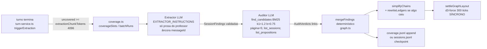
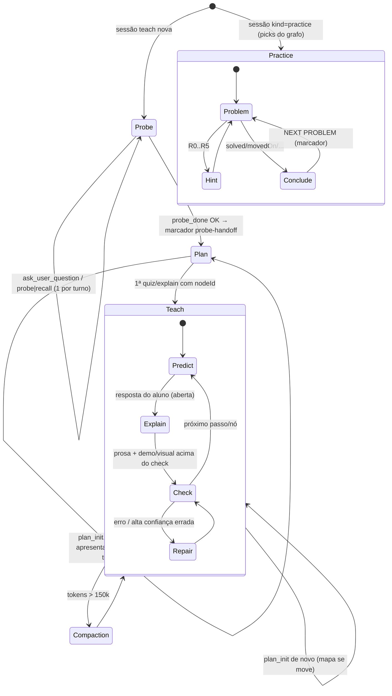
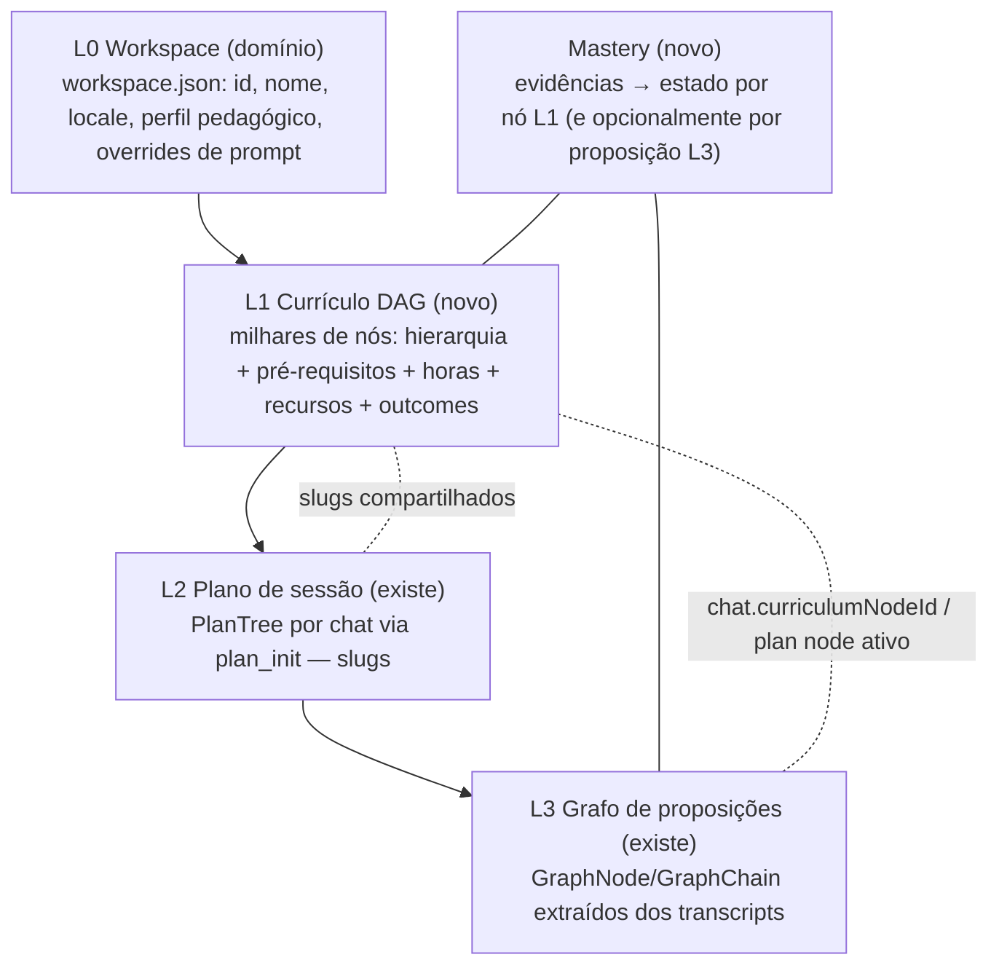

# learnharness: modelo de conhecimento, sessões e pedagogia (análise para integração)

> **Escopo.** Análise do fork local `learnharness` (v0.6.1, `AGPL-3.0-only`, Next.js 16 + Electron + TypeScript + `@earendil-works/pi-agent-core` 1.4.0), lido a partir do código-fonte em `C:\Users\nicoolas\Pictures\learnharness`. Data: 2026-11-18.
> **Arquivos lidos:**
> - Núcleo e persistência: `src/core/*` (graph, chains, clusters, coverage, plan, phases, question-core, practice, compaction, contracts/\*, events, pending, native-messages) e `src/store/*`.
> - Servidor e API: `src/server/*` (graph, chats, stores, compaction, jobs, source-\*, events-stream, chat-handler, turn-service) e `app/api/{graph,chats,chat,jobs,events}/**`.
> - Agentes e documentação: `src/agent/system-prompt.md`, `src/agent/prompts/**`, `src/agent/tools/**`, `docs/architecture.md`, `docs/teaching-methodology.md`, além de `docs/flashcards-*` e `plugins/flashcards`.
>
> Os repositórios em `_refs/` **não** fazem parte deste relatório.
> **Convenção.** `arquivo:linha` aponta evidência. Os exemplos de linhas JSONL são **ilustrativos**: os campos vêm dos tipos em `src/core/contracts/graph.ts`, mas os valores são inventados.

---

## 0. TL;DR

1. **O grafo guarda cadeias de raciocínio, não arestas.** A verdade armazenada é um conjunto de **proposições** (`GraphNode`, ids `n_…`) mais **cadeias** (`GraphChain`, ids `arg_…`, com `premises[] → conclusion`). Arestas, nós de implicação e clusters são *derivados na leitura*.
   - Tudo fica em ledgers JSONL append-only em `data/graph/` (`nodes.jsonl`, `chains.jsonl`, `sessions.jsonl`, `coverage.jsonl`), com mapas JSON auxiliares e um sidecar de formato (`format.json`, v1).
   - O grafo é **extraído automaticamente** da prosa do professor por um pipeline LLM em três estágios: extractor, auditor com BM25 e merge determinístico. Cada ponto de proveniência fica ancorado a uma mensagem (`chatId` + `messageId`).
2. **Cada sessão é um arquivo JSON** em `data/chats/<id>.json` (`ChatRecord`, schema v2).
   - O registro *é* o estado do agente: a cada turno um pi `Agent` stateless é reconstruído a partir de `record.messages`.
   - A relação grafo↔chat aparece em três pontos:
     - (i) a proveniência das proposições aponta para o chat e a mensagem;
     - (ii) `coverage.jsonl` registra quais mensagens já foram "dobradas" no grafo, por fingerprint;
     - (iii) sessões novas podem nascer com um marcador `graph-context` (proposições escolhidas no grafo).
   - Clusters = "sessão de nascimento" da proposição (`provenance[0].chatId`).
3. **A pedagogia é sofisticada e explícita.** Segue um ciclo **probe → plan → teach**, com uma sessão separada de **practice**. As fases são derivadas do transcript, nunca armazenadas.
   - O professor ensina "um passo de raciocínio por vez" a partir do que o aluno já considera "obviamente verdadeiro", em perguntas `predict` (antes) e `check` (depois).
   - Cada pergunta tem uma escala de confiança de 6 pontos e dois campos de "thinking" livres.
   - A prática segue ciência de retrieval: alvo de 85% de acerto por evento de recuperação, intercalação, escada de dicas R0–R5 e classificação de erros.
4. **O que falta:**
   - estado de domínio persistente entre sessões (removido de propósito em 2026-09-27);
   - currículo de longo prazo;
   - recursos externos (livros, vídeos);
   - um conceito de workspace ou domínio;
   - uma política de idioma, pois os prompts estão em inglês e tratam o aluno como "he";
   - uma cadência menos cansativa (um check por passo é "decisão travada", mas com cláusula de revisão).
5. **Integração recomendada:**
   - **Workspaces** via *path getters* por workspace em `config.ts` mais um protocolo "quiesce-and-switch", com `LH_DATA_DIR` por workspace como protótipo de custo zero.
   - **Currículo DAG** como uma nova camada (L1) com store própria (`curriculum/*.jsonl`). Ela conversa com a camada de sessão (L2: `PlanTree`) por **slugs compartilhados** e com o grafo de proposições (L3) via `ChatRecord.curriculumNodeId`.
   - **Mastery** derivado de um *evidence ledger* que é em boa parte reconstruível dos próprios transcripts. Modelo: BKT + FSRS + propagação KST.
6. **Principais dívidas técnicas:**
   - `listChats` lê todos os chats inteiros;
   - fs síncrono e layout d3 síncrono após cada merge;
   - reescrita de chat inteiro a cada persist, com imagens base64 inline;
   - BM25 só em inglês e sem stemming;
   - constantes de path resolvidas no load do módulo (bloqueiam workspaces);
   - script de teste POSIX-only (`NODE_ENV=test tsx …`) que não roda no Windows.

---

## 1. Mapa do código analisado

| Camada | Arquivos | Papel |
|---|---|---|
| Contratos | `src/core/contracts/{graph,chat,plan,probe}.ts`, `src/core/contracts.ts` | Tipos de linha dos ledgers, `ChatRecord`, `PlanTree`, schema TypeBox do `probe_done` |
| Domínio do grafo | `src/core/graph.ts`, `chains.ts`, `clusters.ts`, `session-clusters.ts`, `graph-deletion.ts`, `coverage.ts`, `proposition-candidates.ts`, `layout.ts`, `layout-settle.ts`, `view.ts` | Merge, simplificação de cadeias, view derivada, clusterização, cobertura, BM25, layout |
| Domínio de sessão | `src/core/phases.ts`, `plan-tree.ts`, `plan-blocks.ts`, `question-core.ts`, `practice-problems.ts`, `pending.ts`, `native-messages.ts`, `compaction.ts`, `answer-presentation.ts`, `citations.ts`, `session-markdown.ts`, `search.ts` | Fases, árvore de plano, perguntas, problemas, marcadores, compactação |
| Eventos/portas | `src/core/events.ts`, `src/core/ports.ts` | Barramento SSE em `globalThis`; interfaces `ChatStore`/`GraphStore` |
| Persistência | `src/store/{chats,graph,graph-format,atomic-write,jobs}.ts` | Adaptadores fs (JSON por chat, JSONL do grafo, escrita atômica) |
| Servidor | `src/server/{stores,chats,graph,compaction,jobs,source-organization,source-deletion,events-stream,chat-handler,turn-service,plugin-host,plugin-learning}.ts` | Raiz de composição, orquestração de deleção, gatilho de extração, jobs, SSE |
| Agentes | `src/agent/teacher-agent.ts`, `src/agent/tools.ts`, `src/agent/tools/{plan,mermaid-plan,probe,practice,graph}.ts`, `src/agent/subagents/{extraction,submit-agent}.ts` | Montagem dos agentes por tipo, ferramentas, subagentes de extração |
| Prompts | `src/agent/system-prompt.md`, `src/agent/prompts/{prober,teacher,practice,shared,side-chat}/NN-*.md` | Doutrina pedagógica |
| API | `app/api/chats/**`, `app/api/chat/route.ts`, `app/api/graph/**`, `app/api/jobs/**`, `app/api/events/route.ts` | Transporte HTTP/SSE |
| Config | `config.ts`, `src/core/settings.ts`, `src/core/settings-resolution.ts` | Paths (`LH_DATA_DIR`, `LH_AUTH_FILE`), `ModelRole`, defaults |
| Desktop | `electron/main.cjs` (`DATA_DIR = userData/data`, filho Next com `LH_DATA_DIR`/`LH_AUTH_FILE`, `startServer` ~l.214), `electron-builder.yml` | Empacotamento |

---

## 2. (a) Modelo de dados do grafo

### 2.1 Filosofia

- **"Chains are the stored truth"** (`config.ts:58-63`, comentário do owner de 2026-09-30). Arestas são **sempre derivadas** de cadeias e nunca armazenadas. Um purge no load do módulo em `src/store/graph.ts` apaga os legados `edges.jsonl` e `events.jsonl`.
- **"Store events, derive state".** Ledgers append-only são fundidos na leitura (`getGraph` em `src/core/graph.ts`). Coisas como "fase", "nó atual do plano" e "cobertura" também são derivadas, não duplicadas.
- **Proveniência granular por mensagem.** Toda proposição e toda cadeia sabe de qual chat (ou arquivo de notas `src_…`) e de qual mensagem veio.
- **Sem embeddings.** Identidade entre proposições é decidida por um LLM auditor sobre candidatos BM25. Clusters são definidos pela sessão de nascimento.

### 2.2 Tipos (`src/core/contracts/graph.ts`)

| Tipo | Campos | Notas |
|---|---|---|
| `GraphNode` | `id` (`n_…`), `name`, `statement`, `aliases[]`, `createdAt`, `provenance: ProvenancePoint[]` | Uma **proposição**: enunciado autocontido. `name` é o rótulo curto. |
| `ProvenancePoint` | `chatId` (ou `src_…` para notas), `messageId` (`""` = nível do chat) | `provenance[0]` = nascimento, que define o cluster |
| `GraphChain` | `id` (`arg_…`), `premises: string[]`, `conclusion: string`, `provenance`, `createdAt` | Inferência multi-premissa. As premissas e a conclusão são ids `n_…`. |
| `GraphEdge` | `{from, to}` | **Derivado**: premissa→conclusão (ou premissa→nó de implicação→conclusão) |
| `SessionCheckpoint` | `{chatId, foldedAt}` | Usado para fontes de notas (arquivo inteiro dobrado de uma vez) |
| `CoverageEntry` | `{chatId, fp (sha256), tokens (chars/4), foldedAt}` | Uma linha por mensagem já extraída |
| `NotesSource` | `{id: "src_"+hash(path), filePath, importedAt, contentFp?, extractions?}` | Fontes importadas (markdown/PDF) |
| `ExtractedProposition` | `{id: "p1"…, name, statement, aliases, messageId?}` | Saída **local** do extractor, antes do merge |
| `ExtractedChain` / `SessionFindings` | cadeias com ids locais ou existentes | Saída do extractor |
| `IdentityLink` / `AuditVerdicts` | `{id, linkTo}` / `{links}` | Saída do auditor: "p3 é o mesmo que n_abc" |
| `Cluster` | `{id, label \| null, members[]}` | Derivado |
| `GraphSnapshot` | `nodes, propositions, edges, logicalEdges, impLinks, chains, sessions, fileSources, nodeSessions, clusters, positions?` | O payload de `GET /api/graph` |

Constantes: `CURRENT_GRAPH_FORMAT_VERSION = 1`, `TITLE_MAX_CHARS = 72`, `titleFromPrompt()`.

### 2.3 Layout em disco

`DATA_ROOT` = `process.env.LH_DATA_DIR` ou `<repo>/data` (`config.ts:20-22`). No Electron, `DATA_DIR = app.getPath("userData")/data` (`electron/main.cjs:56`).

```
data/
├─ settings.json                    # SETTINGS_FILE (global)
├─ prompts/<segment>/NN-*.md        # PROMPTS_OVERRIDE_DIR (overrides de prompt; ativados por settings.agent.prompts[segment]=true)
├─ themes/                          # THEMES_DIR
├─ chats/<chatId>.json              # ChatRecord v2, um arquivo por sessão, JSON com TAB
├─ jobs/<jobId>.json                # JobRecord (src/store/jobs.ts:22, JOBS_DIR)
├─ graph/
│  ├─ format.json                   # GRAPH_FORMAT_FILE (sidecar de versão; criado preguiçosamente = v1)
│  ├─ nodes.jsonl                   # linhas de criação + linhas de link (mesma id; acrescentam provenance/aliases)
│  ├─ chains.jsonl                  # GraphChain por linha
│  ├─ sessions.jsonl                # SessionCheckpoint (notas)
│  ├─ coverage.jsonl                # CoverageEntry por mensagem dobrada
│  ├─ sources.json                  # mapa src_id → NotesSource (read-modify-write, NÃO ledger)
│  ├─ source-organization.json      # pastas/arrumação das fontes no UI
│  ├─ positions.json                # {positions:{id:{x,y}}, updatedAt}
│  └─ render-settings.json
├─ core-plugin-data/<pluginId>/     # dados dos plugins de núcleo (ex.: flashcards)
├─ plugins/<id>/{dist,data}/        # plugins de usuário
└─ debug/provider-events/<chatId>.jsonl   # opcional (env-gated)
auth.json                            # AUTH_FILE (LH_AUTH_FILE, ou raiz; 0600 no Electron)
```

**Exemplos ilustrativos de linhas.**

```jsonl
// nodes.jsonl: criação
{"id":"n_k3f9a1","name":"Lei de Ohm","statement":"Em um resistor ôhmico, a tensão é proporcional à corrente: V = R·I.","aliases":["V=RI"],"createdAt":"2026-11-10T12:00:00Z","provenance":[{"chatId":"chat_m3x1_ab12cd34","messageId":"msg_17"}]}
// nodes.jsonl: link (o auditor decidiu que a proposição local é a mesma que n_k3f9a1)
{"id":"n_k3f9a1","aliases":["Ohm's law"],"provenance":[{"chatId":"chat_m4y2_ef56ab78","messageId":"msg_03"}]}
// chains.jsonl
{"id":"arg_7c21","premises":["n_k3f9a1","n_q8z0"],"conclusion":"n_p2m4","provenance":[{"chatId":"chat_m3x1_ab12cd34","messageId":"msg_21"}],"createdAt":"2026-11-10T12:05:00Z"}
// coverage.jsonl
{"chatId":"chat_m3x1_ab12cd34","fp":"9f2c…","tokens":812,"foldedAt":"2026-11-10T12:06:00Z"}
```

> A forma exata da linha de link (quais campos repete) deve ser conferida em `mergeFindings`/`appendLine` antes de escrever um leitor externo. O invariante que importa é este: **o mesmo `id` aparecendo de novo acrescenta proveniência e aliases, e o merge acontece na leitura.**

### 2.4 Adaptador fs (`src/store/graph.ts`, `graph-format.ts`, `atomic-write.ts`)

- `appendLine(file, obj)`: chama `ensureGraphFormat()` e depois `fs.appendFileSync`.
- `readValid(file, guard)`: chama `assertGraphFormat()`, que lança erro se `format.json` declara versão maior que a do build. Lê linha a linha, **pula linhas corrompidas** e valida a forma com guards estritos.
- `rewriteLedgers(...)`: reescrita atômica com `writeFileAtomicSync` (temp + fsync + rename, ~100 ms de retry no Windows e `allowInPlaceFallback`). Usada pela simplificação de cadeias e pelas deleções.
- **Sem locking entre processos.** `docs/architecture.md` exige "one server owner per data/auth profile".
- **Tudo é síncrono** (`fs.*Sync`). Isso é o que permite o "bloco síncrono" das deleções sem locks (ver 2.8).

### 2.5 Pipeline de extração (transcript → grafo)



**1. Gatilho.**
- Em `src/server/chat-handler.ts:887-891`, depois de cada turno, se `kind !== "practice"`, chama `triggerExtraction`.
- `triggerExtraction` (`turn-service.ts`) roda se os tokens não cobertos forem ≥ `graph.extractionChunkTokens` (default 4096, piso `EXTRACTION_CHUNK_TOKENS_FLOOR = 500`). Fica desligado em `NODE_ENV=test`.
- Também existe gatilho manual via `POST /api/graph/coverage/extract`.

**2. Cobertura** (`src/core/coverage.ts`).
- `messageViewLines` projeta **apenas prosa do assistente** no formato `TEACHER [msgId] texto`.
- `messageFingerprint` gera sha256 da projeção. `coverageOf(messages, entries, chatId)` compara com o ledger e devolve `{slots, coveredCount, uncoveredCount, coveredTokens, uncoveredTokens}`.
- `batchRuns` agrupa de forma gulosa e **nunca parte uma mensagem**.
- Consequência: editar ou reescrever uma mensagem muda o fp, e ela volta a ser "não coberta".

**3. Extractor** (`src/agent/subagents/extraction.ts`).
- Prompts: `SESSION_PREAMBLE` (ou `NOTES_PREAMBLE` para notas) + `EXTRACTION_CORE` {entailment, knowledge, standalone, continuation, submission} + `EXTRACTOR_INSTRUCTIONS`.
- Recebe um `sourceDigest` com o que já existe (digest-aware: evita reextrair).
- Saída via `findingsSchema`/`sessionFindingsSchema`, em que `messageId` é obrigatório para sessões.
- Validações: `validateFindingsChains` e `validateSessionAnchors`. As âncoras precisam existir no batch.

**4. Auditor.**
- Recebe as proposições locais e, para cada uma, chama `find_candidates`: BM25 em `proposition-candidates.ts`, com stop-words em inglês, NFKC, **sem stemming**, `CANDIDATE_PAGE_SIZE = 5` e cursores.
- Pode chamar `list_sessions` e `list_propositions` (com statements completos, ao contrário da versão do prober).
- Emite **apenas links de identidade** (`AuditVerdicts.links`).
- Roda sob `withAuditLock`.

**5. Merge** (`mergeFindings(chatId, findings, verdicts, deps, source{foldedAt, coverage?})`).
- Resolve links: se um local está ligado a um `n_` existente, gera uma linha de *link-append*; senão gera uma linha de *create*.
- Emite cadeias com namespace misto (premissas podem ser locais ou existentes), deduplicadas por chat via `chainKey`.
- Roda `simplifyChains` **sobre o ledger inteiro**: gulosa por conclusão, ordenada por `(premiseCount, createdAt, key)`, preferindo a cadeia com menos premissas e removendo cadeias cuja ancestralidade já é coberta. Se algo caiu, chama `rewriteLedgers`.
- Por fim acrescenta as linhas de cobertura (chat) ou o checkpoint (notas).

**6. Controle.**
- `runExtraction` é single-flight por chat, com batches seriais.
- Um guard de chat deletado em cada batch aborta sem fazer merge.
- O uso de tokens vai para `appendExtractionUsage` (`ChatRecord.extractions`).

**7. Layout.** `settleGraphLayout` roda d3-force incremental (`LINK_DISTANCE 40`, 300 ticks) **sincronamente** e grava `positions.json`.

### 2.6 Leitura e view derivada

- `getGraph()`: lê e funde `nodes.jsonl` e `chains.jsonl`.
- `deriveView()`: cadeias com uma premissa viram aresta direta. Cadeias com várias premissas geram um **nó de implicação** (id `arg_…`, nome `"⟹"`), com arestas premissa→imp e imp→conclusão.
- `graphSnapshot()`:
  - para cada fonte, chama `chatStore.getChat` (para títulos e tipos de sessão);
  - `birthSessionPartition` gera os clusters (`MIN_CLUSTER_SIZE = 3`);
  - `attachImpToCommunities` põe cada nó de implicação no cluster majoritário das sessões de nascimento de suas premissas (`impClusterKey`);
  - por fim junta as `positions`.
- `chains.ts`:
  - `ReasoningChain` é a view textual;
  - `chainsForSelection(ids)` devolve as cadeias relevantes para uma seleção;
  - `resolveTargetId` resolve primeiro por id e depois por nome case-insensitive, **vencendo o primeiro match**, o que é ambíguo com homônimos;
  - `formatChainLine` gera "A ∧ B ⟹ C".
- `graphSessionIndex()` (getGraph + listChats) e `graphSessionPropositions()` (**só nomes**) alimentam as ferramentas do prober.
- `graphRevision()` = maior mtime dos ledgers, usado como ETag lógica.

### 2.7 Importação de notas

- `POST /api/graph/import` aceita multipart, converte PDF para texto (máx. 1000 páginas, **sem OCR**) e processa numa fila de 3 em paralelo.
- `registerImport` (`src/server/source-organization.ts`) gera `src_` = `sha256(path)[0..12]`. A id depende do **caminho**, não do conteúdo; `contentFp` é opcional.
- A extração usa `NOTES_PREAMBLE`/`NOTES_EXTRACTOR_INSTRUCTIONS`. A cobertura é por arquivo inteiro (`sessions.jsonl`).

### 2.8 Deleção (`src/core/graph-deletion.ts`, `src/server/chats.ts`, `src/server/graph.ts`)

- `ChatDeleteMode = "preserve-graph" | "delete-nodes"`.
- `deleteChatTraces` / `deleteSourcesTraces`:
  - uma proposição **sobrevive** se tem proveniência estrangeira (de outro chat ou fonte);
  - a linha de criação mantém a identidade, mas perde os aliases;
  - linhas de link do chat deletado morrem;
  - posições são podadas.
- `deleteNodeTraces`: morte completa do nó. Para ids `arg_`, apaga só a cadeia.
- Coreografia em `deleteChatSession` (`src/server/chats.ts:99-127`):
  1. **gates**: 409 se há turno ou job vivo;
  2. **wind-down** da extração: `abortExtraction`, com poll a cada 50 ms e timeout de 10 s que vira 503 retryable;
  3. **bloco síncrono sem `await`**: ledgers, depois jobs, depois o arquivo do chat por último. É *atômico contra o pipeline* só porque o event loop não cede.
- `DELETE /api/graph/nodes/[id]` responde 409 enquanto qualquer extração roda.

---

## 3. (b) Chats e sessões

### 3.1 `ChatRecord` (`src/core/contracts/chat.ts`, `CURRENT_CHAT_VERSION = 2`)

```ts
interface ChatRecord {
  id: string;                    // chat_<base36(Date.now())>_<uuid8>
  title: string; createdAt: string; updatedAt: string;
  messages: LhMessage[];         // histórico NATIVO pi (user/assistant/toolResult/custom markers)
  imageSnapshots?: Record<sha256, {mimeType, data(base64), width, height}>; // inline!
  kind?: "practice";             // ausente = teach
  tree?: PlanTree;               // SÓ o último plan_init
  turns?: TurnUsage[];           // {id, messageId, at, model:"provider:id", steps: CallUsage[]}
  extractions?: ExtractionRunUsage[];
  settings?: { model?: {provider, id}; thinkingLevel?: ThinkingLevel };
  sideChats?: SideChatThread[];
  version?: number;              // carimbado por writeChat
}
```

- `CallUsage = {inputTokens, outputTokens, cacheReadTokens, cacheWriteTokens, cacheWrite1hTokens?, reasoningTokens}`. Isso basta para **estatísticas de tokens por modelo** (objetivo 6 do usuário), junto com `prices.ts` e `cost-summary.ts`.
- `ChatSummary` (lista) = registro sem `messages/tree/turns/extractions/imageSnapshots/sideChats`, mais os campos derivados `kind`, `messageCount`, `phase` (`phaseAt3Lh`), `pendingQuestion` (`danglingQuestionOf`) e `pendingProblem` (`activeProblemOf`) (`src/store/chats.ts:81-127`).

### 3.2 Store de chats (`src/store/chats.ts`)

- `writeChat` é o **choke point**: todo persist passa por ele e carimba `version`. A migração é preguiçosa: só regrava na próxima escrita.
- `getChat` **recusa** registros com versão maior (`return null` + log), para nunca regravar o que não entende.
- `listChats` faz `readdir` e **`getChat` em cada arquivo inteiro**, e depois projeta. É O(total de bytes de todos os chats) a cada refresh da sidebar (ver §6).
- Escritas de conteúdo (`saveMessages`, `appendTurnUsage`, `appendExtractionUsage`, `saveSettings`, `saveTree`, `updateSideChats`, `saveImageSnapshot`) são *read-modify-write* do arquivo inteiro, e **silenciosas** no barramento (a "SILENCE LAW", `chats.ts:28-36`). Só `createChat`, `renameChat` e `deleteChat` emitem `chats-changed`.
- `saveTree` e `saveSettings` não mexem em `updatedAt`, para não reordenar a sidebar.

### 3.3 Mensagens nativas e marcadores (`src/core/native-messages.ts`)

`LhMarkerMessage` = `{role: "custom", customType, content, details?}` com `customType` ∈:

| customType | Quem cria | Para quê |
|---|---|---|
| `graph-context` | `POST /api/chats` com picks (≤ 64) via `newGraphContextMessage(picks, chains)` | Texto "[Session context] …" com ids/statements/cadeias escolhidas no grafo |
| `probe-handoff` | `probe_done` → `newHandoffMessage` / `buildProbeHandoffSteer` | Passa a avaliação do prober para o professor (`HANDOFF_TEXT`) |
| `plan-block` | `planBlocksFor` (`plan-blocks.ts`) | Um marcador por turno com o último `plan_init` bem-sucedido (UI) |
| `subagent-steer` / `subagent-abort` | `src/server/jobs.ts` | Entrega de resultados de jobs (steer ao vivo) |
| `practice-thinking` / `practice-next` / `problem-dismissed` / `plugin-problem-submission` | prática | Pensamento do aluno, "NEXT PROBLEM", descarte, submissão por plugin |
| `compaction` | `src/server/compaction.ts` | Resumo da compactação (`COMPACTED_HISTORY_HEADER`) |
| `side-question` / `side-question-told` | side-chat | Pergunta lateral e "contei ao professor" |

- `nativeInputCause` (~l.991) tem uma lista de marcadores **neutros** (`graph-context`, `plan-block`, `problem-dismissed`, `compaction`, `side-question`, `side-question-told`): marcadores que não contam como "input do aluno". **Todo marcador novo precisa ser classificado lá.**
- `toLlmMessages` (`convertToLlm`, ~l.700) decide o que o modelo vê de cada marcador.

### 3.4 O turno

```mermaid
sequenceDiagram
  participant UI
  participant API as app/api/chat/route.ts
  participant H as server/chat-handler.ts
  participant A as pi Agent (stateless)
  participant S as chatStore
  UI->>API: POST {chatId, input}
  API->>H: handleChatRequest
  H->>S: getChat(chatId)
  H->>H: escolhe agente (l.734-790): practice | prober | teacher<br/>(fase derivada do transcript)
  H->>A: baseAgentOptions(kind) + composeInstructions + tools + plugin contributions
  A-->>UI: stream (SSE do turno)
  A->>S: saveMessages / appendTurnUsage / saveImageSnapshot
  H->>H: finishTurn; question stopper (pergunta encerra o turno)
  H->>H: triggerExtraction (kind !== practice, l.887-891)
  H-->>UI: events: turn-started / turn-settled
```

- **Agente stateless.** O estado é `state.messages = record.messages`. Não há memória fora do registro, exceto o grafo, que só o prober vê, e só por nomes.
- **Seleção de agente** (`chat-handler.ts:734-790`):
  - `kind === "practice"` → practice, que recebe `graphNodes: () => readNodes()` para resolver alvos;
  - caso contrário, `phaseAt3Lh(messages)` decide entre prober e teacher;
  - o prober recebe o `graphStore` só se `graphToolsEnabled(settings)` (`graph.enabled && agent.graphTools.enabled ?? true`).
- **Modelos:** slots BYOK `strong/cheap/vision`. `POST /api/chats` carimba `settings.model` com o slot strong, e `ModelRole` em `config.ts` lista prober, teacher, researcher, demoBuilder, visualMaker, pdfReader, extractor, auditor e sideQuestion. **Nenhum modelo é hardcoded no domínio**, o que combina com o objetivo 7 do usuário.

### 3.5 Relação grafo ↔ chats

1. **Proveniência:** `GraphNode.provenance[].chatId/messageId` e `GraphChain.provenance`.
2. **Cobertura:** `coverage.jsonl` (chatId + fp por mensagem). `GET /api/chats/[id]` devolve `sessionCoverage` (`src/server/chats.ts:185-206`), que alimenta o "anel" de cobertura no UI.
3. **Contexto de entrada:** `graph-context` em sessões criadas a partir de uma seleção no grafo. É isso que a *practice* usa, e o teach pode receber também.
4. **Clusterização:** a sessão de nascimento (`birthSessionOf`) agrupa as proposições no UI.
5. **Leitura pelo prober:** `list_sessions` e `list_propositions` (nomes) em `src/agent/tools/graph.ts`.
6. **O professor não tem ferramentas de grafo** (`docs/architecture.md`: "the teacher has no graph-reader registry").
7. **Prática não alimenta mastery:** os resultados ficam no transcript (`docs/architecture.md`: "Practice outcomes are session evidence, not graph mastery").

### 3.6 Jobs assíncronos (`src/server/jobs.ts`, `src/store/jobs.ts`, `app/api/jobs/**`)

- Tipos: `research`, `pdf`, `demo` e `visual`. São alternáveis via `TOGGLEABLE_TOOLS` em `pending.ts`.
- Persistidos em `data/jobs/<id>.json`.
- **Wake pipeline:**
  - se há turno vivo no chat, o resultado entra como *steer* (`subagent-steer`);
  - se não, um *idle wake* inicia um turno novo que entrega o resultado.
- A recuperação no boot reentrega resultados pendentes.

### 3.7 Compactação (`src/core/compaction.ts`, `src/server/compaction.ts`)

- Constantes: `DEFAULT_COMPACTION_THRESHOLD_TOKENS = 150000` (`settings.compaction.thresholdTokens`), `KEEP_RECENT_TOKENS = 20000` e `COMPACTION_RESERVE_TOKENS = 16384`.
- `buildCompactionPrompt` pede um resumo em seções **orientadas ao aluno**:
  - "The learner's understanding";
  - "The teaching arc";
  - "The plan dependency tree", **verbatim**;
  - "The current moment".
- O servidor dispara a compactação no *settle* do turno e bloqueia o início do turno seguinte até ela terminar (turn-start gate).
- É memória **intra-sessão**. Não existe memória entre sessões além do grafo.

### 3.8 Side-chat

`src/agent/prompts/side-chat/` responde em 1–2 frases, **nunca vaza o gabarito** de uma pergunta aberta e vive em `record.sideChats`. Bom para tirar dúvidas sem quebrar o ritmo.

### 3.9 Eventos (`src/core/events.ts`, `src/server/events-stream.ts`, `app/api/events/route.ts`)

- Vocabulário: `turn-started`, `turn-settled`, `jobs-changed`, `activity-changed`, `chats-changed`, `sources-changed`, `subscriptions-changed`, `record-changed`, `compaction-changed`, `side-chats-changed`, `plugins-changed` e `plugin-message`.
- O barramento vive em `globalThis`. O SSE manda ping a cada 25 s.
- O padrão é **notify→fetch**: o evento só avisa e o cliente refaz o GET.
- **Os eventos não têm dimensão de workspace** e são efêmeros (sem replay).

---

## 4. (c) O ciclo medir → planejar → ensinar → praticar

### 4.1 Teoria canônica (`docs/teaching-methodology.md`)

- **§1. Dois estados.** "Current understanding" é o conjunto de proposições que o aluno *aceita como obviamente verdadeiras*. "Goal understanding" é o alvo.
- **§2. Critério de término.** Não é recall nem cobertura. É o alvo *parecer obviamente verdadeiro*. Fato decorado "apodrece"; fato conectado e seguro "trava".
- **§3–4.** O "clique" e a ideia de que conhecimento é estrutura.
- **§5. Regra única de ordem:** "move one reasoning step at a time" (l.34). Erros aparecem na hora e de forma localizada (l.39).
- **§6. Fundações:** verdades incondicionais.
- **§7. Alocação de esforço.**
- **§8. Árvore mínima.** O plano é uma *view de baixa resolução* e a apresentação é por passo.
- **§9.** Um check por passo de raciocínio. A decisão foi travada em 2026-09-24, *com cláusula de revisão* (l.86): "If the rhythm proves unpleasant in practice, revisit".
- **§10.** Demandas de implementação: o que o produto precisa garantir.

O `system-prompt.md:9` resume a regra do ciclo: *"measure, then plan, then teach"*.

### 4.2 Composição de prompts (`src/agent/prompts/README.md`, `teacher-agent.ts`)

| Agente | Composição |
|---|---|
| Prober | `system-prompt.md` → `prober/*` → `shared/*` |
| Teacher | `system-prompt.md` → `teacher/*` → `shared/*` |
| Practice | `practice/*` + allowlist de shared (`10-voice`, `15-accuracy`, `16-mental-model`, `35-side-conversations`, `40-formatting`) |
| Side-chat | `side-chat/00-base` + shared `10/15/40` + `90-style` |

- Nomes de arquivo seguem `^\d+-[\w.-]+\.md$` (ordem lexical).
- **Overrides:** `data/prompts/<segment>/…`, ativados por `settings.json → agent.prompts[segment] = true`. É o gancho natural para uma **pedagogia por domínio/workspace** (§5.1).
- **Plugins:** `registerInstructions` acrescenta texto **estático** por tipo de agente, e `registerTools` registra fábricas de ferramentas executadas por turno (`src/core/plugins.ts:163-167`).

### 4.3 Fase 1: Probe (medir)

Ferramentas do prober (`src/agent/tools.ts`):
- `probe` ou `recall`, conforme a mecânica: `agent.tools.explain === true` → recall livre;
- `ask_user_question`;
- `read/ls/find/grep` (arquivos do aluno);
- `research` e `pdf`;
- `list_sessions` e `list_propositions` (só com `graphToolsEnabled`);
- `probe_done` (sempre).

Doutrina (`prompts/prober/10-probe-doctrine.md`):
1. **Duas medições.** O *objetivo* é medido com `ask_user_question` e o *conhecimento atual* com a ferramenta de quiz.
2. Lê o mapa existente (`list_sessions`, `list_propositions`) e torna o objetivo **concreto**.
3. Raciocina sobre as **strands** (fios de pré-requisito) que o objetivo exige.
4. **Busca binária por strand** para achar *floor* e *ceiling*. *"Enter near the top, not the bottom"* (l.23). Acerto com confiança → sobe; erro → estreita.
5. Conclui com `probe_done`.

`probe_done` (`src/core/contracts/probe.ts`):
- Schema TypeBox único, compartilhado entre a ferramenta e o UI: `{assessment: {strands: [{strand, assessment}] (minItems 1), summary?}}`.
- **O `assessment` é texto livre.** Floor, ceiling e misconceptions vão em prosa, sem estrutura.
- `src/agent/tools/probe.ts` recusa `probe_done` com pergunta aberta ou com probe já concluído.
- Em caso de sucesso, enfileira `buildProbeHandoffSteer`: o marcador `probe-handoff` muda a fase para *plan*.

### 4.4 Fase 2: Plan (planejar)

Ferramenta: `plan_init` (`src/agent/tools/plan.ts`).
- Recebe um bloco **mermaid `graph TD`**.
- `parseMermaidPlan` (`mermaid-plan.ts`) aplica:
  - `HEADER_RE`;
  - slugs com `SLUG_RE = ^[a-z0-9]+([_-][a-z0-9]+)*$`;
  - setas `-->`, `==>` e `-.->`;
  - erros com número de linha.
- `createTree` (`plan-tree.ts`) valida ids únicos, extremos existentes, ausência de self-loop, de duplicatas e de **ciclos** (DFS). Em caso de erro, lança `PlanTreeError`.
- `chatStore.saveTree(id, tree)` **substitui** a árvore anterior.
- O retorno inclui `nodeIds` e um lembrete.

`PlanTree = {nodes: PlanNode{id, title, summary?}[], edges: PlanEdge{from,to}[], version}`. A aresta significa "from deve ser entendido antes de to".

Doutrina (`prompts/teacher/10-planning.md`, *"Planning — think hard here"*):
- **Árvore mínima** (l.9). É *"a map, not a syllabus"* (l.19): os nós são marcos estruturais (verdades incondicionais embaixo, objetivo no sumidouro), não turnos de ensino. Um nó pode levar 1 ou 5 passos.
- *"No size ceiling"* (l.22).
- **Inconsistência:** a descrição da ferramenta diz *"5–15 nodes … compress"* (`tools/plan.ts:71`), o que contradiz o prompt.
- *"The map moves with him"*: reescrever com `plan_init` no meio da aula é permitido e não exige reapresentação.
- **Tags de posição** (l.33): toda chamada de quiz/explain leva `nodeId` **e** `type` (`predict|check`). A posição atual é a última tag (`derivePlanStatusesLh`). *"A tag is a position, not a verdict"*: nós nunca são marcados como concluídos.
- **Apresentação:** a abordagem em prosa mais o mapa. *"Stress-test the roots"*. *"Presenting ends your turn"* (l.44): o aluno confirma antes de começar.

Estados derivados:
- `derivePlanStatuses*` dá `current` (último nó tagueado) e `visited` (execuções anteriores);
- `phaseAt3Lh`: probe → plan (após `probe_done`) → teach (primeira chamada quiz/explain com `nodeId`);
- `teachStepIndex` e `phaseTimeline` dão a linha do tempo.

### 4.5 Fase 3: Teach (ensinar)

Ferramentas do teacher:
- `quiz` ou `explain` (`nodeId` validado contra `record.tree` por `nodeIdProblem`);
- `ask_user_question`;
- `read/ls/find/grep`;
- `show_image`;
- `plan_init`;
- `research`, `demo`, `visual` e `pdf`.

**Não há ferramentas de grafo.**

**Método** (`teacher/05-method.md`):
- **Princípio i: "Unconditional truths first".**
  - Fundamentos são estabelecidos como verdades sem exceção: enunciados universais ("all X are Y") e definições reais.
  - Há também o padrão "ALL X is done through {____}" (l.29).
  - O texto distingue *verdade incondicional* de *axioma*.
- **Princípio ii: "How could I have discovered this?"**, a motivação no estilo 3Blue1Brown. Cada fato novo chega como resposta a uma pergunta natural.
- Síntese (l.9): partir do que ele tem como obviamente verdadeiro e andar um passo de raciocínio por vez.

**Execução por passo** (`teacher/20-teaching.md`):
1. *"One step, one fact"*. Se precisa de duas explicações, são dois passos (l.7).
2. Apresentação para absorção máxima. A conexão "se carrega sozinha". **Nunca** "Node 3:" como capítulos. Verbosidade é overhead (l.14).
3. Socrático vs expositivo, conforme o passo.
4. *"Teach first, check second"* (l.28): o check fica *abaixo* da explicação, colapsado atrás do botão **"Check your understanding"**.

**Predict vs check** (`teacher/28-predictions.md`):
- `predict` vem **antes** do passo. É motivação e precisa ser resolvido explicitamente quando a explicação chega. Chega **aberto**.
- `check` vem **depois**. É dado e chega **colapsado** (*reveal law*: `questionNeedsReveal` só colapsa checks da fase teach).
- Ciclo (l.20): predict → previsão do aluno → ensino que resolve a previsão → check → resposta → reação → próximo predict.
- *"One question per turn, every turn"* (l.22). Isso é garantido mecanicamente pelo `makeQuestionStopper`: uma ferramenta de pergunta encerra o turno.

**Princípios de pergunta** (`teacher/30-question-principles.md`):
- respondível por raciocínio a partir da sessão, **nunca recitação**;
- preferir aplicação;
- erros precisam ser **nomeáveis**: cada distrator encarna um modelo errado específico;
- *"His answer is signal, not verdict"* (l.11).

**Ofício das opções** (`shared/20-question-tools.md`):
- enunciados nus;
- distratores obtidos por **mutação da afirmação correta**;
- erros críveis;
- sem negrito assimétrico;
- LaTeX em tudo;
- recall livre corrigido com rigor;
- duas "thinking channels";
- **uma** pergunta por turno.

### 4.6 Perguntas, confiança e campos de pensamento (`src/core/question-core.ts`)

```ts
quizInputBase = { question, options: {label, value}[] (≥2), multiSelect?,
                  explanation /* ANTES de correctAnswer: o modelo compromete o raciocínio primeiro */,
                  correctAnswer, details? }
quizInputObject = { type: "predict" | "check", nodeId, ...quizInputBase }
explainInputBase = { question, correctAnswer /* comprometido antes */, details? }   // recall livre
explainInputObject = { type, nodeId, ...explainInputBase }

QuestionAnswerData = { kind, tool, questionType, dontKnow, answers, text,
                       thinking,            // "como pensei a resposta"
                       readingThinking,     // "o que pensei enquanto lia a explicação" (thinkingWhileReading)
                       images, confidence /* 0–100 */, correct, ... }
CONFIDENCE_STOPS = [0, 30, 50, 70, 90, 100]
```

- **UI:**
  - `components/question-dock.tsx` é o slider com as paradas;
  - `components/confidence-rail.tsx` é a rampa de 6 cores;
  - `components/chat.tsx` tem o `ReadingThinkingField`;
  - `answered-card.tsx` mostra a resposta dada.
- **O modelo só vê o que o aluno acrescentou.** `compactAnswerForModel` entrega answers, text, correct, confidence, thinking e thinkingWhileReading, e não repete o gabarito.
- **Interpretação** (`shared/25-confidence.md`): há uma tabela de leitura de acerto×confiança. *"Wrong + high confidence: the strongest signal"* (l.9), uma misconception comprometida que deve ser nomeada, sondada com cuidado e re-ensinada.
- **Pensamento como dado primário** (`shared/16-mental-model.md`): os campos de thinking valem mais que o acerto binário para modelar a mente do aluno.

### 4.7 Recursos assíncronos no ensino

Quatro tipos de job estão disponíveis:
- `research` (`teacher/40-jobs.md`): fire-and-forget, **uma pergunta por chamada**, cita as fontes. Engines em `src/core/search.ts`: tavily, brave, exa, firecrawl e ollama.
- `pdf`: lê PDFs do aluno.
- `demo` e `visual` (`teacher/50-demos.md`):
  - `demo` gera um HTML single-file testado;
  - `visual` gera SVG num loop render→inspect;
  - *"the brief is the builder's whole world"*: o subagente não vê a conversa;
  - o professor deve **ensinar com o artefato**, não só anexá-lo.
- `show_image` (`teacher/55-images.md`): mostra uma imagem. Um `visual` com imagem pode anotá-la.

### 4.8 Practice (sessão separada, `kind: "practice"`)

Criação e ferramentas:
- **Criação:** `POST /api/chats` com picks do grafo gera o marcador `graph-context`, ou a sessão começa com material livre.
- `problem` (`practiceProblemInputSchema`): `{statement, mode: recall|discrimination|composition, target?: propositionId[], modelSolution}`.
  - A `modelSolution` é **comprometida antes** de o problema ser posto.
  - Os alvos são normalizados com `resolveTargetId`, e alvos desconhecidos são rejeitados.
- `conclude`:
  - `outcome`: `solved | solvedWithHints | movedOn | surrendered | dismissed`;
  - `verdict`;
  - `rung`: `R0–R5 | null`;
  - `missClass`: `cue | discrimination | execution | careless | structural | null`;
  - `retest`.
  - Revela a solução modelo e **encerra o turno** (*pause law*). O próximo problema só vem com o marcador `practice-next` (`NEXT_PROBLEM_TEXT`).
- `PracticeGate` limita os posts por turno.

Doutrina (`practice/10-doctrine.md`):
- **Restrição de inatividade:** só há recuperação se o alvo estiver *inativo* quando a situação chega (l.31). Mover-se por uma cadeia já ativa é manutenção.
- **Métrica:** *decision points per minute* na borda da habilidade, não volume de busca (l.23, l.33).
- **Banda de dificuldade:** ~**85% de sucesso por evento de recuperação**, não por problema (l.39).
- **Três modos** (l.49-51): recall (a proposição surge de pistas fracas ou variadas), discrimination e composition (a cadeia roda inteira sob carga).
- **Intercalação é o default** (l.35, l.70). Blocos do mesmo alvo são repetição, não prática de recuperação.
- **Escada de dicas** R0 (redirecionar a atenção) … R5 (passo resolvido) (l.93-98). O degrau usado mede a dificuldade: R0–R1 significa que o problema estava no ponto, R3 ou mais que estava além da borda (l.106).
- **Arco da sessão:** abertura morna, corpo intercalado, fechamento com retestes (l.127).

### 4.9 Diagrama de estados do ciclo



### 4.10 O que torna o ensino bom

1. **Mede antes de ensinar**, com busca binária por strand ("entra perto do topo"). Isso evita o tédio de recomeçar do básico.
2. **Árvore mínima e verdades incondicionais.** A estrutura é ancorada em fatos sem exceção, o que ajuda a reter e a não "desaprender".
3. **Motivação antes do fato.** "Como eu poderia ter descoberto isso?" combinado com `predict` cria tensão cognitiva útil (efeito de geração/pré-teste).
4. **Granularidade:** um passo, um fato, um check. Erros são capturados cedo e localizados.
5. **Perguntas diagnósticas.** Distratores são modelos errados nomeáveis, aplicação vale mais que recitação e há recall livre com rigor.
6. **Calibração metacognitiva:** confiança de 6 níveis, `dontKnow` e a leitura "errado + confiante".
7. **Thinking fields** como dado primário: o professor vê o *raciocínio*, não só o acerto.
8. **Voz** (`shared/10-voice.md`): sem elogio, sem viés de concordância, seca. **Precisão** (`15-accuracy`): verificar dúvidas e sinalizar incerteza, apoiado em `research` com citações.
9. **Artefatos ativos** (demos e visuais testados) usados *dentro* do ensino.
10. **Prática fundamentada** em ciência de retrieval (inatividade, 85%, intercalação, escada de dicas, classes de erro, pausa).
11. **Side-chat** para dúvidas tangenciais sem quebrar o fluxo nem vazar gabarito.
12. **Compactação centrada no aluno**, que preserva o entendimento, o arco e a árvore *verbatim*.
13. **Commit-before-reveal**: `explanation` vem antes de `correctAnswer` no schema e `modelSolution` é comprometida antes do problema. Isso reduz respostas incoerentes do modelo.

### 4.11 O que falta (mapeado aos objetivos do usuário)

| Lacuna | Evidência | Objetivo afetado |
|---|---|---|
| Sem modelo de aluno ou mastery entre sessões; níveis de entendimento removidos | `docs/archive/vision.md` (estado de nó adiado; níveis removidos em 2026-09-27); `architecture.md` ("Practice outcomes are session evidence, not graph mastery") | Árvore massiva, XP, rankings |
| Professor sem ferramentas de grafo; prober só vê **nomes** | `tools.ts`, `tools/graph.ts` | Continuidade entre sessões |
| Avaliação do probe é texto livre | `contracts/probe.ts` | Mastery computável, pular probe repetido |
| Sem currículo de longo prazo; só `PlanTree` por sessão, sobrescrito | `chats.ts:222-229` | Árvore de 1000–1500 h |
| Sem modelo de recurso (capítulo de livro, vídeo com timestamp/legendas) | nenhum tipo para isso; `research` só devolve prosa no transcript | Aulas com livros e YouTube |
| Revisão espaçada separada do ensino (só no plugin de flashcards, por proposição) | `plugins/flashcards` | Flashcards Anki/Obsidian; retenção |
| Doutrina derivacional ("verdades incondicionais", cadeias lógicas) não serve bem para **aquisição de língua** (vocabulário, listening, produção) | `teacher/05-method.md` | Workspace Inglês |
| Prompts em inglês, aluno tratado como "he", sem política de idioma | todos os `.md` | PT-BR, recursos PT/EN |
| Cadência predict + check em **todo** passo pode cansar | `teaching-methodology.md:86` (decisão travada com cláusula de revisão) | "Não cansativo" |
| Sem ritual de fechamento de sessão (resumo, cards, próximo passo) | nenhuma ferramenta `wrap_up` | Flashcards, continuidade |
| Sem XP ou estatísticas de estudo (horas/dia) | só `turns`/`extractions` | XP, stats |
| Contradição de instrução no plano ("5–15 nodes" vs "No size ceiling") | `tools/plan.ts:71` vs `10-planning.md:22` | Qualidade do plano |

---

## 5. (d) Como encaixar workspaces, currículo DAG e mastery com o mínimo de atrito

### 5.0 Arquitetura em camadas proposta



Princípios:
- (1) **Não tocar no pipeline de extração.** L3 continua como está, só que isolado por workspace.
- (2) **Seguir "store events, derive state"**: ledgers JSONL + derivação, com caches memoizados por mtime.
- (3) **Reaproveitar a validação existente**: `SLUG_RE`, `createTree` e `runSubmitAgent`.

### 5.1 Workspaces (domínios isolados: Eletrônica, Inglês)

#### Opções

| Opção | Como | Prós | Contras |
|---|---|---|---|
| **A. Um `LH_DATA_DIR` por workspace** | `electron/main.cjs` mantém `workspaces/index.json`; trocar de workspace reinicia o filho Next com `LH_DATA_DIR=…/workspaces/<id>` (ou mantém um filho por workspace em portas distintas) | **Zero mudança em `src/`**; isolamento total, inclusive plugins e jobs; ótimo protótipo | Reinício de alguns segundos; dados globais (perfil, XP, estatísticas cruzadas, auth) exigem leitor externo; `settings.json` duplicado por workspace |
| **B. Path getters + "quiesce-and-switch"** (recomendada) | `config.ts` expõe `wsPaths()` com base no workspace ativo (persistido em `data/workspaces/index.json`); a troca só é aceita sem atividade viva | Um servidor; troca instantânea; settings/auth/temas globais; perfil global fácil | Refatorar ~16 importadores de constantes; resetar registros em memória; emitir `workspace-changed` |
| C. Tag `workspaceId` em cada registro | filtro em todas as leituras | Consultas cruzadas fáceis | **Rejeitada**: o grafo e o BM25 misturariam domínios, todas as funções derivadas precisariam de filtro e o risco de vazamento é alto |
| D. `AsyncLocalStorage` por request | header/cookie → contexto | Workspaces simultâneos | Jobs, extração e compactação em background precisam carregar o contexto; o barramento `globalThis` precisa de campo de workspace; muito invasivo para um app desktop de um usuário |

#### Opção B: o que mudar (lista para o engenheiro)

1. **`config.ts`**
   - Manter `DATA_ROOT`, `SETTINGS_FILE`, `THEMES_DIR` e `AUTH_FILE` globais.
   - Transformar em **funções** (`getPaths()`, `getLedgerFiles()`, etc.) as constantes `PATHS.chats`, `PATHS.graph`, `PATHS.debug`, `LEDGER_FILES`, `SOURCES_FILE`, `SOURCE_ORGANIZATION_FILE`, `POSITIONS_FILE`, `RENDER_SETTINGS_FILE` e `GRAPH_FORMAT_FILE`. Todas devem resolver `data/workspaces/<activeId>/…`.
   - `PROMPTS_OVERRIDE_DIR`: global **+** camada por workspace. A ordem de resolução fica workspace → global → embutido.
2. **`src/store/jobs.ts:22`**: `JOBS_DIR` vira getter.
3. **`src/store/graph.ts`**:
   - o purge no load do módulo (`edges.jsonl`/`events.jsonl`) vira `onWorkspaceActivate()`;
   - todo cache de leitura passa a ser indexado por path.
4. **Registros em memória a resetar ou validar na troca:**
   - registry de extração (`extractionStatuses`), turn liveness (`isTurnRunning`), loops de jobs (`isJobLive`), `sideChats`;
   - estado de compactação, entregas pendentes (`discardChatDeliveries`) e `clearTurnFailure`;
   - caches de `graphRevision` e positions;
   - registries de plugins em `globalThis`.
5. **Protocolo de troca** (`POST /api/workspaces/active`):
   1. recusar com 409 se há turno vivo, job running, extração, compactação ou side-chat. É o mesmo padrão de `runningWorkBlocker` (`src/server/chats.ts:72-97`), generalizado para "qualquer chat";
   2. gravar `index.json.active`;
   3. resetar os registros;
   4. rodar a recuperação de entrega de jobs do novo workspace;
   5. reativar plugins com o diretório de dados do workspace;
   6. emitir `workspace-changed`, que faz o cliente refazer todos os GETs.
6. **Plugins:** `core-plugin-data/<id>` passa a ficar **por workspace**, para que os decks de flashcards sejam por domínio. O `ctx.learning` já é read-only e passa a ler do workspace ativo.
7. **Eventos:** acrescentar `workspace-changed` em `src/core/events.ts`. Opcionalmente, incluir `workspaceId` no payload de todos os eventos para descartar eventos atrasados.
8. **API nova:** `GET/POST /api/workspaces`, `PATCH /api/workspaces/[id]` e `POST /api/workspaces/active`.
9. **Migração:** no primeiro boot, se existir `data/chats` ou `data/graph` na raiz, mover para `data/workspaces/default/`, por *rename* (barato e atômico no mesmo volume).

Layout proposto:

```
data/
├─ settings.json  auth.json  themes/  prompts/          # globais
├─ profile/                                              # global: XP, stats agregadas, calibração Monte Carlo
│  ├─ xp.jsonl
│  └─ study-sessions.jsonl
└─ workspaces/
   ├─ index.json            # {active:"eletronica", list:[{id,name,createdAt}]}
   └─ <wsId>/
      ├─ workspace.json     # ver abaixo
      ├─ chats/  jobs/  graph/  debug/  core-plugin-data/
      ├─ prompts/<segment>/NN-*.md    # overlay pedagógico do domínio
      ├─ curriculum/                  # §5.2
      └─ mastery/                     # §5.3
```

```ts
// src/core/contracts/workspace.ts (novo)
interface WorkspaceConfig {
  id: string;                         // SLUG_RE
  name: string;                       // "Eletrônica", "Inglês"
  locale: "pt-BR" | "en";             // idioma de saída do tutor
  resourceLangs: ("pt" | "en")[];     // aceita vídeos/livros nesses idiomas
  teachingProfile: "derivational" | "language-acquisition" | "procedural-skill";
  promptOverlays?: string[];          // segmentos ativados neste workspace
  curriculumRootId?: string;          // raiz do DAG L1
  createdAt: string;
}
```

**Pedagogia por domínio.** O mecanismo de overrides já existe. Um workspace "Inglês" com `teachingProfile: "language-acquisition"` ativaria overlays como:
- `teacher/05-method.md`: *comprehensible input* (i+1), chunks lexicais, produção guiada e correção focada em forma, no lugar de "verdades incondicionais";
- `practice/10-doctrine.md`: listening e shadowing, cloze e produção.

Um segmento `shared/05-language.md` (global) fixaria: "responda em pt-BR; termos técnicos no original quando consagrados; refira-se ao aluno de forma neutra".

### 5.2 Currículo DAG massivo (L1)

#### Tipos

```ts
// src/core/contracts/curriculum.ts (novo)
export const CURRENT_CURRICULUM_FORMAT_VERSION = 1;

export type CurriculumKind = "domain" | "area" | "topic" | "skill";   // granularidade hierárquica
export type CurriculumLevel = 0 | 1 | 2 | 3 | 4 | 5;                   // básico … pós-doc

export interface CurriculumResource {
  id: string;                          // "res_" + hash(url|title+locator)
  kind: "ai-lesson" | "book-chapter" | "video" | "article" | "exercise-set" | "simulation";
  title: string;
  url?: string;                        // YouTube, DOI, etc.
  lang?: "pt" | "en";
  subtitles?: ("pt" | "en")[];
  locator?: string;                    // "Cap. 3, pp. 45–60" | "t=12:30–18:05"
  estMinutes?: number;
  verifiedAt?: string;                 // checado por job research
  license?: string;
}

export interface CurriculumNode {
  id: string;                          // slug, SLUG_RE de mermaid-plan.ts — único no workspace
  title: string;
  summary: string;
  kind: CurriculumKind;
  level: CurriculumLevel;
  parentId: string | null;             // árvore (hierarquia de contenção)
  prerequisites: string[];             // DAG: "prereq deve ser entendido antes deste"
  estHours: number;                    // horas PRÓPRIAS (folhas); contêineres = soma derivada
  outcomes: string[];                  // "consegue …" testáveis (viram checks/problems)
  resources: CurriculumResource[];
  status: "proposed" | "accepted" | "retired";
  createdAt: string;
  provenance: { by: "ai" | "user" | "import"; expansionId?: string; model?: string };
}
```

#### Persistência (ledger + snapshot)

- `curriculum/events.jsonl`, append-only, com operações:
  - `{op:"upsert", node}`
  - `{op:"patch", id, fields, at}`
  - `{op:"edge+", from, to}` / `{op:"edge-", from, to}`
  - `{op:"retire", id}`
- `curriculum/expansions.jsonl`: uma linha por expansão de IA. Guarda `{id, parentId, model, prompt digest, usage, accepted|rejected, at}` e alimenta as estatísticas de tokens.
- `curriculum/snapshot.json`: materialização (mapa id→nó + ordem topológica + rollups), reconstruída se `mtime(events) > snapshot.builtAt`. Com 5k nós × ~1 KB, o fold leva dezenas de ms, mas o snapshot evita refazer a cada request.
- `curriculum/format.json`: mesmo padrão de `graph-format.ts`.
- Escrita via `writeFileAtomicSync`. Reaproveitar o padrão de `appendLine` e `readValid` com guards estritos.

#### Invariantes (verificar em toda escrita)

1. Cada `id` casa com `SLUG_RE` e é único no workspace.
2. `parentId` forma uma **floresta**, com raiz única por workspace (`kind: "domain"`), sem ciclos de contenção.
3. `prerequisites` forma um **DAG**, e um pré-requisito **nunca** é ancestral ou descendente do nó na hierarquia.
4. Nenhum nó ativo referencia nó `retired`. Ao aposentar, as arestas são removidas ou redirecionadas.
5. `estHours ≥ 0`. Contêineres não somam horas próprias (ou somam só overhead explícito).
6. Opcional: **redução transitiva**, que remove pré-requisitos implicados por outros. É o espírito de `simplifyChains` aplicado ao currículo.

**Algoritmos.**
- **Ciclo ao inserir a aresta `a → b`:** DFS de `b` sobre `prerequisites` procurando `a`, em O(V+E). Com milhares de nós, isso basta. Para milhões, usar ordem topológica dinâmica (Pearce–Kelly).
- **Ordem topológica** (Kahn) no snapshot.
- **Rollup de horas:** soma por subárvore.
- **Caminho crítico até um alvo:** DP de caminho mais longo ponderado por `estHours` na ordem topológica, restrito aos ancestrais por pré-requisito do alvo.
- **Fronteira** = nós `accepted`, não dominados, com todos os pré-requisitos dominados (§5.3).

**Reuso de código existente.**
- `createTree` (`src/core/plan-tree.ts`) já valida ids únicos, extremos, self-loops, duplicatas e ciclos. Serve para validar **fragmentos** vindos de mermaid.
- `parseMermaidPlan` (`src/agent/tools/mermaid-plan.ts`) aceita `graph TD` com slugs. O expansor pode emitir mermaid **ou** JSON TypeBox. JSON é recomendado, porque carrega horas, recursos e outcomes.

#### Expansão procedural por IA

- Basear em `runSubmitAgent<T>` (`src/agent/subagents/submit-agent.ts`), que já oferece um loop "chame a ferramenta de submissão até passar no `validate`", com `maxTurns`, `signal`, `onStep` e `extraTools`:

```ts
runSubmitAgent<ExpansionSubmission>({
  role: "curriculumExpander",            // novo ModelRole em config.ts (slot strong ou cheap configurável)
  toolName: "submit_expansion",
  toolDescription: "Submit the children of <parent> with prerequisites, hours, outcomes and resources.",
  parameters: expansionSchema,           // TypeBox: {parentId, children: CurriculumNodeDraft[], edges: {from,to}[]}
  systemPrompt: CURRICULUM_EXPANDER_INSTRUCTIONS,
  prompt: buildExpansionPrompt(ctx),     // caminho raiz→pai, irmãos, vizinhos BM25, nível-alvo, orçamento de horas
  extraTools: [findCurriculumCandidates, research?],
  validate: (s) => checkInvariants(snapshot, s),   // devolve texto de erro → o agente corrige (error-back)
  maxTurns: 6, engine, signal, onStep,
});
```

- **Dedup:** reaproveitar o BM25 de `proposition-candidates.ts` sobre `title + summary` do currículo. O expansor recebe os candidatos e precisa *referenciar* um nó existente em vez de duplicá-lo. Isso espelha o par extractor/auditor.
- **Recursos:**
  - um job `research` por nó folha (já existe e cita fontes) preenche `resources[]`;
  - para vídeos, guardar URL + `locator` (timestamps) + `lang`/`subtitles`;
  - marcar `verifiedAt` só depois de checar.
- **Fluxo de aceitação:** expansões entram como `status: "proposed"`. O usuário aceita ou rejeita no UI (diff da subárvore) e só então elas viram `accepted`. Isso evita poluir um DAG de milhares de nós.
- **Lean 4 / corretude formal.** Recomendação pragmática:
  - **invariantes estruturais** (aciclicidade, floresta, sem aresta ancestral) com testes de propriedade (fast-check) sobre o validador. Isso cobre 99% do valor;
  - Lean 4 só como selo opcional "formalizado" para proposições matemáticas (L3) de domínios formais. Não serve para "Inglês" e é caro para "Eletrônica" aplicada.

#### Pontes com as camadas existentes

1. **Chat ↔ currículo**
   - Novo campo opcional `ChatRecord.curriculumNodeId?: string`. Como é aditivo, não exige subir `CURRENT_CHAT_VERSION`. Se for preciso forçar, subir para 3 com migração preguiçosa (`writeChat`).
   - `POST /api/chats` aceita `curriculumNodeId` e injeta um marcador **`curriculum-context`**, modelado em `newGraphContextMessage` (`native-messages.ts:~345`). O marcador inclui: o caminho raiz→nó, `outcomes`, os pré-requisitos com estado de mastery, recursos e sessões anteriores nesse nó.
   - Checklist do marcador novo:
     - (a) acrescentar à união `customType` (`native-messages.ts:75`);
     - (b) classificar como **neutro** em `nativeInputCause` (~l.991);
     - (c) definir a projeção em `toLlmMessages` (~l.700);
     - (d) renderizar no UI e em `session-markdown.ts`.
2. **Probe**
   - Nova ferramenta read-only `curriculum_status(nodeId)`, que devolve a mastery do nó e dos pré-requisitos e a última evidência. O prober pode **pular strands já provadas** recentemente.
   - Estender `probeDoneInputSchema` com campos **opcionais** por strand: `curriculumNodeId?`, `floor?` e `ceiling?` (slugs), além de `verdict?: "held" | "partial" | "absent"`. O schema TypeBox é compartilhado com o UI, então muda uma vez só.
3. **Plano**
   - Instrução nova em `teacher/10-planning.md`: *"se um nó do mapa corresponde a um nó do currículo, use o mesmo slug"*.
   - `plan_init` pode ganhar uma lista `curriculumSlugs` de referência no retorno.
   - Com slugs compartilhados, a tag `nodeId` de cada quiz vira evidência direta para L1.
   - **Corrigir** a descrição "5–15 nodes" em `tools/plan.ts:71`.
4. **Proposições → currículo**, derivado e sem armazenar:
   - (i) a sessão de nascimento (`provenance[0].chatId`) leva a `chat.curriculumNodeId`;
   - (ii) mais fino: `messageId` → último quiz tagueado antes da mensagem (`derivePlanStatusesLh`/`phaseTimeline`) → nó do plano → slug do currículo, quando coincidem.
5. **Teacher:** dar a ele `curriculum_status` e uma versão de `list_propositions` restrita ao nó corrente (com statements). Isso fecha a lacuna "teacher has no graph-reader".
6. **UI:**
   - **não** usar d3-force para L1. Com milhares de nós vira hairball e o settle síncrono trava;
   - usar uma view **hierárquica com LOD**: árvore colapsável ou treemap por `parentId`, com pré-requisitos mostrados sob demanda (ao focar um nó, só ancestrais e descendentes por prerequisito), em layout em camadas (dagre/elk) calculado por subárvore;
   - o grafo de proposições (L3) continua como está, filtrado pelo nó do currículo selecionado.

### 5.3 Estado de mastery por nó

#### Evidência: derivar dos transcripts primeiro

A maior parte da evidência **já está nos chats**. Seguindo "store events, derive state", a recomendação é:

1. **`evidenceFromChat(record): MasteryEvidence[]`**, uma função pura em `src/core/mastery-evidence.ts` que varre `record.messages`:
   - **checks do teach:** a chamada `quiz`/`explain` com `{type: "check", nodeId}` mais o `toolResult` com `QuestionAnswerData` (`correct`, `confidence`, `dontKnow`, `thinking`);
   - **predicts:** registrar com **peso ~0**. Previsões erradas são esperadas e funcionam como motivação (`28-predictions.md`);
   - **probe:** `probe`/`recall` + `probe_done` (strands estruturadas, se o schema for estendido);
   - **practice:** `problem.target[]` + `conclude.{outcome, rung, missClass}`.

   Cache por `(chatId, updatedAt)`. **Nenhuma mudança no caminho de escrita.**
2. **`mastery/evidence.jsonl`** guarda só o que **não** está em chats: ratings FSRS do plugin de flashcards (ou leitura direta dos dados do plugin), autoavaliação, ajustes manuais e importações.

```ts
interface MasteryEvidence {
  id: string; at: string;
  curriculumNodeId: string | null;      // resolvido via slug/chat.curriculumNodeId
  planNodeId?: string; propositionIds?: string[];
  chatId?: string; messageId?: string; toolCallId?: string;
  source: "probe" | "teach-check" | "teach-predict" | "practice" | "flashcard" | "self-report" | "manual";
  correct?: boolean; dontKnow?: boolean; confidence?: number;     // 0–100 (CONFIDENCE_STOPS)
  optionsCount?: number;                                          // p(guess) de MCQ
  outcome?: "solved" | "solvedWithHints" | "movedOn" | "surrendered" | "dismissed";
  rung?: 0 | 1 | 2 | 3 | 4 | 5; missClass?: string;
  fsrsRating?: 1 | 2 | 3 | 4;
  probe?: { verdict: "held" | "partial" | "absent"; floor?: string; ceiling?: string };
  weight?: number;
}
```

#### Modelo (derivado na leitura e memoizado por mtime)

1. **BKT** (Bayesian Knowledge Tracing) por nó L1:
   - `p(L₀)` vem do probe: held → 0.8, partial → 0.4, absent → 0.1, desconhecido → 0.2;
   - `p(T)` (transição) ≈ 0.1–0.2 por evento de ensino;
   - `p(G)` = `1/optionsCount` para MCQ e ≈0.05 para recall livre;
   - `p(S)` (slip) ≈ 0.1.
   - **A confiança modula:** errado com confiança ≥ 90 reduz `p(S)` (o erro é "de verdade") e também dispara o sinal "misconception". Certo com confiança ≤ 30 aumenta `p(G)`.
   - Na prática, `rung` dá peso: R0–R1 conta como acerto pleno, R2–R3 como acerto parcial e R4–R5 ou `surrendered` como erro.
2. **Retenção (FSRS-6)**: estabilidade `S` por nó, atualizada por sucessos **espaçados**: checks em dias diferentes, prática e flashcards.
   - `R(t) = (1 + factor · t/S)^(−decay)`, a mesma fórmula do port em `plugins/flashcards`, baseado em ts-fsrs 5.2.3 (MIT).
   - `mastery_efetiva = p(L) × R(t)`.
3. **Propagação KST** (surmise relation, no estilo ALEKS), como inferência **soft** e não armazenada:
   - dominar X com alta confiança eleva o piso dos pré-requisitos de X;
   - falhar X reduz o prior dos dependentes de X.
   - Isso encurta o probe: um único check em nível alto "prova" a cadeia abaixo.
4. **Estados discretos** para o UI:
   - `unseen` (sem evidência);
   - `absent` (probe ausente);
   - `learning` (p(L) < 0.6);
   - `practiced` (0.6–0.85);
   - `mastered` (≥ 0.85 e R ≥ 0.85);
   - `decaying` (p(L) ≥ 0.85, mas R < 0.7, ou seja, revisão devida).

#### Uso

- **Próximo nó:** a fronteira (pré-requisitos com `mastery_efetiva ≥ θ = 0.8`) é ordenada por:
  - (1) estar no caminho crítico até o objetivo do workspace;
  - (2) revisões `decaying` devidas;
  - (3) menor `estHours`;
  - (4) intercalação entre áreas (a doutrina de prática já pede isso).
- **Plano diário:** N minutos = revisões devidas (flashcards/practice) + 1 nó novo da fronteira.
- **XP:** função da evidência, por exemplo `XP = Σ peso(source) × nível(nó) × (sucesso com esforço)`. Recompensar a banda de 85% e não o volume.
- **Rankings calibrados por Monte Carlo:** simular o tempo restante sobre o DAG com `estHours × fator de calibração do aluno` (razão horas reais/estimadas por área, com ruído lognormal) e reportar P50/P90 até o objetivo.
- **Horas de estudo:** derivar de timestamps de mensagens e respostas, com sessões quebradas por inatividade > 10 min, e gravar em `profile/study-sessions.jsonl` para estatísticas leves.

### 5.4 Ajustes pedagógicos de baixo custo

1. **Cadência adaptativa.** É uma revisão permitida pela cláusula de `teaching-methodology.md:86`.
   - Manter check por passo quando a incerteza é alta.
   - Numa sequência de acertos com confiança ≥ 70, permitir 2–3 passos por check e um botão "entendi, continue". Esse botão vale como autoavaliação de peso baixo.
   - `predict` deixa de ser obrigatório em todo passo e passa a valer só em passos com "descoberta".
   - Implementação: só prompts (`teacher/20-teaching.md`, `28-predictions.md`) mais uma opção no question dock.
2. **Orçamento de sessão** de 25–40 min, com uma ferramenta `wrap_up`. Ela produz o resumo do que ficou "obviamente verdadeiro", gera cards (plugin de flashcards via `ctx.workers`), registra mastery e sugere o próximo nó.
3. **Idioma:** o segmento `shared/05-language.md` para pt-BR e pronome neutro. Recursos PT/EN filtrados por `workspace.resourceLangs`.
4. **Exportar flashcards:**
   - **Anki** via `.apkg` (genanki é Python/MIT; em JS há opções de geração de `.apkg` via SQLite) ou AnkiConnect, que exige o Anki aberto.
   - **Obsidian** via markdown com sintaxe do plugin "Spaced Repetition" (`pergunta::resposta`) num vault por workspace.
   - O scheduler FSRS interno continua sendo a fonte da verdade.

### 5.5 Ordem de implementação sugerida

| Fase | Entrega | Arquivos principais | Testes |
|---|---|---|---|
| 0 | Protótipo de workspaces via Opção A (Electron) | `electron/main.cjs` | manual |
| 1 | Path getters + `workspace.json` + troca quiesce + `workspace-changed` | `config.ts`, `src/store/{chats,graph,jobs}.ts`, `src/server/*`, `src/core/events.ts`, `app/api/workspaces/**` | isolamento: criar chat no WS A e garantir ausência no WS B; troca recusada com turno vivo |
| 2 | Store do currículo + validador + view hierárquica read-only | `src/core/contracts/curriculum.ts`, `src/core/curriculum.ts`, `src/store/curriculum.ts`, `app/api/curriculum/**` | propriedades: aciclicidade, floresta, sem aresta ancestral, rollups |
| 3 | Expansor IA (`runSubmitAgent`) + aceitação no UI + recursos via `research` | `src/agent/subagents/curriculum-expander.ts`, `config.ts` (`ModelRole`) | validate/error-back; dedup BM25 |
| 4 | Ponte chat↔currículo: `curriculumNodeId`, marcador `curriculum-context`, slug compartilhado no plano, `curriculum_status` | `contracts/chat.ts`, `native-messages.ts`, `app/api/chats/route.ts`, `tools.ts`, prompts | marcador neutro; slugs válidos |
| 5 | Mastery: `evidenceFromChat` + BKT/FSRS/KST + fronteira + estados no UI | `src/core/mastery*.ts`, `src/server/mastery.ts` | fixtures de transcript → estados esperados |
| 6 | Pedagogia: cadência adaptativa, `wrap_up`, overlays de domínio, pt-BR | `src/agent/prompts/**`, `data/workspaces/<id>/prompts/**` | avaliação qualitativa |
| 7 | XP, estatísticas, Monte Carlo, exportação Anki/Obsidian | `src/server/stats.ts`, plugin flashcards | numéricos |

Antes de tudo, tornar o script de teste multiplataforma. Hoje é `"test": "NODE_ENV=test tsx --test …"`, que falha no Windows; a correção é `cross-env` ou definir a env no próprio runner.

---

## 6. (e) Limitações e dívida técnica

| # | Item | Evidência | Impacto | Mitigação |
|---|---|---|---|---|
| 1 | `listChats` lê e faz parse de **todos** os chats inteiros a cada listagem | `src/store/chats.ts:81-127` | Com centenas de sessões longas (e imagens base64), a sidebar fica O(GB) | Índice `chats/index.json` atualizado em `writeChat`, ou SQLite atrás de `ChatStore` (`src/core/ports.ts`; raiz de composição em `src/server/stores.ts`) |
| 2 | `graphSnapshot` chama `getChat` por fonte; `graphSessionIndex` = getGraph + listChats | `src/core/graph.ts` | O GET do grafo escala com o tamanho de todos os chats | Usar o índice acima (só títulos e tipos) |
| 3 | JSONL reparseado a cada leitura, sem índice | `src/store/graph.ts` (`readValid`) | Latência crescente | Memo por `(path, mtime, size)` |
| 4 | fs síncrono em tudo; `settleGraphLayout` síncrono (300 ticks d3) após cada merge | `layout-settle.ts`, `extraction.ts` | Bloqueia o event loop: SSE, turnos e UI travam com grafos grandes | `worker_threads` para o layout, ou layout sob demanda no cliente |
| 5 | `simplifyChains` sobre o ledger inteiro + `rewriteLedgers` completo | `src/core/graph.ts` | O(n) por merge, com reescrita de arquivo grande | Simplificar só as conclusões tocadas e compactar o ledger periodicamente |
| 6 | Persist do chat reescreve o arquivo inteiro várias vezes por turno; imagens base64 inline em `imageSnapshots` | `chats.ts:132-178` | I/O e risco de arquivos de dezenas de MB | Imagens em `chats/<id>/blobs/<sha256>`; mensagens em JSONL append |
| 7 | Sem transações entre arquivos; a deleção depende da ordem do bloco síncrono; um processo dono por perfil, sem lock | `src/server/chats.ts:49-71`, `docs/architecture.md` | Duas instâncias corrompem dados; crash no meio deixa estados intermediários (documentados como recuperáveis) | Lockfile por `DATA_ROOT` (ou por workspace) no boot |
| 8 | BM25 com stop-words em inglês, sem stemming, sem identidade cross-lingual; o auditor vê 5 candidatos por página | `proposition-candidates.ts` | Em PT, ou PT+EN, duplicatas sobrevivem ("Lei de Ohm" ≠ "Ohm's law") | Stop-words e stemmer PT (RSLP), aliases bilíngues obrigatórios no extractor e, opcionalmente, embeddings locais só para gerar candidatos |
| 9 | Clusters só pela sessão de nascimento (`MIN_CLUSTER_SIZE = 3`) | `clusters.ts`, `session-clusters.ts` | Com milhares de sessões, vira mosaico de clusters minúsculos ou hairball | Agrupar por nó L1 do currículo (via `chat.curriculumNodeId`) |
| 10 | Custo de extração: cada 4096 tokens não cobertos dispara extractor + auditor (LLM) | `settings.ts` (`extractionChunkTokens`), `turn-service.ts` | Em 1000–1500 h de estudo, o custo é significativo | Slot cheap para extração, chunk maior e extração adiada para o `wrap_up` |
| 11 | Só a prosa do professor é extraída; as respostas e o pensamento do aluno não entram no grafo | `coverage.ts` (`messageViewLines`) | O grafo representa "o que foi ensinado", não "o que o aluno sabe" | Mastery separado (§5.3) |
| 12 | Só o último `PlanTree` fica salvo (`saveTree` substitui) | `chats.ts:222-229` | Histórico do plano só reconstruível pelos tool calls do transcript | Aceitável (derivável); ou `treeHistory[]` |
| 13 | Id de fonte de notas = hash do **caminho** | `source-organization.ts` (`registerImport`) | Mover ou renomear o arquivo cria fonte nova e duplica a extração | Usar `contentFp` como identidade, com o caminho como atributo |
| 14 | Eventos efêmeros, sem workspace, barramento em `globalThis` | `src/core/events.ts` | Troca de workspace e eventos atrasados exigem cuidado | `workspace-changed` + `workspaceId` no payload |
| 15 | Paths são constantes de load do módulo (~16 importadores) | `config.ts` | Bloqueia workspaces na mesma instância | Getters (§5.1) |
| 16 | Mastery explicitamente ausente; níveis removidos | `docs/archive/vision.md`, `architecture.md` | Sem continuidade de longo prazo | §5.3 |
| 17 | O teacher não lê o grafo; o prober vê só nomes | `tools.ts`, `tools/graph.ts` | O professor não sabe o que foi aprendido em outras sessões | `curriculum_status` + `list_propositions` filtrado |
| 18 | Instruções conflitantes no plano ("5–15 nodes" vs "No size ceiling") | `tools/plan.ts:71`, `10-planning.md:22` | O modelo pode comprimir demais | Alinhar a descrição da ferramenta ao prompt |
| 19 | Prompts só em inglês; pronome "he" fixo | `src/agent/**/*.md` | Saída e tratamento inadequados para pt-BR | `shared/05-language.md` + revisão de pronomes |
| 20 | `probe_done.assessment` em texto livre | `contracts/probe.ts` | Não dá para computar mastery a partir do probe | Campos opcionais estruturados |
| 21 | `resolveTargetId`: o primeiro match por nome vence | `chains.ts` | Homônimos resolvem para o alvo errado na prática | Exigir id, ou recusar ambiguidade |
| 22 | Script de teste POSIX; `desktop:dist` só para mac (o `electron-builder.yml` já tem nsis/linux) | `package.json` | Desenvolvimento no Windows sem testes nem build | `cross-env`; scripts `desktop:dist:win` |
| 23 | Importação de PDF sem OCR, limite de 1000 páginas | `app/api/graph/import` | Livros escaneados falham | OCR opcional (job `pdf` com modelo vision) |
| 24 | A compactação é só intra-sessão | `compaction.ts` | Sem memória de longo prazo além do grafo | Mastery + resumo por nó L1 (memória por nó do currículo) |

---

## 7. Apêndices

### A. Excertos curtos dos prompts que definem a metodologia

As citações são curtas. O restante está parafraseado acima.

| Arquivo:linha | Excerto | Função |
|---|---|---|
| `src/agent/system-prompt.md:9` | "measure, then plan, then teach" | Ordem do ciclo |
| `docs/teaching-methodology.md:34` | "move one reasoning step at a time" | Regra única de ordenação |
| `docs/teaching-methodology.md:86` | "If the rhythm proves unpleasant in practice, revisit" | Cláusula que permite cadência adaptativa |
| `teacher/05-method.md:13` | "Unconditional truths first" | Fundações sem exceção |
| `teacher/05-method.md:34` | "How could I have discovered this?" | Motivação |
| `teacher/10-planning.md:19` | "map, not a syllabus" | Plano como marcos |
| `teacher/10-planning.md:22` | "No size ceiling" | Sem compressão artificial |
| `teacher/10-planning.md:33` | "A tag is a position, not a verdict" | `nodeId` move o mapa, não dá nota |
| `teacher/10-planning.md:44` | "Presenting ends your turn." | Confirmação do plano |
| `teacher/20-teaching.md:7` | "If a step needs two explanations to land, it's two steps." | Granularidade |
| `teacher/20-teaching.md:28` | "Teach first, check second" | Ordem no transcript |
| `teacher/28-predictions.md:22` | "One question per turn, every turn" | Ritmo |
| `teacher/30-question-principles.md:11` | "His answer is signal, not verdict." | Erro como dado |
| `prober/10-probe-doctrine.md:23` | "Enter near the top, not the bottom." | Busca binária eficiente |
| `shared/25-confidence.md:9` | "Wrong + high confidence: the strongest signal" | Misconception comprometida |
| `practice/10-doctrine.md:39` | "near 85% success per retrieval event" | Banda de dificuldade |
| `practice/10-doctrine.md:70` | "Interleaving is the default." | Intercalação |

### B. Ferramentas por agente

| Ferramenta | Prober | Teacher | Practice | Observação |
|---|---|---|---|---|
| `probe` / `recall` | ✔ | | | mecânica conforme `agent.tools.explain` |
| `quiz` / `explain` (com `type` + `nodeId`) | | ✔ | | `nodeId` validado contra `record.tree` |
| `ask_user_question` | ✔ | ✔ | | |
| `probe_done` | ✔ (sempre) | | | recusa com pergunta aberta |
| `plan_init` | | ✔ | | mermaid → `createTree` → `saveTree` |
| `list_sessions` / `list_propositions` | ✔ (gated) | | | só nomes para o prober |
| `read/ls/find/grep` | ✔ | ✔ | | arquivos do aluno |
| `show_image` | | ✔ | | |
| `research` / `pdf` | ✔ | ✔ | | jobs alternáveis |
| `demo` / `visual` | | ✔ | | jobs alternáveis |
| `problem` / `conclude` | | | ✔ | `PracticeGate`, pausa |
| ferramentas de plugin | conforme `registerTools` | idem | idem | fábricas por turno |

Ferramentas de pergunta (`QUESTION_TOOLS`): `quiz`, `probe`, `ask_user_question`, `explain` e `recall`. Cada uma encerra o turno via question stopper.

### C. Constantes úteis

| Constante | Valor | Onde |
|---|---|---|
| `CURRENT_CHAT_VERSION` | 2 | `contracts/chat.ts` |
| `CURRENT_GRAPH_FORMAT_VERSION` | 1 | `contracts/graph.ts` |
| `extractionChunkTokens` (default / piso) | 4096 / 500 | `settings.ts` |
| `DEFAULT_COMPACTION_THRESHOLD_TOKENS` | 150 000 | `compaction.ts` |
| `KEEP_RECENT_TOKENS` / `COMPACTION_RESERVE_TOKENS` | 20 000 / 16 384 | `compaction.ts` |
| `CONFIDENCE_STOPS` | [0, 30, 50, 70, 90, 100] | `question-core.ts` |
| `CANDIDATE_PAGE_SIZE`, BM25 k1/b | 5, 1.2/0.75 | `proposition-candidates.ts` |
| `MIN_CLUSTER_SIZE` | 3 | `clusters.ts` |
| Layout | `LINK_DISTANCE` 40, 300 ticks | `layout.ts` |
| Picks de `graph-context` | ≤ 64 | `app/api/chats/route.ts` |
| `workerRequestConcurrency` | 8 | `settings.ts` |
| Wind-down de deleção | 10 s, poll 50 ms | `src/server/chats.ts:33-34` |
| Ping SSE | 25 s | `events-stream.ts` |
| `SLUG_RE` | `^[a-z0-9]+([_-][a-z0-9]+)*$` | `mermaid-plan.ts` |
| `TITLE_MAX_CHARS` | 72 | `contracts/graph.ts` |

### D. Licença

- O repositório é `AGPL-3.0-only`. Qualquer código copiado ou derivado (incluindo os prompts) carrega a AGPL. Se o app final for distribuído ou servido em rede, o código-fonte correspondente precisa ser oferecido.
- O scheduler FSRS do plugin de flashcards é um port de **ts-fsrs 5.2.3 (MIT)**. Para evitar a contaminação AGPL nesse componente, dependa diretamente de `ts-fsrs` (MIT) em vez de copiar o port.
