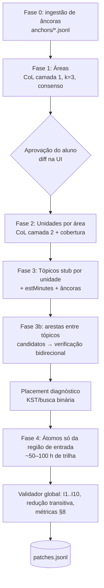

# R3: currículo-grafo massivo e expansível com LLMs (Eletrônica e Inglês)

> **Escopo.** Como construir e manter, com LLMs, um grafo de currículo por domínio que vai dos fundamentos ao doutorado, para **Eletrônica** e **Inglês**. Cobre o esqueleto inicial (*seed*) com centenas de nós e a expansão *lazy*/procedural sob demanda. O grafo precisa ser verificável, sem ciclos, sem duplicatas e ancorado em currículos reais.
> **Data:** 2026-11-18. **Status:** pesquisa e design. Nada foi implementado e nenhum arquivo do repositório além deste foi modificado.
> **Relatórios irmãos (ler junto):**
> - `docs/research/lh-graph-pedagogy.md`: modelo atual do learnharness, com proposta de camadas L1 currículo / L2 PlanTree / L3 proposições.
> - `docs/research/ref-open-mastery.md`: engine e schema do open-mastery.
> - `docs/research/r1-pedagogia-tutoria-ia.md`: pedagogia.
>
> **Convenção:**
> - `[V]` marca fato verificado em fonte primária nesta pesquisa.
> - `[S]` marca fonte secundária ou não confirmada.
> - `[P]` marca **proposta minha** (design, não fato).

---

## 0. TL;DR: decisões recomendadas

1. **Não pedir ao LLM que "lembre" um currículo.** Pedir que *organize, refine e conecte* itens de **âncoras reais** (ementas, especificações de exame, perfis CEFR, sumários de livros).
   - LLMs reconstroem estruturas de conhecimento muito mal sem fonte. No teste de reconstrução do *Roget*, a similaridade Jaccard do conjunto de nós foi de **0,028** (arXiv 2603.01341) `[V]`.
   - Em pré-requisitos multi-hop, a acurácia cai para perto do acaso: **65,6% → 54,2%** de 1 para 2 saltos, com viés de aceitar cadeias (benchmark EduKG, ai-for-edu) `[V]`.
2. **A estrutura é calculada por código determinístico; o LLM só propõe.** Fronteira, transitividade, aciclicidade e estado do aluno ficam fora do LLM.
   - Num benchmark KST de nov./2026, LLMs acertaram o conjunto exato de "próximos passos" em **61,3%** só com descrições.
   - Com a relação de pré-requisitos fornecida, o acerto foi **96,3%**; com o espaço de conhecimento completo, **98,2%** (arXiv 2611.13667) `[V]`.
3. **Hierarquia de 5 níveis:** Domínio → Área → Unidade → Tópico → Átomo/KC.
   - Átomo = 10–45 min de estudo focado, com 1–3 objetivos avaliáveis.
   - O Math Academy usa ~2.500 tópicos (4º ano até universidade), cada um com 3–4 *knowledge points* `[V]`.
4. **Arestas tipadas:**
   - `part_of`: árvore.
   - `requires`: pré-requisito **duro**, DAG, controla o acesso.
   - `builds_towards`: pré-requisito **suave**, ordena sem bloquear.
   - `encompasses`: peso 0–1, revisão implícita estilo FIRe.
   - Também `related`, `confusable_with`, `anchored_to` e `covered_by`.
   - Em Inglês predominam arestas suaves: a própria Pearson (GSE) diz que língua "não é sequencial" como engenharia elétrica `[V]`.
5. **Expansão lazy por gatilhos:** fronteira próxima, ponto fraco, pedido explícito e lacuna de cobertura. Cada expansão passa por um pipeline fixo:
   1. contexto (escopo do pai, irmãos, vizinhos, âncoras);
   2. geração estruturada com *k* amostras;
   3. consenso;
   4. deduplicação por embeddings + juiz LLM;
   5. validação de arestas bidirecional com probabilidade em *float*;
   6. checagem de ciclo, redução transitiva, granularidade e cobertura;
   7. *patch* versionado, aplicado só se os invariantes passarem.
6. **Estado do aluno = "estado de conhecimento" da Knowledge Space Theory (KST).**
   - O conjunto dominado é fechado para baixo em `requires`.
   - A fronteira é a *outer fringe*.
   - Toda mudança no grafo migra os estados (fecho para baixo + verificação rápida).
   - Isso dá a "lógica formalmente correta": invariantes provados num modelo em Lean 4 (opcional) e testados por *property-based testing* em TypeScript (obrigatório).
7. **Dimensionamento (§5).**
   - Eletrônica:
     - mapa completo ≈ **5.000 átomos** (~1.250 tópicos);
     - trilha de 1 ano ≈ **2.200 átomos ≈ 1.480 h**;
     - seed ≈ **1.000–1.150 nós**.
   - Inglês:
     - mapa ≈ **1.750 nós**, contando conjuntos lexicais e regimes de prática;
     - trilha ≈ **1.160 nós ≈ 1.480 h** (B1 → C1/C2, calibrado pelos GLH da Cambridge).
8. **Âncoras de licença limpa para embutir no app:**
   - CEFR-J Vocabulary Profile (7.799 entradas) e Grammar Profile (~500 itens, com colunas EGP/GSE);
   - Octanove C1/C2 (2.136, CC BY-SA);
   - NGSL (2.809, CC BY-SA);
   - Kuphaldt ModEL (~225 módulos de eletrônica, CC BY 4.0);
   - lista NCEES FE Electrical & Computer (17 áreas).
   - Já MIT OCW (CC BY-NC-SA), EGP, EVP, GSE e CEFR CV ficam **por referência** (IDs e títulos), sem copiar o texto.

---

## 1. Ponto de partida no learnharness

O learnharness já tem dois grafos. **Nenhum dos dois é um currículo.**

| Estrutura | Onde | Natureza | Papel no plano |
|---|---|---|---|
| Grafo de proposições e cadeias | `src/core/graph.ts`, `src/core/contracts/graph.ts` (`GraphNode{id,name,statement,aliases,provenance}`), ledgers `graph/{nodes,chains,sessions,coverage}.jsonl` | Pós-hoc: extraído da prosa do professor (extractor → auditor → merge) | **L3**: "o que foi ensinado" |
| `PlanTree` da sessão | `src/core/contracts/plan.ts` (`PlanNode{id,title,summary}`, `PlanEdge{from,to}`), `src/core/plan-tree.ts` (`createTree`, `createsCycle`) | DAG local da sessão, reescrito via `plan_init` (Mermaid) | **L2**: o "mapa da aula" |
| **Currículo-grafo** (este relatório) | novo: `curriculum/<domínio>/…` | Mapa global do domínio, persistente e expansível | **L1**: "o território" |

`[P]` O currículo é uma camada nova (L1), alinhada com a proposta de `lh-graph-pedagogy.md`:
- O `PlanTree` de uma sessão passa a ser uma **projeção** (subgrafo) da fronteira L1, com `PlanNode.id` igual ao id do átomo ou tópico L1.
- As proposições L3 ganham ligação `covers → átomo L1`.

Dois padrões existentes devem ser reaproveitados:
- **"identity auditor"** do pipeline de extração (decisão *link-or-create* por julgamento, não por string), que é exatamente o que a deduplicação de nós precisa;
- **`createsCycle`** (DFS de `to` buscando `from`) de `plan-tree.ts`, que deve ser generalizado para o currículo.

---

## 2. Estado da arte 2023–2026

### 2.1 LLMs como "especialistas" em pré-requisitos: o que os números dizem

| Trabalho (ano) | O que faz | Resultado-chave | Lição para nós |
|---|---|---|---|
| **Evaluating LLMs with Educational KGs: Prerequisite Relationships & Multi-hop** (ai-for-edu, 2024; [site](https://ai-for-edu.github.io/Evaluating-Large-Language-Models-with-Educational-Knowledge-Graphs-on-Prerequisite-Relationships/benchmark), [repo](https://github.com/ai-for-edu/Evaluating-Large-Language-Models-with-Educational-Knowledge-Graphs-on-Prerequisite-Relationships)) | 4 EduKGs (DBE-KT22, WDKG-Course, WDKG-KnowledgePoints, Junyi), 6 LLMs (GPT-4, Claude-3-haiku, Gemini-1.5-pro…) | Média de acurácia: 1 salto **65,6%**, 2 saltos **54,2%**, 3 saltos **53,7%**. Amostras negativas de 3 saltos: 0–32%, positivas 84–100% (viés de **aceitar** cadeias). Saída em *float* tem AUROC maior que binária na maioria dos casos `[V]` | Só fazer perguntas de **1 salto**. Calcular transitividade em código. Pedir **probabilidade**, não sim/não. Tratar "sim" do LLM com desconfiança |
| **K12-KGraph** (NeurIPS 2026 E&D; [arXiv 2605.09635](https://arxiv.org/abs/2605.09635), [repo](https://github.com/haolpku/K12-KGraph), CC BY-NC-SA) | KG de livros oficiais (PEP) de 4 matérias: 10.685 nós, 23.278 arestas. Extração com GPT-5.2 guiada por schema e com **citação de evidência**, *merge* hierárquico (livro → matéria → global), **validação de DAG** + revisão de especialistas | Gemini-3-Flash: só **57,1%** EM no K12-Bench. *Prereq* e *Neighbor* são as tarefas mais difíceis (>40% sem resolver) `[V]` | Schema útil: nós `Concept/Skill/Experiment/Exercise`; arestas `is_a`, `prerequisites_for`, `verifies`, `relates_to`, `tests_concept`, `tests_skill` (`src/kg/prompt.txt`). Exigir **frase-evidência** por aresta |
| **Benchmarking LLM Next-Step Recommendations with KST** ([arXiv 2611.13667](https://arxiv.org/abs/2611.13667), nov./2026) | Deriva estados admissíveis e "próximos passos" pela KST e compara com recomendações de 6 LLMs | Conjunto exato correto: só descrições **61,3%**; LLM reconstrói pré-requisitos **62,8%**; pré-requisitos fornecidos **96,3%**; espaço completo **98,2%** `[V]` | A **fronteira é calculada**, nunca "perguntada" ao LLM |
| **Do LLMs Exhibit Coherent Knowledge Structures…? (KST)** ([arXiv 2609.05245](https://arxiv.org/abs/2609.05245), EMNLP 2026 Findings) | 8 LLMs vs. alunos humanos | LLMs "frequentemente violam dependências" e não convergem entre si. Os déficits são invisíveis a acurácia e a LLM-as-judge `[V]` | Um único LLM-juiz não basta: usar **múltiplos modelos** + checagens estruturais |
| **Structural Hallucination in LLMs** ([arXiv 2603.01341](https://arxiv.org/abs/2603.01341)) | Teste de estresse por rede: reconstruir o Roget, Wikidata e citações | Roget: Jaccard de nós **0,028**, F1 < 0,05. Omissão de citações 91,9% `[V]` | **Âncoras obrigatórias**: o LLM não "lembra" estruturas fielmente |
| **How Well Do LLMs Predict Prerequisite Skills?** ([arXiv 2507.18479](https://arxiv.org/abs/2507.18479), 2025) | ESCO-PrereqSkill: 3.196 skills, 13 LLMs, zero-shot | LLaMA4-Maverick, Claude-3.7-Sonnet e Qwen2-72B ficam mais próximos do *ground truth* em similaridade semântica `[V]` | O zero-shot é razoável para **propor candidatos**, não para decidir |
| **Leveraging LLMs for Identifying KCs** (Wang, Lin, **Koedinger**; [arXiv 2511.09935](https://arxiv.org/abs/2511.09935), LAK'25 WS) | GPT-4o-mini gera KCs para 646 questões | LLM gera **569 KCs** vs. **101** do especialista. *Merge* por cosseno com **limiar 0,8** foi o melhor (428 KCs, RMSE 0,4259 vs. 0,4206 do especialista) `[V]` | LLMs **super-fragmentam**. Fazer *merge* agressivo e ter controle explícito de granularidade |
| **CGLLM / TutorQA** ([arXiv 2402.14293](https://arxiv.org/abs/2402.14293)) e **Graphusion** ([arXiv 2407.10794](https://arxiv.org/abs/2407.10794), 2024) | Recuperação de grafo de conceitos (NLP) zero-shot; *fusion* global (merge de entidades, resolução de conflitos, novas triplas) | Recuperação zero-shot competitiva com supervisionado (~+3% F1). Graphusion: link prediction até +10%; avaliação humana 2,92/3 (entidades) vs. **2,37/3 (relações)** `[V]` | **Conceitos** são fáceis; **relações** são o gargalo. Uma etapa global de *fusion* depois da extração local |
| **ACE** (Aytekin & Saygın, JEDM 16(2) 2024; [artigo](https://jedm.educationaldatamining.org/index.php/JEDM/article/view/737), [dados](https://github.com/cemaytekin/EKG-Dataset)) | Score de pré-requisito para qualquer par, só com descrições textuais + especialista no laço | Reduz muito o esforço do especialista. Alunos que estudaram na ordem do ACE tiveram melhor desempenho `[V]` | Modelo "máquina propõe, humano audita amostra". No nosso caso, o "humano" é o próprio aluno, junto com um crítico LLM |
| **InstructKG** (AlRabah, Kargupta, **Han**, Alawini; [arXiv 2602.17111](https://arxiv.org/abs/2602.17111), 2026) | Grafo a partir do material de aula: arestas `part-of` e `depends-on` | Usa a **ordem de ensino** como sinal (recursão antes de mergesort) `[V]` | A ordem dos capítulos e aulas das âncoras é um sinal forte de candidatos a `requires` |
| **Inferring Prerequisite KCs: multi-criteria** ([arXiv 2509.05393](https://arxiv.org/abs/2509.05393), 2025) | 10 critérios (documento, links da Wikipedia, grafo, texto) combinados por **votação**, sem rótulos | Precisão maior que os métodos anteriores `[V]` | Combinar sinais heterogêneos por voto: ordem nas âncoras + embeddings + LLM + RefD |
| **RPKT: Recursive Prerequisite Knowledge Tracing** ([arXiv 2508.11892](https://arxiv.org/abs/2508.11892), 2025) | Descobre pré-requisitos **recursivamente em tempo real** via LLM até achar a fronteira do aluno; avaliação binária | Descobre vários níveis aninhados e fundamentos matemáticos cross-domain `[V]` | É o modelo da **expansão para trás** (remediação) |
| **Curriculum Brain** ([arXiv 2610.05860](https://arxiv.org/abs/2610.05860), out./2026) | 11 agentes de responsabilidade única + orquestrador determinístico. Base de conhecimento versionada; checa contra regras e contra um mapa extraído do livro; auto-reparo; escala ao humano | 241 execuções de capítulo; 91,5% resolvido sem escalar (após ajuste); **US$ 1,19/capítulo** `[V]` (métrica de consistência interna, não de acurácia externa) | Arquitetura "orquestrador determinístico + agentes LLM pequenos + regras + escalonamento" |
| **ProPRL** ([arXiv 2608.03006](https://arxiv.org/abs/2608.03006), 2026) | Aprendizado de pré-requisitos com **restrição de irreversibilidade** (penaliza confiança alta nos dois sentidos) | SOTA nos datasets testados `[V]` | Testar **A→B e B→A**: alta nos dois indica conceito mal recortado ou confusão com `part_of` |
| **MAS-KCL** ([arXiv 2505.14126](https://arxiv.org/abs/2505.14126), CGI 2025) | Multiagente LLM que ajusta a estrutura do grafo de KCs com feedback bidirecional | Eficaz em 5 datasets sintéticos e 4 reais `[V]` (sem números no abstract) | A estrutura deve ser **revisada com dados de aprendizagem** |
| **Reliable Prerequisite-Aware Learning Path Rec.** ([arXiv 2611.09345](https://arxiv.org/abs/2611.09345), nov./2026) | Pré-requisitos **incertos** com semântica *hard/soft/hybrid*. MOOCCubeX: 3.187 cursos + 541 *held-out* | O melhor ranqueador imediato (XGBoost, MRR 0,905) ≠ a melhor trajetória longa `[V]` | Separar "acesso" (duro) de "ordenação" (suave). Avaliar trilhas longas, não só o próximo passo |
| **Detecting Knowledge Gaps… via Curriculum Prerequisite Graphs** ([arXiv 2606.10736](https://arxiv.org/abs/2606.10736), EDM-WS 2026) | Grafo de pré-requisitos (GPT-4, consultas **par a par**, descartando juízos bidirecionais ou ambíguos); classifica perguntas de alunos em tópicos | 80,0% de acurácia em 43 rótulos. Volume por tópico correlaciona com dificuldade relatada (ρ=0,491) `[V]`; detalhes do grafo `[S]` | Descartar bidirecionais é uma heurística simples e útil |
| **Complexity Horizons… Analog Circuit Analysis** ([arXiv 2605.02285](https://arxiv.org/abs/2605.02285), [código](https://github.com/pacomesimon/LLM_prereq_graphs_circuit_analysis)) | DAG de pré-requisitos de **eletrônica analógica** gerado por pipeline agêntico, para avaliar LLMs comprimidos | Mapeia o "horizonte" de conceitos que cada modelo domina `[V]` | Fonte de exemplo de DAG de análise de circuitos (verificar a licença antes de reusar) |
| **Systematic Review: LLM Concept Map Generation** (Zhai; [arXiv 2509.14554](https://arxiv.org/abs/2509.14554)) | 28 estudos analisados | Seis famílias de métodos. Validade e interpretabilidade continuam como desafios abertos `[V]` | O padrão dominante e mais confiável é "híbrido (KB + LLM) + humano no laço" |

**Datasets para calibrar os prompts offline:**
- LectureBank: 1.352 arquivos de aula, 208 tópicos com pré-requisitos rotulados (AAAI 2019) `[S]`.
- AL-CPL (Liang et al. 2018), MOOCCube/MOOCCubeX, DBE-KT22, Junyi e ESCO-PrereqSkill.
- Métrica clássica: RefD (*Reference Distance*, Liang et al., EMNLP 2015), que mede a assimetria de referências entre conceitos `[S]`.

### 2.2 Geração hierárquica (taxonomias e esqueletos) com LLM

- **Chain-of-Layer (CoL)** ([arXiv 2402.07386](https://arxiv.org/abs/2402.07386), CIKM 2024) `[V]`:
  - induz a taxonomia **camada por camada, de cima para baixo**;
  - a cada iteração, seleciona os candidatos daquela camada e aplica um **Ensemble-based Ranking Filter** para suprimir alucinações.
  - → **É o algoritmo do seed** (§6).
- **SC-Taxo** ([arXiv 2605.00620](https://arxiv.org/abs/2605.00620), 2026) `[V]`:
  - geração **bidirecional**: abstração *bottom-up* + restrição semântica *top-down*;
  - modela dependências entre **irmãos** para manter a consistência entre níveis.
  - → Usar no passo de "revisão de irmãos" (sem sobreposição, mesmo nível de abstração).
- **TnT-LLM** (Wan et al., KDD 2024, arXiv 2403.12173) e **STORM** (Shao et al., NAACL 2024, arXiv 2402.14207) `[S]`:
  - TnT-LLM: taxonomia iterativa em *minibatches* com etapas de atualizar/revisar;
  - STORM: *outline* gerado a partir de perguntas feitas por perspectivas diferentes.
  - → Ideia útil: gerar a lista de áreas pedindo "perspectivas" (graduação, indústria, pós-graduação, exames).

### 2.3 Deduplicação e resolução de entidades: receitas com números

| Fonte | Receita | Limiar |
|---|---|---|
| **KGGen** (NeurIPS 2025; [arXiv 2502.09956](https://arxiv.org/abs/2502.09956); [repo](https://github.com/stair-lab/kg-gen), MIT) | `src/kg_gen/steps/_3_deduplicate.py`, em dois passos. (1) **SemHash**: normaliza NFKC, singulariza, deduplica. (2) **KMeans** em clusters + recuperação top-k=50 por fusão **BM25 (0,5) + embedding (0,5)** + **LLM decide dentro do cluster** | SemHash **0,95** `[V]` |
| **iText2KG / ATOM** ([arXiv 2409.03284](https://arxiv.org/abs/2409.03284), WISE 2024; [repo](https://github.com/AuvaLab/itext2kg), Apache-2.0) | Resolução **sem LLM** por cosseno; o embedding da entidade combina **nome e rótulo/tipo** | Entidade **θ_E=0,8**, relação **θ_R=0,7**; pesos nome/rótulo 0,8/0,2 (default) `[V]` |
| **Koedinger et al.** (2511.09935) | *Merge* de rótulos de KC por cosseno | **0,8** foi o melhor `[V]` |
| **K12-KGraph** (`src/kg/merge_kg.py`) | Dedup léxico por nome normalizado + `check_cycles.py` + revisão de especialistas | — `[V]` |
| **learnharness** (auditor existente) | O auditor decide identidade por julgamento contra o `statement` (*link-or-create*) | — `[V]` |

**Cuidado `[P]`:** limiares de cosseno **não se transferem entre modelos de embedding**, porque cada modelo tem uma distribuição diferente. Calibre com 200–300 pares rotulados por domínio antes de fixar valores (§7.4).

### 2.4 Sistemas e grafos de referência (o que copiar)

- **Math Academy** (humano, proprietário) `[V]`:
  - Grafo **feito à mão** com ~2.500 tópicos; cada tópico tem 3–4 *knowledge points*, e cada KP tem tipicamente vários pré-requisitos (~5 por tópico).
  - Toda aresta de pré-requisito carrega um **peso de *encompassing***.
  - Codificar esses pesos levou ~250 h: ~1.500 tópicos × ~5 relações × ~2 min ([How Math Academy creates its KG](https://justinmath.com/how-math-academy-creates-its-knowledge-graph/)).
  - **FIRe**: crédito de revisão desce pelos pesos e penalidade sobe; "compressão" da repetição espaçada ([FIRe](https://justinmath.com/individualized-spaced-repetition-in-hierarchical-knowledge-structures/)).
  - Calibração de tempo: **1 XP ≈ 1 min** de esforço focado; a série *foundations* (frações → 1º ano de universidade) tem ≈ **15.000 XP ≈ 250 h** `[S]`.
- **open-mastery** (`_refs/open-mastery`; grafo **CC BY-SA 4.0**, engine **MIT**) `[V]`:
  - Um YAML por nó: `id`, `prereqs`, `bloom`, `assess`, `context`; cascata de `_prompt.yaml`.
  - Regras de aresta: "**necessária, não suficiente**", "**direta, não transitiva**" e o teste *"um aluno que domina tudo EXCETO A ainda consegue aprender B?"*.
  - Validação no *load*: ids resolvem, sem ciclos, sem órfãos, ids únicos.
  - `encompasses` (peso) está planejado.
  - Fronteira = nós não dominados com todos os pré-requisitos dominados.
  - Ver `_refs/open-mastery/docs/GRAPH_FORMAT.md`.
- **Learning Commons Knowledge Graph** (CZI; [repo](https://github.com/learning-commons-org/knowledge-graph), código MIT, dados por publisher) `[V]`:
  - Entidades `StandardsFrameworkItem`, **`LearningComponent`** ("parte ensinável" de um padrão), `Lesson`, `Assessment`.
  - Relações `supports` (LC → padrão), **`buildsTowards`** (progressão: o pré-requisito torna o sucesso "mais provável", **não garantido**) e `hasStandardAlignment` (com **Jaccard** de LCs compartilhados).
  - Inclui o **Eedi Misconceptions Graph**.
  - → Modelo para `builds_towards` (suave) e para alinhar a âncoras via componentes compartilhados.
- **DeepTutor** (`_refs/DeepTutor`, Apache-2.0) `[V]`:
  - `deeptutor/learning/objective_relations.py::validate_objective_relations` valida ids únicos, refs conhecidas, auto-pré-requisito e ciclo (DFS que **devolve o caminho do ciclo**).
  - `learning/models.py::LearningModule.objective`: uma frase que **delimita o que revisões podem fazer**. É o padrão de **"contrato de escopo"** do nó pai que adoto na expansão (§7).
- **Learnharness `PlanTree`** (`src/core/plan-tree.ts`): `createTree` valida cada aresta contra as já aceitas, nomeando a aresta culpada.

### 2.5 Base formal: Knowledge Space Theory (KST)

([Wikipedia: Knowledge space](https://en.wikipedia.org/wiki/Knowledge_space); Doignon & Falmagne 1985/1999; Falmagne & Doignon, *Learning Spaces*, 2011; [arXiv 1511.06757](https://arxiv.org/abs/1511.06757)) `[V]`

- **Domínio** Q (itens/átomos). Um **estado de conhecimento** é um subconjunto de Q. A **estrutura** K é a família de estados viáveis.
- **Espaço de conhecimento:** K fechado sob união.
- **Quase-ordinal:** fechado também sob interseção. Pelo teorema de Birkhoff, corresponde a uma **(quase-)ordem de pré-requisitos**: os estados são exatamente os conjuntos **fechados para baixo**.
  - → Um DAG `requires` "AND-only" gera exatamente isso.
- **Learning space** (*well-graded*): todo estado não vazio perde algum item e continua viável, ou seja, "dá para aprender um conceito por vez". Isso equivale a um **antimatroide**.
- **Outer fringe** de um estado = o que o aluno está **pronto para aprender** (= nossa "fronteira"). **Inner fringe** = o que acabou de aprender. O ALEKS usa as duas.
- **Pré-requisitos "OU"** (A *ou* A′ antes de B) exigem *surmise systems*: o espaço continua fechado sob união, mas não sob interseção. `[P]` Modelar como `requiresAnyOf` (§4.3).
- **QUERY** (Koppen & Doignon 1990): constrói a estrutura **consultando um especialista** e usa regras de inferência (transitividade) para **pular perguntas**.
  - `[P]` O LLM faz o papel de especialista (barato, mas ruidoso). Como no QUERY, perguntas dedutíveis não são feitas. Isso corta a explosão O(n²) de pares.

### 2.6 Lições consolidadas

1. LLMs são bons em **nomear e recortar conceitos** e ruins em **relações**, sobretudo multi-hop e negativas.
2. Toda a estrutura derivada (transitividade, fronteira, ordem topológica) é **código**.
3. Pré-requisitos devem ser **checados nos dois sentidos**, em **probabilidade**, com **mais de um modelo**, contra **sinais independentes** (ordem nas âncoras, embeddings, dados do aluno).
4. Granularidade: o LLM **super-fragmenta** (569 vs. 101). Use limites explícitos de minutos e objetivos, mais *merge* por similaridade.
5. Âncoras + evidência citada reduzem a alucinação estrutural. Nós sem âncora entram como **provisórios**.
6. O grafo é uma **hipótese** (open-mastery): os dados de aprendizagem corrigem as arestas ao longo do tempo (MAS-KCL, ACE).

---

## 3. Âncoras (currículos, taxonomias, listas) e suas licenças

### 3.1 Eletrônica

| Âncora | O que fornece | Licença / uso | URL |
|---|---|---|---|
| **MIT OCW: núcleo de graduação**. Cada disciplina de 12 unidades ≈ 12 h/semana × ~14 semanas ≈ **~170 h** `[V]` | 6.002 *Circuits and Electronics* (S2007): modelos concentrados, nodal, superposição, Thévenin, lógica digital/MOSFET chave-resistor, pequenos sinais, op-amps, 1ª/2ª ordem; pré-requisitos 8.02 e 18.03; livro Agarwal & Lang `[V]`. 6.012 *Microelectronic Devices and Circuits* (F2009; livro Fonstad, aberto no DSpace@MIT) `[V]`. 6.003 *Signals and Systems* (F2011). 6.004 *Computation Structures* (S2017). 6.013 *Electromagnetics and Applications* (S2009). 6.101 *Intro Analog Electronics Lab*. 6.111 *Intro Digital Systems Lab* | **CC BY-NC-SA 4.0**: referenciar títulos e estrutura; não embutir conteúdo em app comercial | `ocw.mit.edu/courses/6-002-circuits-and-electronics-spring-2007/` · `…/6-012-microelectronic-devices-and-circuits-fall-2009/` · `…/6-003-signals-and-systems-fall-2011/` · `…/6-004-computation-structures-spring-2017/` · `…/6-013-electromagnetics-and-applications-spring-2009/` |
| **MIT OCW: avançado/pós** | 6.301 *Solid-State Circuits* (F2010). 6.331 *Advanced Circuit Techniques* (S2002). 6.334 *Power Electronics* (S2007; pré-req. 6.012; Kassakian/Schlecht/Verghese). 6.622 *Power Electronics* (S2023). 6.302 *Feedback Systems* (S2007). 6.341 *Discrete-Time Signal Processing* (F2005). 6.374 *Digital ICs* (F2003). 6.720J *Integrated Microelectronic Devices* (S2007). **6.776 *High Speed Communication Circuits*** (S2005), 25 aulas: TL/S-params/Smith → amplificadores banda larga → ruído/NF → LNA → VCO → mixers → ruído de fase → PA → PLL/sintetizadores fracionários `[V]` | idem | todas retornaram HTTP 200 em `ocw.mit.edu/courses/<slug>/` nesta pesquisa |
| **Renumeração MIT 2022** | 6.002→**6.2000**, 6.012→**6.2500**, 6.004→**6.1910**; 6.3000 é Signals & Systems `[S]` | — | [eecs.mit.edu/academics/subject-numbering](https://www.eecs.mit.edu/academics/subject-numbering) |
| **NCEES FE Electrical & Computer** (CBT, vigente desde jul./2020) | **17 áreas, com subtópicos A–H**: Math; Prob/Stat; Ethics; Econ; Properties of Electrical Materials (semicondutores…); Circuit Analysis (KCL/KVL, Thévenin/Norton, fasores, impedância); Linear Systems (Laplace, FT); Signal Processing (amostragem, filtros analógicos/digitais, Z); Electronics (dispositivos, amplificadores, op-amps, instrumentação, potência); Power Systems; Electromagnetics (Maxwell, linhas); Control (Bode, estabilidade); Communications; Computer Networks; Digital Systems; Computer Systems; Software Eng. 110 questões, 6 h `[V]` (contagem por área no PDF `[S]`, layout ambíguo) | especificação pública | [FE-Electrical-and-Computer-CBT-specs.pdf](https://ncees.org/wp-content/uploads/2022/09/FE-Electrical-and-Computer-CBT-specs.pdf) |
| **ABET: critérios de programa EE 2025–26** | Probabilidade e estatística; matemática até cálculo; ciências; tópicos de engenharia para analisar e projetar dispositivos e sistemas HW+SW complexos. Para "electrical/electronic(s)": **EDO, álgebra linear, variáveis complexas, matemática discreta** `[V]` | público | [abet.org …criteria 2025–2026](https://www.abet.org/accreditation/accreditation-criteria/criteria-for-accrediting-engineering-programs-2025-2026/) |
| **IEEE/ACM CE2016** (Computer Engineering) | Knowledge Areas → Knowledge Units → learning outcomes, com horas-núcleo; ex.: CE-CAE Circuits & Electronics ~50 h, CE-DIG ~50 h, CE-ESY ~40 h `[S]` | DOI 10.1145/3025098 | — |
| **Kuphaldt, Modular Electronics Learning (ModEL)** | **~225 módulos** em 14 categorias (Electrical Fundamentals, Network Analysis, AC, Semiconductors, Switching Circuits, Amplification, Communication, Programmable Systems, Measurement & Control, Power Systems…). Cada módulo tem tutoriais em profundidades diferentes, questões e experimentos. Fonte LaTeX disponível (`mod_<tópico>.latex`) `[V]` | **CC BY 4.0**: pode embutir com atribuição | [ibiblio.org/kuphaldt/socratic/model](https://www.ibiblio.org/kuphaldt/socratic/model/) |
| **Lessons in Electric Circuits** (Kuphaldt, 6 volumes: DC, AC, Semiconductors, Digital, Reference, Experiments) | Nível técnico/fundamentos | Edições antigas sob Design Science License; reproduções recentes indicam CC BY `[S]`, verificar em ibiblio | [ibiblio.org/kuphaldt/electricCircuits](https://www.ibiblio.org/kuphaldt/electricCircuits/) |
| **Livros abertos** | Ellingson, *Electromagnetics* vol. 1–2 (**CC BY-SA 4.0**) `[V]`. Fiore, *Semiconductor Devices* etc. (**CC BY-NC-SA**) `[S]`. Fonstad, *Microelectronic Devices and Circuits* (DSpace@MIT) | conforme licença | [open.umn.edu: electrical](https://open.umn.edu/opentextbooks/subjects/electrical) |
| **Livros-texto canônicos** (só sumários como âncora de região) | *The Art of Electronics* 3ª ed. (Horowitz & Hill); *Microelectronic Circuits* (Sedra/Smith, 8ª ed. com Carusone & Gaudet); Razavi, *Design of Analog CMOS ICs* (2ª ed.) e *RF Microelectronics*; Gray/Hurst/Lewis/Meyer; Pozar (micro-ondas); Erickson & Maksimović (potência); Oppenheim & Willsky (sinais); Harris & Harris (digital/RISC-V); Weste & Harris (VLSI). Edições `[S]`, verificar | copyright: guardar **apenas** título de capítulo e intervalo de páginas (`covered_by`) | — |
| PT-BR (opcional) | DCN de Engenharia (Res. CNE/CES 2/2019) e conteúdos do ENADE Engenharia Elétrica `[S]`, não verificado nesta pesquisa | público | — |

### 3.2 Inglês

| Âncora | Conteúdo (números verificados) | Licença / uso | URL |
|---|---|---|---|
| **Cambridge: Guided Learning Hours (GLH)** | Adulto, L1 com o mesmo alfabeto (≈ brasileiro), Exemplo 1, horas **do nível anterior / cumulativas**: A1 90–100 / 90–100; A2 100–150 / 190–250; **B1 160–240 / 350–490**; **B2 180–260 / 530–750**; **C1 200–300 / 730–1050**; **C2 300–400 / 1030–1450**. GLH = aula + estudo guiado; estudo autônomo extra acelera. "Não validado empiricamente" `[V]`. Tabela do Helpdesk: A2 180–200, B1 350–400, B2 500–600, C1 700–800, C2 1000–1200 `[S]` | público | [CUP: How long does it take…](https://www.cambridge.org/elt/blog/wp-content/uploads/2018/10/How-long-does-it-take-to-learn-a-foreign-language.pdf) · [Helpdesk GLH](https://support.cambridgeenglish.org/hc/en-gb/articles/202838506-Guided-learning-hours) |
| **CEFR Companion Volume (2020)** | Escalas de descritores para recepção, produção, interação e **mediação** (novas), interação online, Pre-A1; descritores neutros em gênero/modalidade `[V]` | © Conselho da Europa; reprodução pede permissão: usar **IDs/escalas** como referência | [coe.int: CEFR descriptors](https://www.coe.int/en/web/common-european-framework-reference-languages/cefr-descriptors) |
| **CEFR-J Vocabulary Profile 1.5** | **7.799 entradas** (headword+POS): A1 1.164, A2 1.411, B1 2.446, B2 2.778 `[V]` (contado do CSV) | **Uso comercial e de pesquisa gratuito com citação** (© Tono Lab/TUFS) | [openlanguageprofiles/olp-en-cefrj](https://github.com/openlanguageprofiles/olp-en-cefrj) |
| **Octanove Vocabulary Profile C1/C2 1.0** | **2.136**: C1 1.111, C2 1.025 `[V]` | **CC BY-SA 4.0** | idem |
| **CEFR-J Grammar Profile (20180315)** | **~500 itens gramaticais**. Colunas: `Shorthand Code`, `Grammatical Item`, `CEFR-J Level` (A1.1…), `FREQ*DISP`, `Core Inventory`, **`EGP`**, **`GSELO`**; já cruza níveis com EGP e GSE `[V]` | grátis com citação (parcialmente traduzido do japonês) | idem |
| **English Grammar Profile (EGP)** | **~1.200** declarações *can-do* gramaticais com nível CEFR `[V]` (via literatura) | online, © Cambridge: não redistribuir; referenciar | englishprofile.org |
| **English Vocabulary Profile (EVP)** | ~**7.000 headwords** A1–C2; nível por **sentido** (~15 mil sentidos) `[S]` | online, © Cambridge | englishprofile.org |
| **GSE Learning Objectives (Pearson), Adult, set./2022** | Escala 10–90 alinhada ao CEFR; ~**970** *can-dos* funcionais (L/R/S/W) no PDF adulto `[V]` (contagem minha por regex; aproximada); conjuntos separados para Academic e Professional. Semântica: estar em 61 = **50% de probabilidade** de executar LOs de nível 61 (lógica IRT) | **"All rights reserved"**: só como referência de nível | [PDF adult general](https://www.pearsoncanadaschool.com/content/dam/websites/pearson-canada-school/assets/documents/literacy/gse/gse-learning-objectives-adult-general-english.pdf) |
| **NGSL 1.2** | **2.809** palavras ≈ 92% de cobertura do inglês geral; **NAWL 1.2**: 957 acadêmicas; NGSL-Spoken `[V]` | **CC BY-SA 4.0** | [newgeneralservicelist.com](https://www.newgeneralservicelist.com/new-general-service-list) |
| **AWL** (Coxhead 2000) | 570 famílias de palavras acadêmicas `[S]` | verificar | — |
| **COCA / wordfrequency.info** | frequência e colocações | **restrito** (lista grátis limitada, versão completa paga): usar NGSL/SUBTLEX no lugar | — |
| **FSI** | Português é Categoria I: **24–30 semanas / 600–750 h de aula** até proficiência profissional (para falantes de inglês) `[S]`. Simetria PT→EN é só uma heurística | — | — |

**Nota de design para Inglês `[P]`:**
- Vocabulário **não** vira um nó por palavra (seriam ~10 mil nós). Vira **conjuntos lexicais** de 15–40 itens (por banda de frequência NGSL/CEFR-J × campo semântico), que geram flashcards (Anki/Obsidian, ver outros relatórios).
- Gramática vira átomos (≈ EGP/CEFR-J agrupados).
- Habilidades viram *can-dos* (CEFR CV/GSE como referência de nível) e **regimes de prática** (escuta e leitura extensivas com orçamento de horas).

### 3.3 Política de licenças para o app (AGPL-3.0)

- **Pode embutir** (com atribuição e mantendo a licença do dado):
  - CEFR-J vocabulário e gramática (com citação);
  - Octanove, NGSL e NAWL (CC BY-SA: derivados do **dado** ficam CC BY-SA);
  - ModEL (CC BY 4.0) e Ellingson (CC BY-SA);
  - open-mastery `graph/` (CC BY-SA).
- **Só referenciar** (id, título, nível, URL):
  - MIT OCW (NC);
  - EGP/EVP (Cambridge), GSE (Pearson), descritores CEFR (CoE);
  - sumários de livros comerciais;
  - COCA.
- **`[P]`** Separar o arquivo `anchors/<fonte>.jsonl` com o campo `license` e `embeddable: boolean`. Gerar conteúdo de aula próprio via LLM, nunca copiando texto de fonte NC/copyright.

---

## 4. Arquitetura do grafo

### 4.1 Hierarquia e granularidade `[P]`

| Nível | Exemplo EE | Exemplo Inglês | Cardinalidade (filhos/pai) | Tamanho |
|---|---|---|---|---|
| **Domínio** | Eletrônica | Inglês | — | — |
| **Área** | Eletrônica analógica | Gramática | 10–16 por domínio | 50–250 h |
| **Unidade** | Amplificadores com transistor | Tempo e aspecto | 6–15 por área | 8–40 h |
| **Tópico** | Amplificador emissor-comum | Present perfect | 4–12 por unidade | 1–5 h |
| **Átomo (KC)** | Ganho de pequenos sinais do EC com degeneração | *Present perfect* + *for/since* (duração) | 2–6 por tópico | **10–45 min** (alvo 20–30) |

**Regras de átomo** (baseadas em Math Academy 3–4 KPs/tópico; open-mastery; KLI de Koedinger):
- 1–3 objetivos com verbo de Bloom;
- avaliável com 3–5 itens;
- explicável em ≤ ~1.200 palavras + 1 exemplo resolvido;
- ≤ 2 termos técnicos novos que não venham dos pré-requisitos (senão falta pré-requisito ou o átomo está grosso demais).

**Tipos de nó (`kind`):**
- `concept` (ideia/modelo);
- `procedure` (técnica: análise nodal; *wh-question formation*);
- `lexical_set` (Inglês);
- `phoneme_contrast` (Inglês);
- `can_do` (habilidade comunicativa);
- `practice_regime` (horas de prática extensiva com critério de saída);
- `lab` (simulação SPICE/Falstad/medição);
- `design_project`;
- `checkpoint` (avaliação de região: mock FE, mock C1).

### 4.2 Schema de nó (TypeScript) `[P]`

```ts
// src/core/curriculum/types.ts (proposta)
export type Level =
  | { scheme: "ee"; band: 0 | 1 | 2 | 3 | 4 }     // 0 pré-univ, 1 grad básico, 2 grad avançado, 3 mestrado, 4 doutorado
  | { scheme: "cefr"; cefr: "PreA1"|"A1"|"A2"|"B1"|"B2"|"C1"|"C2"; gse?: number }; // gse 10–90 como referência

export type NodeKind = "domain" | "area" | "unit" | "topic" | "atom";
export type AtomType = "concept" | "procedure" | "lexical_set" | "phoneme_contrast"
  | "can_do" | "practice_regime" | "lab" | "design_project" | "checkpoint";

export type NodeStatus =
  | "stub"          // só título + escopo; filhos não materializados
  | "proposed"      // gerado, aguardando validação
  | "provisional"   // validado automaticamente; pode mudar sem aviso
  | "stable"        // já visto pelo aluno ou validado por humano/2º modelo; muda só por nova versão
  | "deprecated";   // substituído (ver aliasOf / supersededBy)

export interface AnchorRef {
  source: string;      // "ncees-fe-ec-2020" | "mit-ocw-6.002-s07" | "cefrj-vp-1.5" | "egp" | "modEL" ...
  ref: string;         // "9.B" | "L12" | "headword:abandon#verb" | "mod_bjtamp"
  span?: string;       // "cap. 4 §4.3–4.6" | "pp. 210–245"
  embeddable: boolean; // pode exibir conteúdo da fonte? (licença)
  evidence?: string;   // frase curta que justifica o vínculo (≤ 25 palavras, parafraseada)
}

export interface CurriculumNode {
  id: string;                 // estável e imutável: "ee.an.amp.ce-small-signal-gain.7f3a" (prefixo + slug + hash curto)
  domainId: "ee" | "en" | string;
  kind: NodeKind;
  atomType?: AtomType;        // só se kind === "atom"
  parentId: string | null;    // pai primário (árvore part_of)
  title: { pt: string; en: string };       // título PT-BR + termo canônico EN (melhora dedup e busca de vídeo)
  aliases: string[];          // sinônimos e grafias ("BJT CE amp", "emissor comum")
  scope: string;              // CONTRATO DE ESCOPO: 1–2 frases sobre o que está dentro e o que está fora (como LearningModule.objective do DeepTutor)
  summary: string;            // 1–3 frases para o aluno
  objectives: string[];       // 1–3 (átomo) | 3–8 (tópico); verbo de Bloom + condição
  bloom?: "remember"|"understand"|"apply"|"analyze"|"evaluate"|"create";
  assess: string[];           // "solve" | "derive" | "explain" | "simulate" | "minimal_pair_discrimination" | "dictation" | "write_paragraph" ...
  misconceptions?: string[];  // erros típicos (ex.: "confundir r_pi com r_e"; "*since 3 years")
  level: Level;
  estMinutes: number;         // estimativa a priori (LLM) → atualizada por dados reais (§7.6)
  estMinutesObserved?: { mean: number; n: number };
  anchors: AnchorRef[];       // ≥1 para status stable em regiões de graduação
  requiresAnyOf?: string[][]; // cláusulas OU: [[A, A2], [C]] = (A ∨ A2) ∧ C  (surmise system)
  status: NodeStatus;
  depthHint?: number;         // profundidade topológica (cache)
  lexicalItems?: Array<{ lemma: string; pos?: string; cefr?: string; ngslRank?: number }>; // lexical_set
  practice?: { targetHours: number; exitCriterion: string };   // practice_regime
  provenance: {
    createdBy: "seed" | "expansion" | "user" | "import";
    trigger?: string;          // id do evento de expansão
    model?: string;            // id do modelo configurado (nunca hardcoded no código)
    promptVersion?: string;    // hash do template
    createdAt: string;
    validation?: { dedupMaxSim: number; consensus: number; critic?: string; anchorCoverage: number };
  };
  version: number;
  aliasOf?: string;            // se fundido em outro nó
  supersededBy?: string[];     // se dividido
}
```

**Embedding** `[P]`:
- Calculado sobre `title.en + " — " + summary + " | " + objectives.join("; ")`.
- Guardado à parte (`embeddings.f32` + índice de ids).
- Com 5–10 mil nós × 1.024 dims ≈ 20–40 MB em float32, a busca por força bruta em memória basta; não precisa de banco vetorial.
- Modelos locais via transformers.js, todos com ONNX `[V]`:
  - **Qwen3-Embedding-0.6B** (Apache-2.0);
  - **bge-m3** (MIT; multilíngue PT/EN);
  - **EmbeddingGemma-300m** (licença Gemma).

### 4.3 Tipos de aresta

| Tipo | Direção / restrição | Semântica | Uso |
|---|---|---|---|
| `part_of` | filho → pai; **floresta** (1 pai primário) | Hierarquia de agregação | Navegação, agregação de horas e domínio, cascata de prompts (como `_prompt.yaml` do open-mastery) |
| `also_in` | nó → outro pai | Listagem secundária (ex.: "Bode" em Controle **e** em Sinais) | Sem efeito de *gating* |
| **`requires`** | A → B; **DAG**; só entre nós que **não** são ancestral/descendente em `part_of` | **Pré-requisito duro**: "necessário, não suficiente". Teste: *quem domina tudo exceto A ainda aprende B?* Se não → aresta | Fronteira (*outer fringe*), *gating*, placement |
| `requiresAnyOf` | cláusula no nó | OU entre alternativas (ex.: Laplace via EDO **ou** via circuitos) | KST *surmise system* |
| **`builds_towards`** | A → B; o DAG **conjunto** com `requires` deve continuar acíclico | Pré-requisito **suave**: aumenta a probabilidade de sucesso sem ser necessário (como no Learning Commons) | Ordenação e *score* de prontidão; predomina em Inglês |
| **`encompasses`** | B → A com peso w ∈ (0,1] | Praticar B exercita a fração w de A (FIRe) | Revisão implícita, compressão do SRS (ver relatório de memória/SRS) |
| `related` | não direcionada, com `label` (`analogy`, `same_math`, `application`, `dual`) | Ex.: "circuito RC" ↔ "EDO 1ª ordem" (cross-domain) | Explicações por analogia, *interleaving* |
| `confusable_with` | não direcionada | Pares que se confundem: /ɪ/–/iː/, *since*/*for*, r_π/r_e, *make/do* | Prática contrastiva e intercalada; detecção de erro |
| `anchored_to` | nó → item de âncora (campo `anchors`) | Alinhamento a currículo real | Cobertura e anti-alucinação |
| `covered_by` | nó/região → recurso (capítulo, vídeo `[t0,t1]`) | Livros cobrem regiões grandes; vídeos cobrem tópicos | Ordenar recursos pelo menor índice topológico coberto |
| `alias_of` / `superseded_by` | histórico | Merge e split | Migração de estado; ids nunca reutilizados |

### 4.4 Invariantes (o que o código garante sempre) `[P]`

- **I1:** ids únicos e imutáveis; `aliasOf` aponta para nó não-`deprecated`.
- **I2:** `part_of` é floresta com raiz única por domínio. `kind` cresce estritamente para baixo (domain < area < unit < topic < atom).
- **I3:** `requires ∪ builds_towards` é **acíclico** (DAG).
- **I4:** não existe `requires(A,B)` quando A é ancestral ou descendente de B em `part_of`.
- **I5:** `requires` está em **redução transitiva**: nenhuma aresta direta A→B quando já existe outro caminho A⇝B em `requires`. Arestas implicadas não são armazenadas.
- **I6:** monotonicidade de nível. Em EE, `requires(A,B) ⇒ band(A) ≤ band(B)`. Em Inglês há tolerância de ±1 subnível para `builds_towards` e nenhuma para `requires`.
- **I7:** fan-in de `requires` por átomo ≤ 5. Acima disso, o átomo é grosso demais e deve ser reestruturado.
- **I8:** todo átomo `stable` de regiões de graduação tem ≥ 1 âncora. Em regiões de pós, ≥ 1 âncora **ou** `validation.critic` aprovado por um segundo modelo.
- **I9:** o estado do aluno (§4.5) é **fechado para baixo** em `requires`.
- **I10:** todo `requires`/`builds_towards` aponta para nós existentes e não-`deprecated` (resolvidos via alias).

### 4.5 Estado do aluno, fronteira e migração

- **Estado** S ⊆ átomos, com p(domínio) ≥ θ (ex.: θ = 0,85 vindo do modelo de memória/BKT; ver relatório de memória).
- **Fronteira:** `F(S) = { b ∉ S : ∀a. requires(a,b) ⇒ a ∈ S, e alguma cláusula de requiresAnyOf(b) satisfeita }`. É a *outer fringe* da KST.
- **Prontidão** (ranking dentro de F, não *gating*): combina
  - domínio dos `builds_towards`;
  - prioridade de ponto fraco;
  - cobertura de revisões vencidas via `encompasses` (FIRe);
  - interesse/meta declarada;
  - variedade (*interleaving*).
- **Migração após um patch** (garante I9):
  1. Nova aresta `requires(A,B)` com B∈S e A∉S → marcar A como **inferido** (p=0,7, `source:"graph-migration"`) e agendar uma **sondagem rápida** de A.
  2. *Split* de X em {X1…Xk} → cada Xi herda o domínio de X como "inferido".
  3. *Merge* de X,Y em Z → domínio(Z) = combinação conservadora (mín.), com evidências unidas.
  4. Por fim, `S := downClosure(S)` (fecho para baixo) e recalcular a fronteira.
- **Placement inicial:** busca binária no DAG (open-mastery) ou avaliação adaptativa KST. Testa um nó do meio: se dominado, marca os ancestrais como inferidos; se não, desce.

### 4.6 Armazenamento e versionamento `[P]`

- Por domínio, em `data/curriculum/<domainId>/`:
  - `nodes.jsonl` e `edges.jsonl`: snapshot materializado e reconstruível;
  - **`patches.jsonl`**: *event log* de operações, a fonte da verdade;
  - `anchors/<source>.jsonl`, `embeddings.f32` + `embeddings.ids.json`, `format.json` (versão).
  - Segue o padrão de ledgers JSONL e version guards de `src/store/graph-format.ts`.
- **Operações de patch:**
  - `AddNode`, `UpdateNode` (só campos não estruturais em `stable`), `SplitNode`, `MergeNodes`, `DeprecateNode`;
  - `AddEdge`, `RemoveEdge`, `ReweightEdge`, `SetStatus`.
  - Cada patch carrega `preconditions` (ex.: `version` esperada do nó), `trigger`, `model`, `promptVersion` e `validationReport`.
- `applyPatch(graph, patch): Result<Graph, Violation[]>` é uma **função pura** em `src/core/curriculum/patch.ts`. Patch com violação **não entra no log**; fica num `rejected.jsonl` para auditoria.
- **Re-auditoria:** como todo nó guarda modelo e versão de prompt, um job noturno pode revalidar nós `provisional` com modelos melhores.

---

## 5. Dimensionamento: nós e horas por região

### 5.1 Calibração

- **MIT:** 1 unidade ≈ 1 h/semana (~14 h/período). Uma disciplina de 12 unidades ≈ **~170 h** ([MIT Registrar](https://registrar.mit.edu/faculty-curriculum-support/curriculum-schedule-planning/proposing-subject/calculating-instructional)) `[V]`. Portanto **1.500 h ≈ 9 disciplinas MIT de 12 unidades**: um núcleo forte de graduação mais 2–3 disciplinas de pós. **Doutorado completo em 1 ano não é realista.** O grafo **contém** os nós de doutorado; a trilha do 1º ano chega à fronteira de 1–2 especializações.
- **Math Academy:** ~2.500 tópicos (4º ano → universidade); *foundations* ≈ 250 h; 1 XP ≈ 1 min `[V]`/`[S]`.
- **Cambridge GLH (adulto, contexto favorável):** B1→C1 ≈ 380–560 GLH; B1→C2 ≈ 680–960 GLH. Com prática autônoma de *input* (escuta e leitura extensivas), 1.000–1.500 h totais é coerente com **B1 → C1 sólido / C2 parcial** `[V]`.
- **Átomo médio** `[P]`:
  - EE ≈ 30 min focado + ~30% de revisões espaçadas ≈ **40 min efetivos**;
  - Inglês: conjuntos lexicais custam mais em revisões SRS, e regimes de prática são orçados em horas.

### 5.2 Eletrônica `[P]` (trilha de ~1.480 h; ajustar pelo placement)

| Região (área) | Nível | Átomos no mapa | Átomos na trilha (ano 1) | Horas na trilha | Âncoras principais |
|---|---|---|---|---|---|
| E0 Ferramentas matemáticas (álgebra/trig, complexos, cálculo, EDO, álg. linear, prob.) | 0–1 | 350 | 150* | 90 | FE §1–2; ABET |
| E1 Física para eletricidade (campos, potencial, energia, magnetismo) | 0–1 | 80 | 50 | 30 | 8.02; ModEL "Magnetic and Electric Fields" |
| E2 Circuitos DC (Ohm, KCL/KVL, nodal/malhas, Thévenin/Norton, fontes, potência) | 1 | 140 | 120 | 70 | 6.002; FE §6; ModEL "Electrical Fundamentals/Network Analysis" |
| E3 Transientes e AC (RC/RL/RLC, fasores, impedância, potência AC, ressonância, filtros passivos, transformadores, trifásico) | 1 | 220 | 170 | 110 | 6.002; FE §6–7; ModEL "AC Fundamentals" |
| E4 Sinais e sistemas (LTI, convolução, Fourier, Laplace, Z, amostragem, DSP básico) | 1–2 | 260 | 150 | 100 | 6.003/6.3000; 6.341; FE §7–8 |
| E5 Dispositivos semicondutores (bandas, dopagem, deriva/difusão, junção pn, BJT, MOSFET, modelos) | 1–3 | 300 | 150 | 100 | 6.012 (Fonstad); 6.720J; FE §5 |
| E6 Eletrônica analógica (diodos, polarização, pequenos sinais, amplificadores, resposta em frequência, realimentação, op-amps, par diferencial, espelhos, estágios de saída, osciladores, ruído) | 1–2 | 420 | 300 | 200 | 6.002/6.012/6.301; Sedra/Smith; AoE; FE §9 |
| E7 Digital e arquitetura (Boole, combinacional, sequencial, FSM, Verilog, timing, CMOS digital, memórias, RISC-V, FPGA) | 1–2 | 350 | 200 | 130 | 6.004/6.1910; 6.111; FE §15–16 |
| E8 Sistemas embarcados (MCU, C embarcado, GPIO/timers/IRQ, ADC/DAC, UART/SPI/I²C/CAN, RTOS, baixo consumo, PCB, depuração) | 2 | 300 | 200 | 140 | ModEL "Programmable Systems"; CE2016 CE-ESY |
| E9 Controle (diagramas, estabilidade, lugar das raízes, Bode/Nyquist, PID, espaço de estados, controle digital) | 2 | 260 | 130 | 90 | 6.302; FE §12 |
| E10 Eletrônica de potência (retificadores, buck/boost, magnéticos, perdas, controle de conversores, inversores, GaN/SiC) | 2–3 | 260 | 120 | 85 | 6.334/6.622; Erickson; FE §9.E |
| E11 Eletromagnetismo, linhas, RF/micro-ondas (Maxwell, ondas, LT, Smith, S-params, casamento, antenas) | 2–3 | 350 | 120 | 85 | 6.013; Ellingson (CC BY-SA); 6.776 aulas 3–5; FE §11 |
| E12 Instrumentação, medidas, ruído, integridade de sinal, EMC | 2–3 | 180 | 80 | 50 | ModEL "Measurement and Control"; FE §9.D |
| E13 **Pós-graduação** (ramos: IC analógico CMOS, conversores A/D-D/A, PLL, RF IC [6.776], VLSI digital [6.374], dispositivos avançados, controle robusto/ótimo/MPC, potência avançada, método de pesquisa: ler papers, SPICE/TCAD, medição) | 3–4 | **1.500+ (lazy)** | 250 | 200 | Razavi; Gray-Meyer; Lee; 6.776; 6.374; 6.331 |
| **Total** | | **≈ 4.970** | **≈ 2.190** | **≈ 1.480** | |

\* E0 depende muito do diagnóstico: se o aluno já domina cálculo e EDO, essas ~90 h vão para E13.

- Tópicos ≈ átomos/4: mapa ≈ 1.250 tópicos, ≈ 180–220 unidades, 14 áreas.
- Cadeia mais longa esperada: ~60–90 átomos (de Ohm até ruído de fase em PLL). O open-mastery, com 131 nós, tem cadeia de ~15.

### 5.3 Inglês `[P]` (de A2/B1 até C1+ em ~1.480 h)

| Região | Nós no mapa | Nós na trilha | Horas | Âncoras |
|---|---|---|---|---|
| L1 Vocabulário geral (NGSL 2.809; CEFR-J A1–B2), conjuntos de 15–40 itens | 320 | 200 | 220 | NGSL, CEFR-J VP |
| L2 Vocabulário avançado/acadêmico (NAWL 957, AWL, Octanove C1/C2 2.136, colocações, *phrasal verbs*, idioms) | 200 | 120 | 130 | NAWL, Octanove |
| L3 Gramática (CEFR-J GP ~500 → ~350 átomos; níveis cruzados com EGP) | 350 | 250 | 220 | CEFR-J GP, EGP (ref.) |
| L4 Pronúncia e prosódia (fonemas GA/RP, pares mínimos priorizados por carga funcional e interferência do PT-BR: /θ ð/, /ɪ iː/, /æ ɛ/, -ed, epêntese final, schwa e redução, acento, ritmo, *connected speech*, entonação) | 120 | 90 | 80 | IPA; literatura de carga funcional `[S]` |
| L5 Compreensão oral (estratégias + regimes de escuta extensiva por faixa GSE) | 150 | 100 | 260 | CEFR CV; GSE (ref.) |
| L6 Leitura (estratégias; extensiva: *graded readers* → autêntico; técnica/acadêmica) | 120 | 80 | 170 | CEFR CV |
| L7 Produção oral e interação (funções, fluência, discussão, apresentação) | 160 | 110 | 160 | CEFR CV; GSE (ref.) |
| L8 Escrita, geral → acadêmica (parágrafo, coesão, *hedging*, argumentação, síntese, citação; gêneros: e-mail, report, essay, abstract, paper) | 180 | 120 | 150 | CEFR CV; NAWL |
| L9 Mediação, pragmática e sociolinguística (registro, polidez, mediar textos e conceitos) | 90 | 50 | 50 | CEFR CV (mediação) |
| L10 **Ponte com Eletrônica**: inglês técnico (datasheets, *app notes*, papers IEEE, apresentações técnicas) | 60 | 40 | 40 | `related` cross-domain com E* |
| **Total** | **≈ 1.750** | **≈ 1.160** | **≈ 1.480** | |

- Em Inglês, ~45% das horas vão para **regimes de prática** (L5–L7). Esses nós têm `targetHours` e `exitCriterion` (ex.: "entende 80% de um podcast B2 sem legenda"), não "aulas".
- Ordem dentro de L1/L2: banda de frequência (posição no NGSL) primeiro e nível CEFR depois.

---

## 6. Geração do esqueleto inicial (seed) com centenas de nós

### 6.1 Visão geral



### 6.2 Fases em detalhe `[P]`

**Fase 0: âncoras**, curadas uma vez no repositório (só o que a licença permite), em JSONL normalizado `{source, ref, title, parentRef?, order, level?, text?}`:
- **EE:**
  - FE spec: 17 áreas e ~80 subitens;
  - critério ABET;
  - lista ModEL (~225 títulos, CC BY);
  - sumários de LIEC;
  - títulos de aulas OCW: 6.002, 6.012, 6.003, 6.004, 6.013, 6.302, 6.334, 6.776, 6.374… (só títulos, como referência);
  - sumários de capítulos dos livros-texto (título e intervalo);
  - KAs do CE2016.
- **EN:**
  - CSVs do CEFR-J (vocabulário e gramática) e Octanove;
  - NGSL/NAWL com rank;
  - lista de escalas do CEFR CV (nomes e níveis);
  - inventário fonêmico + pares mínimos;
  - lista de gêneros acadêmicos.
- O **campo `order`** guarda a ordem na fonte (semana, capítulo, rank). É sinal de pré-requisito (InstructKG).

**Fase 1: áreas** (Chain-of-Layer, camada 1):
- Gerar *k*=3 propostas (modelos e temperaturas diferentes). Usar a dica STORM: pedir a visão de "4 perspectivas" (graduação, indústria, pós-graduação, exame FE/Cambridge).
- Agrupar por embedding (≥ 0,85) e manter as que aparecem em ≥ 2 de 3 (filtro de ranking por *ensemble*).
- Checar cobertura: toda área da FE (EE) ou toda escala do CV (EN) é coberta por ≥ 1 área.
- **Mostrar ao aluno** como diff aceitável/editável. É o único passo com aprovação obrigatória.

**Fase 2: unidades**, por área (paralelizável):
- Contexto: escopo da área, irmãs (para evitar sobreposição, como no SC-Taxo) e âncoras filtradas por similaridade com a área (top 60).
- Saída: 6–15 unidades com `scope`, `level`, `anchors[]` e `estHours`.
- Checar cobertura: âncoras atribuídas à área que nenhuma unidade cobre geram uma rodada de complemento.

**Fase 3: tópicos `stub`:**
- 4–12 por unidade, com `estMinutes`, `level`, `anchors` e `objectives` (3–8).
- **Atenção:** em E13 (pós), parar no nível de **unidade** (stub). Esses tópicos só nascem por expansão.

**Fase 3b: arestas entre tópicos** (o passo mais caro; ver §7.4). Candidatos para cada tópico B, unidos por voto:
- (a) tópicos da mesma área com `order` anterior nas âncoras;
- (b) top-20 vizinhos por embedding com `level ≤ level(B)`;
- (c) lista que o LLM devolve **escolhendo apenas entre candidatos fornecidos** (estilo RPKT, mas restrito);
- (d) RefD sobre os textos das âncoras, quando houver.

Depois: verificação bidirecional, aciclicidade, redução transitiva. Usar a inferência do QUERY: se A→B e B→C já foram aceitas, **não perguntar** A→C.

**Fase 4: átomos** só para a **região de entrada**, que vem do placement:
- os tópicos da fronteira + 2 saltos à frente, ≈ 50–100 h (~150–250 átomos).
- O resto fica `stub` e é materializado sob demanda (§7).

### 6.3 Tamanho e custo do seed `[P]`

| | Áreas | Unidades | Tópicos | Átomos | Total |
|---|---|---|---|---|---|
| EE | 14 | ~180 | ~700 (sem E13) + ~20 unidades-stub em E13 | ~200 | **~1.100** |
| EN | 10 | ~90 | ~500 (inclui ~150 conjuntos lexicais iniciais) | ~200 | **~800** |

Tokens, ordem de grandeza por domínio:
- camadas 1–3: k=3, cerca de 6 M;
- dedup: ~0,5 M;
- arestas de tópicos: ~5 M para gerar + ~4 M para verificar (com modelo barato);
- átomos de entrada: ~2 M.
- **≈ 15–20 M tokens por domínio.**

Com assinatura (limites por janela):
- Rodar como **job de fundo em lotes** (ver `src/server/jobs.ts`), com *prompt caching* do contexto fixo (âncoras e regras).
- Papéis de modelo configuráveis (`generator`, `critic`, `judge`, `embedder`), **sem hardcode**.
- Usar o modelo barato para os juízes par a par.

### 6.4 Esqueleto de prompt: geração de camada `[P]`

Prompt de sistema em inglês (melhor aderência); títulos saem bilíngues.

```text
SYSTEM: You are a curriculum architect. You ORGANIZE and REFINE material from the provided ANCHORS.
Never invent a topic that cannot be justified by an anchor or by being a strict prerequisite of an anchored topic.
Rules:
- Produce between {min} and {max} children for the parent below.
- Children must be MECE: mutually exclusive within the parent's scope, collectively covering the anchors assigned to it.
- Same abstraction level across siblings. No "Introduction to…" / "Advanced…" / "Miscellaneous" titles.
- Every child: {title_en, title_pt, scope (in/out), level, est_hours|est_minutes, objectives[], anchors[{source,ref,evidence≤25 words}]}.
- If an anchor does not fit any child, list it in "unplaced_anchors" with a reason.
- Output JSON only, matching the schema.
CONTEXT:
- Path: {domain} > {area} > {unit}
- Parent scope contract: "{parent.scope}"
- Existing siblings of parent (do not duplicate): {…}
- Nearby existing nodes (do not duplicate; reuse by id if equivalent): {top-30 by embedding}
- Anchors assigned to parent (ordered): {…}
- Learner profile (summary): {level, goals, known weaknesses}
```

---

## 7. Algoritmo de expansão procedural/lazy

### 7.1 Gatilhos e scheduler `[P]`

| Gatilho | Condição | Modo | Prioridade |
|---|---|---|---|
| `frontier_lookahead` | Existe nó `stub` a ≤ R=2 saltos (em `requires ∪ builds_towards`, para frente) da fronteira F(S) **ou** a fronteira da região tem < 5 átomos disponíveis | **refine** (desce: tópico → átomos) / **extend** (cria tópicos seguintes) | média |
| `weakness` | Átomo B com ≥ 2 falhas sem progresso, ou erro classificado como "conceito ausente" (memória/diagnóstico) | **remediate** (para trás, estilo RPKT): procura pré-requisitos faltantes, **reusando nós existentes primeiro**; cria átomo-ponte se faltar | **alta** |
| `explicit_request` | O aluno pede ("quero aprender PLL", "phrasal verbs de negócios") | **graft** (enxerto): *placement* do novo subdomínio + esqueleto 2 níveis | alta |
| `coverage_gap` | Item de âncora sem `anchored_to` em região já materializada | **refine/extend** | baixa (noturno) |
| `resource_gap` | Capítulo/vídeo ligado (`covered_by`) menciona conceitos sem nó | **refine** | baixa |
| `reaudit` | Nó `provisional` antigo, ou aresta com evidência contrária (§7.6) | **revalidate** | baixa |

Funcionamento do scheduler:
- Fila de prioridade com chave de idempotência `(mode, nodeId, hash(contexto))` e lock por região, para evitar duas expansões sobrepostas.
- Orçamento diário de tokens e expansões (configurável).
- **Raio de materialização:** manter sempre materializados (status ≥ `provisional`, com átomos) os nós a ≤ 2 saltos da fronteira, para que a aula nunca espere pela expansão.

### 7.2 Pipeline de uma expansão (pseudocódigo) `[P]`

```ts
async function expand(trigger: ExpansionTrigger, g: Graph, ctx: Ports): Promise<PatchResult> {
  // 1) CONTEXTO
  const target = resolveTarget(trigger, g);                 // nó stub, nó fraco, ou ponto de enxerto
  const pack = {
    path: ancestors(g, target).map(brief),                  // raiz → alvo (título + scope)
    scope: target.scope,                                    // contrato de escopo
    siblings: children(g, target.parentId).map(brief),
    neighbors: knn(ctx.emb, target, 30, { excludeSubtree: target.id }),
    anchors: anchorsFor(target, g, ctx.anchors, 60),        // atribuídas + top-k similares
    learner: ctx.memory.summaryFor(target.domainId),        // nível, fracos, metas (sem PII)
    rules: GRANULARITY_RULES[target.domainId],
  };

  // 2) GERAÇÃO (k amostras; papéis de modelo vindos de settings)
  const samples = await Promise.all(range(K).map(i =>
    ctx.llm.structured(ctx.models.generator(i), promptFor(trigger.mode, pack), ProposalSchema)));

  // 3) CONSENSO (filtro de ranking por ensemble, estilo CoL)
  let proposals = consensus(samples, { simThreshold: 0.85, minVotes: Math.ceil(K / 2) });

  // 4) DEDUP contra o grafo (link-or-create)
  proposals = await dedup(proposals, g, ctx);               // §7.4 (b)

  // 5) GRANULARIDADE
  proposals = await enforceGranularity(proposals, ctx);     // split/merge; §7.4 (c)

  // 6) ARESTAS: candidatos + verificação
  const cand = edgeCandidates(proposals, g, ctx);           // ordem nas âncoras ∪ kNN ∪ escolha restrita do LLM
  const edges = await verifyEdges(cand, g, ctx);            // §7.4 (d), bidirecional, multimodelo

  // 7) PATCH + INVARIANTES (função pura)
  const patch = buildPatch(trigger, proposals, edges);
  const res = applyPatch(g, patch);                         // checa I1..I10; aciclicidade incremental
  if (!res.ok) return repairOrReject(res.violations, patch, ctx); // ciclo → rejeita a aresta mais fraca ou pede split

  // 8) COBERTURA
  const gaps = uncoveredAnchors(res.graph, target);         // âncoras do pai sem filho → nova rodada (máx. 1)
  // 9) COMMIT
  await ctx.store.appendPatch(patch);
  await ctx.emb.upsert(newNodes(patch));
  migrateLearnerStates(res.graph, patch, ctx.memory);       // §4.5, mantém I9
  return { ok: true, patch, gaps };
}
```

### 7.3 Modos

- **refine** (tópico `stub` → átomos): saída de 2–6 átomos com `requires` **internos** (entre irmãos) e **externos** (para átomos já existentes). Os externos são escolhidos de uma **lista de candidatos fornecida**; o LLM não inventa ids.
- **extend** (fronteira esgotada): cria os próximos tópicos da unidade, ou a próxima unidade, seguindo a ordem das âncoras.
- **remediate** (RPKT restrito):
  1. Prompt: "o aluno falha em B com estes padrões de erro; escolha, **da lista de candidatos**, quais conceitos provavelmente faltam; só proponha um nó **novo** se nenhum candidato servir".
  2. O nó novo nasce como **átomo-ponte** (`level ≤ level(B)`), ligado por `requires` → B.
  3. Em seguida, sondagem diagnóstica (avaliação binária, como no RPKT).
- **graft** (subdomínio novo):
  1. *Placement*: kNN nas áreas e unidades; o LLM escolhe o pai entre 5 candidatos ou propõe "nova área".
  2. Esqueleto de 2 níveis (unidades → tópicos stub) com âncoras buscadas: na base local e, se houver, via ferramenta de pesquisa web/RAG em ementas e sumários.
  3. Arestas `requires` para nós existentes.
  4. Conceitos de **outro domínio** (ex.: eletroquímica para BMS): criar `stub` num domínio satélite `shared` (ex.: "Matemática para Engenharia", "Química básica"), ligado por `requires`. Esses nós são só leitura nas sessões de EE.

### 7.4 Checagens (com limiares iniciais, todos calibráveis)

**(a) Schema e estrutura.** Validação JSON Schema. `kind` coerente com o pai. Ids das refs resolvidos (padrão `RelationRefs`/`resolve_relation_refs` do DeepTutor: refs locais da requisição viram ids duráveis).

**(b) Deduplicação** (*link-or-create*).
- Texto do embedding: `title.en + summary + objectives`.
- Normalização prévia: NFKC, minúsculas, singular (KGGen).

| Similaridade (calibrar por modelo) | Ação |
|---|---|
| ≥ 0,95 ou igualdade normalizada | **alias automático** (descarta a proposta e adiciona `aliases` ao existente) |
| 0,80–0,95 | **juiz LLM** → `{same, proposal_broader, proposal_narrower, overlapping, distinct}` + confiança. `same`→alias; `broader`/`narrower`→sugere `part_of`/reposicionamento; `overlapping`→pede re-recorte do escopo |
| < 0,80, mas mesmo pai e Jaccard de títulos ≥ 0,5 | juiz LLM mesmo assim |
| demais | novo nó |

Fontes dos números: 0,95 do KGGen/SemHash; 0,8 de iText2KG e de Koedinger. **Calibração:** rotular ~300 pares por domínio (o aluno e um crítico) e escolher limiares para precisão ≥ 0,95 no alias automático.

**(c) Granularidade.**
- Átomo com `estMinutes` fora de [10, 45] → `split` (>60) ou `merge` com irmão (<8).
- 1–3 objetivos; filhos por pai dentro da cardinalidade de §4.1.
- Títulos vagos (regex "^(introdução|conceitos|noções|avançado|tópicos)") → reescrever.
- **Teste de explicabilidade:** o crítico gera um esboço de explicação de 150 palavras. Se aparecerem > 2 termos novos que não estão nos pré-requisitos, falta pré-requisito ou é preciso dividir o átomo.
- Lembrar que o LLM super-fragmenta (569 vs. 101): na dúvida, **fundir**.

**(d) Validação de arestas `requires` / `builds_towards`.** É o ponto mais crítico.
1. **Estrutura:** A≠B; nenhum é ancestral do outro (I4); nível coerente (I6); fan-in ≤ 5 (I7).
2. **Ciclo:** DFS de B buscando A em `requires ∪ builds_towards` (generalização de `createsCycle` em `src/core/plan-tree.ts`). Com ≤ 10 mil nós isso leva milissegundos. O algoritmo incremental de Pearce–Kelly (2006) mantém uma ordem topológica, se um dia precisar.
3. **Redundância:** se já existe A⇝B, não grava (I5). Se a nova aresta torna redundantes arestas antigas, estas são removidas, com o motivo registrado no patch.
4. **Semântica: juiz de necessidade, de 1 salto, em probabilidade, nos dois sentidos.** São duas chamadas independentes, com ordem aleatória e sem mostrar a outra:
   > *"A learner has mastered everything in this domain EXCEPT {A} (defined as: …). What is the probability (0–1) that they can reach the objectives of {B} (…) WITHOUT first learning {A}? Also: is {A} actually taught as PART of {B}? Answer JSON {p_without, part_of, rationale≤40 words}."*
   - p(A→B) := 1 − p_without(A,B).
   - Regras iniciais:

     | Condição | Decisão |
     |---|---|
     | p(A→B) ≥ 0,75 ∧ p(B→A) ≤ 0,25 ∧ 2º modelo p(A→B) ≥ 0,6 | `requires` |
     | 0,5 ≤ p(A→B) < 0,75 ∧ p(B→A) ≤ 0,35 | `builds_towards` |
     | ambos > 0,5, ou `part_of=true` | **não** criar aresta; mandar para o juiz de hierarquia/dedup (sinal de conceito mal recortado, ProPRL/2606.10736) |
     | demais | descartar |
   - **Não perguntar multi-hop** (o desempenho cai para ~54%). A transitividade é calculada.
5. **Sinais independentes (voto):** ordem nas âncoras (A antes de B na mesma fonte), similaridade, RefD. Uma aresta `requires` **sem nenhum** sinal além do LLM entra como `builds_towards` até haver evidência de dados.
6. **Resolução de ciclo:** se a aresta nova fecha um ciclo, compare as confianças:
   - remove a mais fraca;
   - se todas são fortes, o problema é de recorte → `SplitNode` (ex.: "Transformada de Fourier: intuição" ≠ "Transformada de Fourier: propriedades formais").

**(e) Cobertura.** `anchorCoverage(parent) = |âncoras do pai cobertas por filhos| / |âncoras do pai|`. Meta ≥ 0,9 em graduação e ≥ 0,7 em pós. Faltas geram uma rodada `extend` (máx. 1 por expansão; o resto vai para a fila noturna).

**(f) Alucinação de conteúdo.**
- Exigir `evidence` (≤ 25 palavras, parafraseada) por âncora.
- Em pós-graduação, um nó sem âncora recuperável fica `provisional` com a flag `unverified` (UI discreta) e passa pelo **crítico de 2º modelo**.

### 7.5 Ciclo de vida do nó

`stub → proposed → provisional → stable → (deprecated)`.

- `provisional → stable` quando:
  - (i) o aluno estudou o nó (aulas já referenciam o id), ou
  - (ii) o crítico humano ou um 2º modelo aprova.
- Nós `stable` **não mudam em silêncio**: mudança estrutural vira nova versão (`SplitNode`/`MergeNodes` com alias). Isso mantém o histórico de aulas e de memória coerente.

### 7.6 Aprendizado com dados (o grafo como hipótese) `[P]`

Cada aresta `requires`/`builds_towards` tem uma posterior **Beta(α,β)** de "necessidade". Começa em Beta(1+4·p, 1+4·(1−p)), com p do juiz.

- **Evidência a favor:** o aluno falha em B, a sondagem revela lacuna em A, e depois de remediar A ele passa em B.
- **Evidência contra:**
  - o aluno domina B rapidamente sem domínio verificado de A;
  - ou A foi inferido por migração e a sondagem mostra que A não é dominado, mas B continua sólido.
- **Ações:**
  - média < 0,3 com n ≥ 3 → rebaixar para `builds_towards`;
  - < 0,15 → remover;
  - remediação recorrente sem aresta → propor `requires` (gatilho `reaudit`).

Com um único aluno, os dados são escassos: usar com cautela (*n* mínimo) e registrar tudo.

Em paralelo: `estMinutesObserved` atualiza a estimativa de horas por região, recalibrando o dimensionamento do §5.

---

## 8. Heurísticas de qualidade e métricas (painel de saúde do grafo)

| Métrica | Alvo inicial | Como medir |
|---|---|---|
| Duplicatas residuais | < 2% | Amostra semanal de 50 pares com sim ∈ [0,75; 0,95] → juiz/humano |
| Precisão de `requires` | ≥ 0,85 | 50 arestas por região auditadas pelo crítico de 2º modelo + aluno; *sanity* em LectureBank/AL-CPL |
| % átomos ancorados (graduação / pós) | ≥ 80% / ≥ 50% | I8 |
| Cobertura de âncoras por região | ≥ 0,9 / ≥ 0,7 | §7.4(e) |
| Fan-in médio de `requires` (átomo) | 1–3 (máx. 5) | I7 |
| Filhos por pai | dentro da faixa de §4.1 | estatística de árvore |
| Patches rejeitados por ciclo | tendência → 0 | `rejected.jsonl` |
| Horas estimadas vs. orçamento da região | ±25% | §5 vs. soma de `estMinutes` |
| Latência fronteira→átomo pronto | 0 (raio de materialização) | log do scheduler |
| Tokens por expansão / por semana | dentro do orçamento | `usage` por job (já existe registro de uso por turno) |

---

## 9. "Lógica de evolução formalmente correta": o que dá para provar e como

**O que é provável:** propriedades **estruturais** (invariantes I1–I10, fecho para baixo, fronteira, preservação por operações).

**O que não é provável:** a **verdade semântica** de uma aresta ("Laplace é *mesmo* necessário para Bode?"). Para isso servem a validação e os dados.

### 9.1 Esboço em Lean 4 + Mathlib `[P]`

Não compilado. Mathlib tem `Mathlib/Combinatorics/Digraph/Basic.lean` e `Relation.TransGen`/`ReflTransGen`. Não há antimatroides em Mathlib (busca no repositório; acíclico existe só para `SimpleGraph`).

```lean
import Mathlib

variable {α : Type} [DecidableEq α]

/-- req a b : "a é pré-requisito direto de b" -/
def Acyclic (req : α → α → Prop) : Prop := ∀ a, ¬ Relation.TransGen req a a

/-- adicionar u → v preserva aciclicidade se v não alcança u -/
theorem addEdge_acyclic (req : α → α → Prop) (u v : α)
    (h : Acyclic req) (hnr : ¬ Relation.ReflTransGen req v u) :
    Acyclic (fun a b => req a b ∨ (a = u ∧ b = v)) := by
  sorry -- indução sobre TransGen; todo ciclo novo usa (u,v) e daria v ⇝ u

/-- estado de conhecimento: fechado para baixo -/
def IsState (req : α → α → Prop) (S : Set α) : Prop := ∀ a b, req a b → b ∈ S → a ∈ S

def frontier (req : α → α → Prop) (S : Set α) : Set α := {b | b ∉ S ∧ ∀ a, req a b → a ∈ S}

/-- "learning smoothness": aprender um item da fronteira mantém estado válido -/
theorem learn_frontier (req) (S : Set α) (hS : IsState req S) (b) (hb : b ∈ frontier req S) :
    IsState req (insert b S) := by
  sorry

/-- migração: fecho para baixo é sempre um estado, e contém S -/
def downClosure (req : α → α → Prop) (S : Set α) : Set α :=
  {a | ∃ b ∈ S, Relation.ReflTransGen req a b}
theorem downClosure_isState (req) (S : Set α) : IsState req (downClosure req S) := by sorry
```

### 9.2 Plano pragmático `[P]`

1. **Fonte da verdade em produção:** `src/core/curriculum/invariants.ts` (puro), chamado em todo `applyPatch`. Se falhar, o patch não entra.
2. **Property-based testing** com `fast-check` (MIT):
   - gera sequências aleatórias de patches (inclusive maliciosos) e checa I1–I10;
   - checa "estado migrado é fechado para baixo";
   - checa que a fronteira é igual à definição;
   - checa que `applyPatch` é determinístico e idempotente por `patchId`.
3. **Lean 4 opcional** (~300–500 linhas): prova o modelo abstrato das operações (`AddNode`, `AddEdge`, `Split`, `Merge`, migração).
   - Testes diferenciais: exportar casos do Lean (ou da especificação) e comparar com a implementação TS.
   - Valor: documentação rigorosa e confiança na **álgebra de patches**. Não substitui (1) e (2).

---

## 10. Integração no learnharness `[P]`

| Peça | Local proposto | Observação |
|---|---|---|
| Tipos, invariantes, fronteira, patch, redução transitiva, granularidade | `src/core/curriculum/{types,invariants,frontier,patch,transitive,granularity}.ts` | Puro (respeita as regras de `eslint.config.mjs`: core sem IO). Generalizar `createsCycle` de `plan-tree.ts` |
| Store | `src/store/curriculum.ts` → `data/curriculum/<domainId>/…` | JSONL + version guard, como `graph-format.ts`. **Um diretório por domínio** = isolamento natural para as "sessões por domínio" (meta 3) |
| Expansor / crítico / juízes | `src/agent/subagents/curriculum-{expander,critic,judge}.ts` | Como `extraction.ts`; papéis de modelo vindos de settings (meta 7) |
| Jobs | `src/server/jobs.ts` (existente) | Seed e expansões rodam em background, com orçamento |
| Ferramentas de agente | `curriculum_frontier(domainId)`, `curriculum_node(id)`, `curriculum_request_expansion({nodeId\|query, reason})` (assíncrona), `curriculum_search(query)` | Prober e teacher leem; **só jobs escrevem**. O agente não edita o grafo diretamente |
| `PlanTree` da sessão | `plan_init` passa a receber o subgrafo da fronteira; `PlanNode.id` = id L1 | Mantém o contrato atual ("tree carries structure only") |
| Grafo de proposições (L3) | aresta `covers` (proposição → átomo) na extração | Mede "conteúdo efetivamente ensinado" por átomo e alimenta a cobertura |
| Recursos (livros/vídeos) | `covered_by` em `edges.jsonl` ou `resources.jsonl` | Ordenar por `min(topoIndex(nós cobertos))`; livros ligados a áreas/unidades, vídeos a tópicos/átomos |
| UI | Vista do grafo por domínio | Estados de nó: dominado, fronteira, stub (névoa), provisório (traço discontínuo). Combina com a estética *cel shading* |

---

## 11. Riscos e questões em aberto

1. **Validação humana escassa.** Só há um aluno. A qualidade depende do crítico de 2º modelo + sinais de âncora + dados. **Decisão do usuário:** quanto tempo ele aceita gastar revisando diffs (sugestão: só a Fase 1 e uma amostra semanal de 20 arestas)?
2. **Limites de assinatura.** O seed custa ~15–20 M tokens por domínio. Pode levar dias em planos com janela de uso. Considerar um modelo local para juízes e embeddings.
3. **Licenças.** EGP, EVP, GSE e CEFR CV não podem ser redistribuídos. O app usa CEFR-J, Octanove e NGSL como espinha dorsal e só *referencia* os outros. Confirmar os termos do CoE para os descritores do CV.
4. **Inglês ≠ Eletrônica.** Em Inglês, *gating* duro pode frustrar. Usar `requires` só em gramática (ex.: *present perfect continuous* exige *present perfect* e aspecto contínuo) e em consciência fonêmica. O resto é `builds_towards`, com proficiência estilo IRT (escala GSE) em vez de domínio booleano.
5. **"Até doutorado".** O nível 4 (pesquisa) é aberto por natureza. Depois de E13, a expansão deve virar "frentes de leitura de papers" (nós `practice_regime` com listas de leitura), não átomos fechados.
6. **Calibração de limiares.** Os números de §7.4 são pontos de partida tirados da literatura. Os limiares de cosseno dependem do modelo de embedding escolhido.
7. **Escolha de especialização em EE** (RF/IC analógico/potência/embarcados). Ela muda o orçamento de E13. Perguntar no onboarding.
8. Itens marcados `[S]` (edições de livros, contagem por área do FE, números do EVP, horas do FSI) ainda precisam de verificação primária antes de virar dado do app.

---

## 12. Referências (URLs)

**Pré-requisitos, grafos e currículo com LLM**
- ai-for-edu, *Evaluating LLMs with Educational KGs: Prerequisite Relationships & Multi-hop*: https://ai-for-edu.github.io/Evaluating-Large-Language-Models-with-Educational-Knowledge-Graphs-on-Prerequisite-Relationships/benchmark · https://github.com/ai-for-edu/Evaluating-Large-Language-Models-with-Educational-Knowledge-Graphs-on-Prerequisite-Relationships
- K12-KGraph: https://arxiv.org/abs/2605.09635 · https://github.com/haolpku/K12-KGraph
- KST next-step benchmark: https://arxiv.org/abs/2611.13667
- KST coherence of LLMs: https://arxiv.org/abs/2609.05245
- Structural hallucination: https://arxiv.org/abs/2603.01341
- ESCO-PrereqSkill: https://arxiv.org/abs/2507.18479
- LLM KCs (Koedinger): https://arxiv.org/abs/2511.09935
- CGLLM/TutorQA: https://arxiv.org/abs/2402.14293 · Graphusion: https://arxiv.org/abs/2407.10794
- ACE (JEDM 2024): https://jedm.educationaldatamining.org/index.php/JEDM/article/view/737 · https://github.com/cemaytekin/EKG-Dataset
- InstructKG: https://arxiv.org/abs/2602.17111
- Multi-criteria PR inference: https://arxiv.org/abs/2509.05393
- RPKT: https://arxiv.org/abs/2508.11892
- Curriculum Brain: https://arxiv.org/abs/2610.05860
- ProPRL: https://arxiv.org/abs/2608.03006
- MAS-KCL: https://arxiv.org/abs/2505.14126
- Reliable prerequisite-aware paths: https://arxiv.org/abs/2611.09345
- Knowledge gaps via prerequisite graphs: https://arxiv.org/abs/2606.10736
- Analog-circuit prerequisite DAGs: https://arxiv.org/abs/2605.02285
- Concept-map review: https://arxiv.org/abs/2509.14554
- GPT course concepts: https://arxiv.org/abs/2504.08856
- LLM-assisted KG completion (embedded systems/FPGA curriculum): https://arxiv.org/abs/2501.12300
- Auto-HKG/CG-RAG: https://arxiv.org/abs/2602.00020

**Taxonomia e dedup**
- Chain-of-Layer: https://arxiv.org/abs/2402.07386
- SC-Taxo: https://arxiv.org/abs/2605.00620
- KGGen: https://arxiv.org/abs/2502.09956 · https://github.com/stair-lab/kg-gen
- iText2KG/ATOM: https://arxiv.org/abs/2409.03284 · https://github.com/AuvaLab/itext2kg

**Sistemas e grafos de referência**
- Math Academy, criação do KG: https://justinmath.com/how-math-academy-creates-its-knowledge-graph/
- FIRe: https://justinmath.com/individualized-spaced-repetition-in-hierarchical-knowledge-structures/
- Learning Commons KG: https://github.com/learning-commons-org/knowledge-graph · https://docs.learningcommons.org/knowledge-graph/understanding-knowledge-graph/core-concepts
- open-mastery (local): `_refs/open-mastery/docs/GRAPH_FORMAT.md`, `_refs/open-mastery/graph/schema.json`
- DeepTutor (local): `_refs/DeepTutor/deeptutor/learning/objective_relations.py`, `_refs/DeepTutor/deeptutor/learning/models.py`
- KST: https://en.wikipedia.org/wiki/Knowledge_space · https://arxiv.org/abs/1511.06757

**Âncoras de Eletrônica**
- MIT OCW: https://ocw.mit.edu/courses/6-002-circuits-and-electronics-spring-2007/ (e slugs da §3.1)
- Renumeração EECS: https://www.eecs.mit.edu/academics/subject-numbering
- Unidades MIT: https://registrar.mit.edu/faculty-curriculum-support/curriculum-schedule-planning/proposing-subject/calculating-instructional
- NCEES FE E&C: https://ncees.org/wp-content/uploads/2022/09/FE-Electrical-and-Computer-CBT-specs.pdf
- ABET 2025–26: https://www.abet.org/accreditation/accreditation-criteria/criteria-for-accrediting-engineering-programs-2025-2026/
- ModEL: https://www.ibiblio.org/kuphaldt/socratic/model/
- Open Textbook Library EE: https://open.umn.edu/opentextbooks/subjects/electrical

**Âncoras de Inglês**
- Cambridge GLH: https://support.cambridgeenglish.org/hc/en-gb/articles/202838506-Guided-learning-hours · https://www.cambridge.org/elt/blog/wp-content/uploads/2018/10/How-long-does-it-take-to-learn-a-foreign-language.pdf
- CEFR descriptors (CoE): https://www.coe.int/en/web/common-european-framework-reference-languages/cefr-descriptors
- CEFR-J / Octanove: https://github.com/openlanguageprofiles/olp-en-cefrj
- NGSL/NAWL: https://www.newgeneralservicelist.com/new-general-service-list
- GSE Adult LOs: https://www.pearsoncanadaschool.com/content/dam/websites/pearson-canada-school/assets/documents/literacy/gse/gse-learning-objectives-adult-general-english.pdf

**Embeddings (dedup local)**
- https://huggingface.co/Qwen/Qwen3-Embedding-0.6B (Apache-2.0)
- https://huggingface.co/BAAI/bge-m3 (MIT)
- https://huggingface.co/google/embeddinggemma-300m (Gemma)
- ONNX para transformers.js: `onnx-community/Qwen3-Embedding-0.6B-ONNX`, `onnx-community/embeddinggemma-300m-ONNX`
