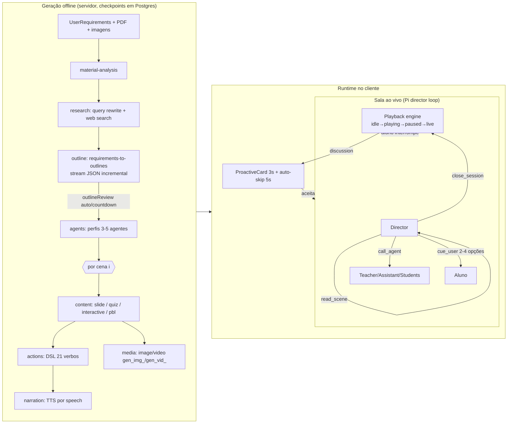

# OpenMAIC — pipeline de geração de aulas imersivas multi-agente (referência para o learnharness)

> Pesquisa de referência `ref-openmaic-pipeline` · data: 2026-11-18
> Fonte primária: clone somente-leitura em `_refs/OpenMAIC` (nenhum código executado) + paper MAIC (arXiv 2409.03512 / JCST'26) + SimClass (arXiv 2406.19226).
> Todos os caminhos abaixo são relativos a `_refs/OpenMAIC/`, salvo indicação.

---

## 0. TL;DR

- **O que é:** OpenMAIC (Open Multi-Agent Interactive Classroom, THU-MAIC / Tsinghua) gera, a partir de um tópico ou PDF, uma "aula" composta de **cenas** (`slide`, `quiz`, `interactive`, `pbl`). Cada cena tem **conteúdo** + uma **lista de ações** (DSL de 21 verbos: `speech`, `spotlight`, `wb_draw_*`, `discussion`, `widget_*`…) que um **playback engine** executa como uma "aula ao vivo" narrada. Em qualquer momento o aluno interrompe, e um **diretor multi-agente** (rodando em `@earendil-works/pi-agent-core` — o mesmo core do learnharness) escolhe qual agente (professor, assistente, colegas) responde.
- **Pipeline em duas etapas:** (1) requisitos → `SceneOutline[]` (+ `languageDirective`, `courseTitle`); (2) para cada outline: conteúdo → ações → narração (TTS) → mídia. Tudo via um seam `AICallFn = (system, user, images?) => Promise<string>` neutro de provedor.
- **Papéis:** Teacher (explica, sempre responde primeiro), Assistant (reformula/resume), 4 arquétipos de colegas (Class Clown, Inquisitive/Curious, Note Taker, Deep Thinker). Evidência: colegas aumentam o engajamento do aluno (SimClass: sem colegas, comprimento das mensagens do usuário cai 26,5% e ~47%) e engajamento em chat correlaciona com notas (MAIC: r ≈ 0,34 com quiz e prova final). **Mas:** alunos preferiram o "modo contínuo" (aula sem interrupções obrigatórias), reclamando de ter de responder após cada frase — exatamente o "padrão cansativo" que queremos evitar.
- **Avaliação (`eval/`):** LLM-as-judge (idioma do outline, "responde primeiro"), testes determinísticos de roteamento do diretor (primeiro `call_agent` deve ser o professor; aprovação ≥ 0,7 em 5 amostras), robustez a falhas de agentes-filho, scorer VLM de layout do quadro branco (5 dimensões 1–10), checagens geométricas de shapes SVG, juiz do planejador PBL e validação manual de ZPD. Não há estudo de aprendizagem no repo; os números de aprendizagem vêm dos papers.
- **Licença:** **MIT** (raiz, desde v0.3.0, 2026-06-28) — compatível com nosso fork AGPL-3.0 (manter o aviso de copyright). Exceção: `packages/mathml2omml` é **LGPL-3.0-or-later** (evitar/isolar). Pacotes `@openmaic/*` (dsl, generation, geometry, importer, renderer, storage) são MIT e publicados no npm.
- **O que reaproveitar:** o *contrato* (tipos `SceneOutline`/`Action`), os *prompts* de outline/ações/quiz (adaptados ao pt-BR), as regras de cadência (`outline-constraints.json`), o padrão **diretor + `call_agent` + `cue_user`/`close_session`** (portável quase 1:1 para nosso pi-agent-core), a **segurança de resposta em quiz** (nunca revelar antes do envio; feedback direcionado depois), o **protocolo de widgets** (postMessage + contrato de observação) e as **regras do quadro branco** (layout + geometria) — reimplementados com SVG desenhado à mão/cel-shading.

---

## 1. Escopo, versões e fontes

| Item | Valor |
|---|---|
| Repo | https://github.com/THU-MAIC/OpenMAIC — 43.878 stars, 6.755 forks, `pushed_at` 2026-11-18 (via `gh api repos/THU-MAIC/OpenMAIC`) |
| Licença | MIT (`LICENSE`, "Copyright (c) 2026 THU-MAIC"); relicenciado de AGPL para MIT em v0.3.0 (2026-06-28, ver timeline no `README.md`) |
| Release mais recente | v1.5.0-rc.3 (2026-11-17); v1.4.0 = PBL v3 (2026-11-04); v1.2.0 passou a exigir PostgreSQL 16 |
| Stack | Next.js 16, React 19, TypeScript 5, Tailwind 4, PostgreSQL 16, `@earendil-works/pi-agent-core`/`pi-ai` **0.80.3** (learnharness usa **1.4.0** — checar diferenças de API antes de portar) |
| Pacotes | `packages/@openmaic/generation` 0.3.32 (MIT), `dsl` 0.13.0, `geometry` 0.1.0, `importer` 0.3.1, `renderer` 0.2.2, `storage` 0.39.4 (todos MIT), `editor` 0.0.12 (sem campo `license` → cai na MIT da raiz), `packages/pptxgenjs` (MIT, terceiro), `packages/mathml2omml` (LGPL-3.0-or-later) |
| Paper principal | Yu et al., "From MOOC to MAIC: Reshaping Online Teaching and Learning through LLM-driven Agents", arXiv:2409.03512 (set/2024) → JCST 2026, DOI 10.1007/s11390-025-6000-0 — https://arxiv.org/abs/2409.03512 · https://jcst.ict.ac.cn/en/article/doi/10.1007/s11390-025-6000-0 |
| Paper companheiro | Zhang et al., "Simulating Classroom Education with LLM-Empowered Agents" (SimClass), arXiv:2406.19226 (v2 nov/2024) — https://arxiv.org/abs/2406.19226 |
| Estudo posterior | Hao et al., arXiv:2503.01694 (2025) — 312 graduandos, curso de 6 módulos em ambiente multi-agente; "alta interação ≠ aprendizagem produtiva"; conhecimento prévio molda o padrão de interação; ganhos comparáveis — https://arxiv.org/abs/2503.01694 |
| Notícia | Tsinghua: grupo ensinado por IA ligeiramente acima do controle humano em testes do curso; entrevistas com 20 alunos — https://www.tsinghua.edu.cn/en/info/1245/14044.htm |

---

## 2. Arquitetura em uma página



Camadas:
1. **Contrato** — `packages/@openmaic/dsl/src/{action.ts,stage.ts}`: `Stage`, `Scene`, `Action`, `QuizQuestion`, `GeneratedAgentConfig`.
2. **Geração pura** — `packages/@openmaic/generation/src/*` + `templates/*`: funções puras que recebem um `AICallFn`.
3. **Orquestração do run** — `lib/server/generation/run/{plan.ts,engine.ts,runner.ts,retry.ts}` e `lib/server/generation/steps/*`: máquina de estados, retries, concorrência, checkpoints.
4. **Runtime** — `lib/playback/*` (engine de reprodução), `lib/choreography/timing.ts` (constantes de tempo), `lib/chat/pi/*` (diretor multi-agente), `lib/orchestration/*` (registro de agentes, sumarizadores), `lib/quiz/*` + `app/api/quiz-grade/route.ts`.
5. **Skills** — `skills/**/SKILL.md` + `outline-constraints.json` (restrições verificáveis de mistura de cenas).
6. **Evals** — `eval/*`.

---

## 3. (a) Como a aula é gerada — passo a passo

### 3.1 Entrada

`packages/@openmaic/generation/src/outline-types.ts`:

```ts
interface UserRequirements {
  requirement: string;          // texto livre do usuário (tópico, objetivo, público)
  userNickname?: string; userBio?: string;   // perfil -> {{userProfile}}
  webSearch?: boolean;          // liga a etapa research
  interactiveMode?: boolean;    // usa o prompt "interactive-outlines" (interactive-first)
  taskEngineMode?: boolean;     // variante PBL/tarefas
}
// + pdfText (truncado em MAX_PDF_CONTENT_CHARS = 50_000), pdfImages (até MAX_VISION_IMAGES = 20)
```

Modelo: **`AICallFn = (systemPrompt, userPrompt, images?) => Promise<string>`** (`pipeline-types.ts`). Os "slots" de modelo são configurados por papel em `openmaic.yml` (`llm`, `course.outline`, `course.content`, `agent`, `image`, `video`, `tts`, `asr`, `webSearch`, `document`), com chaves `${VAR}`, `lock` e `allowUserKeys` — **nenhum modelo hard-coded** (regra explícita em `AGENTS.md`: "shared layers do not hard-code a specific model or service vendor"). O README recomenda um modelo rápido de contexto longo como padrão.

### 3.2 Máquina de estados do run

`lib/server/generation/run/plan.ts` + `engine.ts`:

- Passos de preparação: `material-analysis → research → outline → [await-outline-confirmation] → agents`.
- Passos por cena (ids estáveis): `scene:{i}:content`, `scene:{i}:actions`, `scene:{i}:narration`; mídia: `media:{elementId}`.
- `advanceRun` avança a partir do checkpoint; o run tem *lease* em Postgres (retomável após crash).
- **Retries:** primeira cena recebe os requisitos completos + 2 retries; cenas seguintes 5 retries.
- **Concorrência:** `lazyBoundedMap` gera *conteúdo* de cenas futuras em paralelo, mas *consome em ordem* (as ações da cena i precisam do contexto das falas anteriores).
- `outlineReview: "auto" | "countdown"` — o usuário pode revisar/editar o outline antes de gastar tokens no conteúdo (`changeOutlineType(outline, newType)` em `outline-type.ts` troca tipo com defaults: quiz 3 perguntas, `medium`, `single`).
- Agentes: gerados automaticamente (`lib/server/generation/steps/agent-profiles.ts`) com fallback para presets (`lib/orchestration/registry/built-in.ts`).

### 3.3 Etapa 1 — Outline (`requirements-to-outlines`)

Código: `outline-generator.ts` → `buildOutlinePrompt(requirements, context)` e `generateSceneOutlinesFromRequirements(requirements, pdfText, pdfImages, aiCall, options)`. Streaming no servidor: `lib/server/generation/steps/outline.ts` (`extractNewOutlines` = parser incremental de array JSON; eventos `languageDirective`, `courseTitle`, `outline`, `retry`; `MAX_STREAM_RETRIES = 2` + modelo de fallback; teto `MAX_OUTLINE_STREAM_BYTES = 512 KB`).

Prompts: `packages/@openmaic/generation/templates/requirements-to-outlines/{system.md,user.md}`. Regras-chave (parafraseadas):

| Tema | Regra |
|---|---|
| Idioma | Pedido explícito vence; idioma do requisito = idioma de ensino; **aprendizado de língua estrangeira → ensinar na língua nativa** (exceto níveis avançados C1/N1); idioma do PDF **não** sobrepõe (traduz/explica); pedidos por procuração ("para meu filho") usam o público-alvo. Saída: `languageDirective` (2–5 frases) reutilizado em todos os prompts seguintes. |
| Duração | Padrão 15–20 min (user.md diz 15–30), público geral, estilo interativo; cenas de 1–3 min (PBL 15–30); **1–2 cenas/min**. |
| Mistura | **quiz a cada 3–5 slides**; no máx. **1–2 `interactive`** e **≤ 1 `pbl`** por curso. |
| Visual | `keyPoints` podem marcar `[Chart]`/`[Table]` para o gerador de slide. |
| Widgets | Tabela de escolha: `simulation` (física/química), `diagram` (processos), `code` (programação), `game` (prática), `visualization3d` (modelos 3D), `procedural-skill` (habilidades procedimentais, só se permitido). |
| Saída | Objeto `{ languageDirective, courseTitle (≤30 chars), outlines: SceneOutline[] }` — "nunca array solto". |

Templating (`prompt` loader do pacote): Markdown com `{{snippet:x}}` → `{{#if cond}}…{{/if}}` → `{{var}}` (nessa ordem). Variáveis do user.md: `requirement`, `userProfile`, `pdfContent`, `availableImages`, `researchContext`, `teacherContext`, `hasSourceImages`.

Pós-processamento (`outline-generator.ts`): `parseJsonResponse` (robusto), atribui `order`/`id`, `uniquifyMediaElementIds`, e **`applyOutlineFallbacks`**: `interactive` sem widget → `slide`; `pbl` sem `pblConfig` → `slide`; `procedural-skill` → `diagram` se não permitido.

Estrutura de dados central:

```ts
interface SceneOutline {
  id: string; type: 'slide' | 'quiz' | 'interactive' | 'pbl';
  title: string; description: string;      // propósito didático
  keyPoints: string[];                      // 3-ish pontos; podem conter [Chart]/[Table]
  design?: string; teachingObjective?: string; estimatedDuration?: number; order: number;
  languageNote?: string; suggestedImageIds?: string[];
  mediaGenerations?: { type: 'image'|'video'; prompt: string; elementId: string; aspectRatio?: string; style?: string }[];
  quizConfig?: { questionCount: number; difficulty: 'easy'|'medium'|'hard'; questionTypes: ('single'|'multiple'|'text')[] };
  pblConfig?: { projectTopic; projectDescription; targetSkills /* ≤6 */; issueCount?; scenarioRoleplay?; scenarioBrief? };
  widgetType?: 'simulation'|'diagram'|'code'|'game'|'visualization3d'|'procedural-skill';
  widgetOutline?: WidgetOutline;  // concept, keyVariables, designIdea, diagramType, objects, interactions, steps, successCriteria, ...
}
```

**Restrições de skill verificáveis** — `skills/agent-runtime/*/outline-constraints.json` (lecture-style, deep-interactive, workshop-style, vocational, deep-research, pptx-import, pro-editing, style-clone, teacher-style-clone). Campos: `allowedTypes`, `firstSceneType`, `typeMix{type:{min,max,minRatio}}`, `allowedWidgetTypes`, `requiredWidgetOutlineFields`, `noConsecutiveSameWidgetType`. São **renderizadas no prompt do outline e validadas depois** com diagnósticos (`lib/server/agent-runtime/skills.ts`, ~linhas 760–880). Exemplos:
- *lecture-style*: `slide` minRatio 0,65; quiz 1–3; interactive ≤ 2; primeira cena `slide`.
- *deep-interactive*: `interactive` minRatio 0,6; `noConsecutiveSameWidgetType`.
- *workshop-style*: interactive min 3 e minRatio 0,4; quiz min 2.

Variante *interactive-first* (`lib/prompts/templates/interactive-outlines/system.md`): abrir com slides, widgets no meio, slides de transição, fechar com slides; ~10 cenas → 2 simulações, 1–2 jogos, 1 diagrama.

### 3.4 Etapa 2a — Conteúdo por tipo (`scene-generator.ts`, 2.102 linhas)

`generateSceneContent(outline, aiCall, options)` roteia por tipo:

| Tipo | Função / prompt | Validações e pós-processamento |
|---|---|---|
| `slide` | `generateSlideContent` · `templates/slide-content/system.md` (939 linhas) | Princípio: **"slides são apoio visual, não roteiro"** (a fala carrega a elaboração). Canvas 1000×562,5, margens 50; tabela de altura de texto por fonte (ex.: 18 px → 49/76/103/130/157 px p/ 1–5 linhas); largura: `chars ≤ (width−20)/fontSize`, ≤ 75% de ocupação; checklist P0/P1 antes da saída. Pós: `fixElementDefaults` (via `normalizeElement` da DSL + `shapeToTextFallback`), KaTeX para LaTeX, `resolveImageIds` (`img_N`), placeholders de mídia `gen_img_*`/`gen_vid_*`, ids `${type}_${nanoid(8)}`. Suporta **EDIT MODE** (`editDirective` + `baselineContent`). |
| `quiz` | `generateQuizContent` · `templates/quiz-content` | Perguntas `single`/`multiple`/`short_answer` (com `commentPrompt` = rubrica), `analysis`, `points`; opções com `value` A–Z; sem LaTeX. `normalizeQuizOptions`, `normalizeQuizAnswer` (alinhamento exato com chaves), `findQuizOptionsContractFailure`. |
| `interactive` | `generateWidgetContent` · prompt por widget (`templates/simulation-content/system.md` etc.) | HTML autocontido; `extractHtml`; `findInteractiveScriptSyntaxFailure`; `extractWidgetConfig` de `<script type="application/json" id="widget-config">` (variáveis/presets); `postProcessInteractiveHtml`. **Listener postMessage obrigatório.** |
| `pbl` | `generatePBLV2ProjectSingleCall` (+ `pblLoopFallback`) | Projeto com issues/papéis; juiz próprio em `eval/pbl-v2-planner`. |

`extractInteractiveElements(html)` produz um **inventário de seletores** (ids ≤ 60, `data-step-id`/`data-action` ≤ 30, classes semânticas ≤ 30, filtrando utilitários Tailwind) que alimenta o prompt de ações — o LLM só aponta para alvos que existem.

### 3.5 Etapa 2b — Ações (a "coreografia")

`generateSceneActions(outline, content, aiCall, { ctx, agents, userProfile, languageDirective })` com prompts `templates/{slide,quiz,interactive,pbl}-actions/`.

**Formato de saída do LLM** — array JSON intercalando fala e ação:

```json
[
  {"type":"action","name":"spotlight","params":{"elementId":"text_ab12cd34"}},
  {"type":"text","content":"Repare neste termo: ..."},
  {"type":"action","name":"wb_draw_latex","params":{"latex":"V = R I","x":80,"y":120}},
  {"type":"text","content":"Ou seja, a tensão ..."},
  {"type":"action","name":"discussion","params":{"topic":"...","prompt":"...","agentId":"default-4"}}
]
```

Parser: `action-parser.ts` → `parseActionsFromStructuredOutput(response, sceneType, allowedActions, logger)`: remove cercas de código → `JSON.parse` → `jsonrepair` → `partial-json`; `text` vira `speech`; **`discussion` é truncado para ser o último item**; remove ações *slide-only* (`spotlight`, `laser`) fora de slides; aplica whitelist `allowedActions`. Depois `processActions` valida `elementId` do spotlight (fallback: primeiro elemento) e `agentId` da discussão (fallback: estudante aleatório); `lib/server/generation/steps/scene-actions.ts` descarta tipos desconhecidos. Há ações de fallback padrão (texto em chinês — trocar).

**Regras do prompt `slide-actions/system.md`** (as mais úteis para didática):
- `spotlight` **antes** da frase que fala do elemento; `laser` é mais leve; `play_video` é síncrono.
- **"Single voice, teacher only"**: nada de diálogo roteirizado de alunos nem rubricas de cena; slides concisos, fala elabora.
- `discussion` (topic, prompt, agentId de um *student*) **deve ser a última ação**, e **no máximo 1–2 por curso; a maioria das páginas não tem nenhuma**.
- Continuidade de sessão (de `buildCourseContext` em `prompt-formatters.ts`): outline com "← current", posição (primeira/meio/última), últimos 150 chars da fala anterior, e as proibições "não cumprimente de novo após a primeira página" / "nunca diga 'na última aula'".
- 5–10 itens por cena.
- Snippet `packages/@openmaic/generation/snippets/speech-tts-readability.md`: nada de LaTeX na fala; verbalizar fórmulas e operadores.

**`quiz-actions`**: 1–2 falas apenas, **sem revelar/antecipar/ensinar a resposta**; a conversa pós-quiz é tratada à parte. **`interactive-actions`**: `widget_*` usando seletores do inventário; diagrama percorrido com `widget_reveal #node-{id}` seguindo `revealOrder`; 3–8 itens. **`pbl-actions`**: 1–2 falas de introdução ancoradas no `projectSummary`.

**DSL de ações** (`packages/@openmaic/dsl/src/action.ts`, 21 tipos):

| Categoria | Ações | Semântica |
|---|---|---|
| Fire-and-forget (slide-only) | `spotlight{elementId, dimOpacity?}`, `laser{elementId, color?}` | efeito visual; auto-limpa em `EFFECT_AUTO_CLEAR_MS = 5000` |
| Fala/mídia (síncronas) | `speech{text, audioId?, voice?, speed?}`, `play_video{elementId}` | aguarda TTS/vídeo |
| Quadro branco (síncronas) | `wb_open`, `wb_draw_text`, `wb_draw_shape{rectangle|circle|triangle}`, `wb_draw_chart{bar…scatter}`, `wb_draw_latex`, `wb_draw_table{data:string[][]}`, `wb_draw_line{startX..endY, style, points:['','arrow']}`, `wb_draw_code`, `wb_edit_code{insert_after|insert_before|delete_lines|replace_lines}`, `wb_clear`, `wb_delete{elementId}`, `wb_close` | coordenadas 0–1000 × 0–562 |
| Interação social | `discussion{topic, prompt?, agentId?}` | abre ProactiveCard |
| Widget (síncronas) | `widget_highlight{target}`, `widget_setState{state}`, `widget_annotation{target, content}`, `widget_reveal{target}` | postMessage para o iframe |

### 3.6 Etapa 2c — Narração, mídia e montagem

- Narração: cada `speech` vira um clipe TTS (`audioId`); a voz de cada agente vem de `voiceConfig`/`voiceDesign {identity, gender, texture, delivery}`.
- Sem TTS, o tempo de leitura é estimado deterministicamente (`lib/choreography/timing.ts → estimateSpeechDurationMs`): **240 ms/palavra (~250 WPM)** para texto não-CJK, 150 ms/char para CJK, mínimo 2.000 ms, dividido pela velocidade.
- Mídia: `MediaGenerationRequest` gera imagens/vídeos para placeholders `gen_img_*`/`gen_vid_*` em paralelo.
- `scene-builder.ts → buildCompleteScene(outline, content, actions, stageId, {sceneId})` monta a `Scene` (viewport 1000, ratio 0,5625, tema padrão).

### 3.7 Perfis de agentes gerados (`lib/server/generation/steps/agent-profiles.ts`)

Prompt pede **3–5 agentes, exatamente 1 teacher**; prioridades teacher 10 / assistant 7 / students 4–6; persona de 2–3 frases; avatar; cor de uma paleta; `voiceDesign`. Validação: ≥ 2 agentes e exatamente 1 teacher, senão fallback para presets.

```ts
interface GeneratedAgentConfig { id; name; role: 'teacher'|'assistant'|'student'; persona; avatar; color; priority; voiceConfig?; voiceDesign? }
interface MultiAgentConfig { enabled: boolean; agentIds: string[]; directorPrompt?: string }
```

---

## 4. Runtime: reprodução + sala ao vivo

### 4.1 Playback engine (`lib/playback/engine.ts`, `types.ts`)

- Modos: `idle → playing → paused → live`.
- Callbacks: `onProactiveShow`, `onDiscussionConfirmed`, `onUserInterrupt`, `onProgress({sceneIndex, actionIndex, consumedDiscussions})`.
- **Interrupção do usuário** (`handleUserInterrupt`): salva o cursor em `actionIndex − 1` (ao voltar, repete a frase interrompida) e entra em `live`.
- **`discussion`**: após `DISCUSSION_TRIGGER_DELAY_MS = 3000` mostra um **ProactiveCard** (convite de um colega: "quer discutir X?"); em playback ele conta `DISCUSSION_AUTO_SKIP_MS = 5000` e **pula sozinho** se o aluno não aceitar; se o agente da discussão não estiver selecionado, pula.
- Tempos de animação (fonte única p/ app e exportador de vídeo): `WB_OPEN_MS 2000`, `WB_DRAW_MS 800`, `WB_EDIT_MS 600`, `WB_DELETE_MS 300`, `WB_CLOSE_MS 700`, `WIDGET_MS 300`, `wbDrawCodeMs = min(800 + 50·linhas, 3000)`, `wbClearMs = min(380 + 55·elementos, 1400)`.

### 4.2 Diretor multi-agente (Pi) — `lib/chat/pi/*`

`director-loop.ts → runPiDirectorLoop(opts)` cria um `Agent` do pi-agent-core com `streamFn`, `systemPrompt`, tools, `allowedToolNames`, histórico (`toHistoryMessages`, máx. 12), `transformContext` (compaction + *tail state* do quadro), `afterToolCall` que **termina o loop** quando `userCued` ou `sessionClosed`. Emite `done` com `directorState {turnCount, agentResponses, whiteboardLedger}`. Se houve conteúdo mas nenhuma tool terminal, faz `cue_user` automático.

Tools (`lib/chat/pi/tools/`, schemas typebox):
- `read_scene{sceneId}` — carrega evidência da cena (anexada uma vez ao próximo `call_agent`; "nunca adivinhe conteúdo pelo título").
- `call_agent{agentId, instruction}` — roda um agente-filho com seu próprio `buildAgent`, parser estruturado e validação de ações (`call-agent.ts`, `child-runtime.ts`).
- `cue_user{prompt, options?: 2–4 strings ≤ 60 chars}` — devolve a vez ao aluno; a opção escolhida volta como mensagem normal.
- `close_session{endReason: user_goodbye|user_done|back_to_lesson|lesson_complete}` — fecha só a sessão de Q&A/discussão e retoma a aula.
- Ferramentas nativas: `native-spotlight.ts`, `native-whiteboard.ts`, `web-search.ts`.

**Regras de roteamento** (`prompts.ts → buildDirectorPrompt`, parafraseadas):
1. O professor normalmente fala primeiro (em modo discussão, o colega que iniciou fala primeiro e o professor guia).
2. Não repetir o mesmo agente no loop; 3. não chamar dois do mesmo papel em sequência.
4. Não pedir para outro agente re-explicar — pedir pergunta, desafio, exemplo ou resumo.
5–6. **Estudante nunca dá a primeira explicação substantiva**; conceito/mecanismo → professor (ou assistente se o professor indisponível).
7. Nenhum agente imita outro. 8. Terminar com exatamente uma tool terminal quando a resposta basta. 9. Instruções curtas ao filho (nada de "aula completa"). 10. Falhas/timeouts → decidir entre retry, outro agente ou `cue_user`.
- Preferir **1–2 agentes por turno**. "Entendi/valeu" → `close_session(user_done)`; "volta pra aula" → `back_to_lesson`. Antes de fechar, um agente deve dizer uma frase curta de encerramento.

**Prompt do agente-filho** (`buildChildPrompt`/`buildNativeChildPrompt`): persona, diretriz de papel (`buildRoleGuideline`), **teto de fala por papel** (`buildLengthGuidelines`: teacher ~70 caracteres chineses ou 1–2 frases curtas; assistant ~60; student ~40 / 1 frase), sem markdown, **começar pela resposta direta**, no máximo 1 pergunta de acompanhamento, contexto dos pares (`lib/orchestration/summarizers/peer-context.ts → buildPeerContextSection`: "não repita cumprimentos… acrescente valor NOVO"). Regras de "Smart Visual Teaching" para o quadro: canvas 1000×563, área útil x 40..960 / y 40..523, **"desenhar não é o objetivo; entender melhor é"**, em slide preferir `spotlight` a redesenhar; few-shots. `sanitizeVisibleSpeech` limpa a fala visível.

**Contexto de quiz** (`lib/orchestration/summarizers/state-context.ts`): quiz **não enviado** → regras estritas (não recitar nem revelar; uma única pergunta socrática permitida); quiz **enviado** → resposta do aluno, gabarito, veredito, análise, comentário do corretor IA e "não re-ensine o que ele já acertou".

### 4.3 Agentes padrão (`lib/orchestration/registry/built-in.ts → getDefaultAgents()`)

| id | Nome original | Papel | Prioridade | Comportamento |
|---|---|---|---|---|
| default-1 | AI teacher | teacher | 10 | passo a passo, analogias, checa entendimento, adapta o ritmo; "nunca anuncie suas ações; apenas ensine"; ações SLIDE + WHITEBOARD |
| default-2 | 助教 (assistente) | assistant | 7 | reformula mais simples, exemplos, resumos |
| default-3 | 显眼包 (class clown) | student | 4 | piadas, one-liners CURTOS, reanima a atenção |
| default-4 | 好奇宝宝 (curioso) | student | 5 | pergunta por quê/como, casos-limite |
| default-5 | 笔记员 (anotador) | student | 5 | resumos estruturados no quadro |
| default-6 | 思考者 (pensador) | student | 6 | advogado do diabo, conexões |

### 4.4 Quiz e correção

- `lib/quiz/grading.ts`: correção local de `single`/`multiple` por resolução exata do gabarito.
- `app/api/quiz-grade/route.ts`: `short_answer` corrigido por LLM com a rubrica `commentPrompt` → JSON `{score 0..points, comment}`; **fallback de 50% do crédito** se o LLM falhar.

### 4.5 Widgets interativos

- Iframe com HTML gerado; protocolo `postMessage`: `SET_WIDGET_STATE`, `HIGHLIGHT_ELEMENT`, `ANNOTATE_ELEMENT`, reveal.
- Config em `<script type="application/json" id="widget-config">` (variáveis, presets).
- **Contrato de observação** (`packages/@openmaic/generation/snippets/interactive-observation.md`): `#experiment` + `<script type="application/json" data-maic-observation>` com `{summary, state, rendered}` (≤ 32.768 bytes), atualizado por um helper `publishState(observation)` — permite ao professor "ver" o estado do experimento do aluno (`lib/chat/pi/interactive-state-evidence.ts`).

### 4.6 Skills de pedagogia (texto Markdown reaproveitável)

- `skills/classroom/classroom-explanation/SKILL.md`: comece com resposta curta e substantiva; quadro = um bloco e depois sua explicação falada; setas rotuladas; spotlight logo antes da frase; não adicionar quiz a menos que ajude.
- `skills/agent-runtime/zone-of-proximal-development/SKILL.md` (v0.2.0-experimental): **tentativa independente primeiro** → ajuda direcionada (tabela por tipo de erro) → retirada do suporte → nova tarefa independente → registro mínimo de aprendizagem; um único "ajudante principal" por vez; respostas de pares IA são material de ensino, não desempenho do aluno.
- `feynman-learning`: o aluno explica primeiro, corrige-se a menor lacuna, socrático, tirar jargão, transferência.
- `spiral-curriculum`: revisitar ≠ revisar; tabela de dimensões de "upgrade" (complexidade, abstração, densidade de relações, representação, distância de transferência, fronteiras/contraexemplos). **Muito alinhado ao nosso grafo até nível PhD.**
- Outras: `understanding-by-design`, `learning-to-learn`, `curriculum-planner`, `fact-check`, `deep-research`, `social-emotional-learning`, `teacher-style-clone`, `vocational`, etc. (24 no total em `skills/agent-runtime`).

---

## 5. (b) Papéis dos agentes e efeito no engajamento — evidências

### 5.1 Modelo conceitual (paper MAIC, §3)

- Paradigma **"N agentes para 1 aluno"** (vs. MOOC "1 vídeo para N alunos"). Custo de preparo (Fig. 1): MOOC ~US$ 25.000 e ~60 h por curso vs MAIC < US$ 2 e ~30 min.
- **Preparo (Read → Plan):** extração multimodal de slides (GPT-4V) → descrição por página → árvore de conhecimento; *Function Generation* produz ações de ensino `T = (type, value)` com tipos `ShowFile`, `ReadScript` (o mais crucial) e `AskQuestion`; roteiros revisados por instrutores humanos; agentes customizáveis (voz, estilo, RAG de material extra).
- **Papéis:** Teacher (ensina, responde), Assistant (mantém a ordem, evita desvios, suporte), Classmates (iniciam ideias e discussões), Analyzer (analisa desempenho), Manager (controla a aula, oculto).
- **Comportamentos de sala** (Schwanke, 1981): Teaching & Initiation (TI), In-depth Discussion (ID), Emotional Companionship (EC), Classroom Management (CM). Colegas cobrem combinações: Class Clown (TI, EC, CM), Deep Thinker (TI, ID), Note Taker (TI, CM), Inquisitive Mind (TI, EC).
- **Session Controller** = *Class State Receptor* (estado `S_t = {P_t materiais já cobertos, H_t histórico, papéis}`) + *Manager Agent* (meta-agente oculto, inspirado em AutoGen/MathVC) que mapeia `S_t → (agente, função)`; após cada ação espera uma janela τ; a fala do usuário ou o fim de τ dispara nova decisão. No OpenMAIC atual isso virou o **Pi director** (seção 4.2), com `cue_user` explícito em vez de janela τ.

### 5.2 Resultados quantitativos (MAIC)

| Medida | Resultado |
|---|---|
| Qualidade do roteiro (Likert 1–5, 3 anotadores/slide) | MAIC-FuncGen **4,00** geral (Tone 4,00; Clarity 4,25; Supportive 3,57; Matching 4,18) vs Humano 3,86, SCP 3,90, S2T 3,67. **Sem visual 3,61; sem contexto (páginas anteriores) 3,84** → visão do slide e continuidade importam. |
| Manager Agent | 500 decisões reais anotadas por especialistas; precisão "abaixo do ótimo"; **remover descrições de papel reduz a precisão** (números só em gráfico, Fig. 4). Ainda assim, notas dos usuários não caíram significativamente na ablação. |
| Escala do estudo | > 500 alunos, > 100.000 registros, 2 cursos (TAGI, HSU), > 3 meses, ética THU-04-2024-56 |
| Pesquisa CoI pós-curso (1–5) | Objetivos claros 4,12 (DP 0,66); encoraja exploração 4,03 (DP 0,73); **"entende meus pontos fortes/fracos" 3,51 (DP 0,94) = o mais baixo** → falta personalização (mesmo roteiro p/ todos). |
| Comportamento | **~61%** das ações dos alunos = perguntar/buscar informação; **~11%** = gerenciar a aula ("volta o slide", "explica mais simples"). |
| **Modo preferido** | **"Modo contínuo"** (agentes dão a aula sem exigir resposta). Queixa citada: no modo interativo era preciso responder após cada frase do professor, e às vezes a IA ignorava a resposta. Alunos pausavam e reliam o slide em vez de perguntar. |
| Testes | Módulos: 53,3% (Mód. 2, DP 18,9) a 82,4% (Mód. 4, DP 16,3); presença 76,3% (módulos) / 73,3% (final). Aluno: o pós-teste foi o "pico de absorção". |
| Engajamento × nota (Tabela 2, normalizado) | Sem controle: log(nº msgs) × média quiz 0,341***, × prova final 0,346***; log(tam. msg) × quiz 0,202*, × final 0,333**. **Controlando nota do Módulo 1:** 0,206** / 0,174 (n.s.) / 0,177** / 0,235*. |
| Aceitação de tecnologia | N = 111, t = 3,05, p = 0,002 (Hábito t = 2,81; Expectativa de esforço t = 3,98, p < 0,001; Condições facilitadoras t = 3,22) |
| Pensamento de ordem superior (auto-relato) | abstrato t = 2,32, p = 0,02; crítico t = 2,37, p = 0,02 — mas alunos relataram falta de discussão profunda e ensino "mecânico". |

### 5.3 SimClass (arXiv 2406.19226)

- > 400 recrutados, 118 completaram todos os capítulos (77 TAGI, 41 HSU); ablação com 48 alunos (só capítulo 1, GPT-4V; sistema online usava GLM-4).
- **Ablação de colegas** — comprimento médio da mensagem do usuário: TAGI 18,9 → **13,9 sem colegas (−26,5%)**; HSU 15,5 → **8,2 (≈ −47%)**. Sem interação nenhuma, as três presenças do CoI (cognitiva, social, de ensino) caem; **colegas melhoram presença cognitiva e social**.
- FIAS: a fala do professor domina (TT 0,816–0,863 vs especialista humano 0,771); a razão de perguntas indiretas (IDR 0,058–0,124) é muito menor que a de professores humanos (0,885–1,473) → **a IA pergunta/encoraja pouco de forma indireta e fala demais**.
- Correlações nota × log(tamanho)/log(nº de mensagens): r ≈ 0,335, p < 0,001 (correlacional).

### 5.4 Leitura crítica (para nossas decisões)

- Evidência **correlacional** e de **auto-relato**; sem RCT controlando dose de interação; cursos em chinês, alunos de elite; GLM-4/GPT-4V de 2024. Hao et al. (2025) reforçam que **mais interação não é automaticamente melhor** — a qualidade e o encaixe com o conhecimento prévio importam.
- O que é robusto o suficiente para guiar design: (1) **visão + continuidade** melhoram o roteiro; (2) **colegas aumentam a participação** do aluno; (3) **interação forçada a cada frase cansa** — alunos fogem para o modo passivo; (4) feedback personalizado é o ponto fraco; (5) teste pós-aula é o momento de maior consolidação.

---

## 6. (c) Como avaliam — `eval/`

| Suite | Arquivos-chave | Método | Métrica / limiar |
|---|---|---|---|
| Roteamento do diretor | `eval/orchestration/answering-runner.ts` | Cenários sintéticos (com/sem frustração, deriva de tópico); roda o loop Pi real | **1º `call_agent` registrado deve ser o teacher**; `correctRate ≥ EVAL_PASS_THRESHOLD` (padrão **0,7**), `EVAL_SAMPLES` padrão **5** |
| Conteúdo da resposta | `eval/orchestration/answer-content-judge.ts` | LLM-as-judge | `leads_with_answer`, `answered_anywhere`; categorias: `opening-lecture-override`, `ignored-format-request`, `ignored-capability-request`, `ignored-navigation-request`, `ignored-correction`, `frustration-reask`, `adjacent-pivot`, `vague-clarify`, `control-should-pass` |
| Robustez a falhas | `eval/orchestration/child-failure.md` | Injeção: erro, timeout, vazio, erro do professor, erro professor+aluno, parcial | Tetos: 10 delegações, 30 chamadas de provedor, 120 s |
| Idioma do outline | `eval/outline-language/` | LLM judge tolerante comparando `languageDirective` com ground truth | casos tipo `zh_pure_general`, `zh_tech_pygame`… |
| Layout do quadro | `eval/whiteboard-layout/scorer.ts` | **VLM** pontua screenshot renderizado | readability, overlap, rendering_correctness, content_completeness, layout_logic, overall (1–10); cenários `math-quadratic-inequality`, `physics-force-decomposition`… |
| Shapes do quadro | `eval/whiteboard-shapes/` | Determinístico | geometria de path SVG + `viewBox` |
| Planejador PBL v2 | `eval/pbl-v2-planner/` | LLM judge | projectNotLecture, taskEvaluability, typeFit, granularity, coherence (1–5); eixos A (convergente / aberto-avaliável / aberto-reflexivo) e B (artefato / argumento / performance) |
| ZPD | `eval/zone-of-proximal-development/{README,LOCAL_VALIDATION}.md` | Validação manual local (2026-09-05, modelo deepseek-v4-flash, skill v0.2.0-experimental, 133 testes passando) | **sem estudo com alunos reais** |
| Sandbox | `eval/sandbox-lifecycle/`, `eval/shared/` | infra comum | — |

Observação: não há eval de "fadiga"/ritmo nem de aprendizagem real no repo — isso teremos de criar.

---

## 7. (d) O que reutilizar no learnharness para aulas por nó **não cansativas**

### 7.1 Mapeamento de conceitos

| OpenMAIC | learnharness (proposta) |
|---|---|
| `Stage` (curso) | **Aula de um nó** do grafo (`NodeLesson`), dentro da sessão do domínio (Eletrônica/Inglês) |
| `UserRequirements.requirement` | nó (título, descrição, pré-requisitos já dominados, nível-alvo, objetivos) + modelo do aluno (maestria, erros recentes) |
| PDF / web search | capítulos de livro + transcrições de YouTube PT/EN vinculados ao nó (citação de fonte) |
| `SceneOutline[]` | 4–8 "cenas" do nó (6–12 min) |
| Slide PPTist | **cartão cel-shading** (SVG desenhado à mão) — sem editor PPT |
| Whiteboard `wb_*` | **quadro SVG "rough"** com as mesmas ações/coords 1000×562 |
| Pi director + `call_agent` | mesmo padrão em nosso pi-agent-core 1.4.0 (validar API vs 0.80.3) |
| Quiz scene | micro-checagens inline + 1 quiz curto ao final → alimenta flashcards/FSRS (Anki/Obsidian) |
| `openmaic.yml` slots | "papéis de modelo" configuráveis (outline, content, live-agent, judge) sobre a assinatura ChatGPT/Anthropic do usuário |

### 7.2 Tipos propostos (TypeScript, derivados da DSL MIT)

```ts
// lib/lesson/types.ts (novo) — subconjunto da DSL OpenMAIC adaptado
type LessonSceneType = 'explain' | 'check' | 'interactive' | 'recap';
interface LessonSceneOutline {
  id: string; type: LessonSceneType; title: string;
  purpose: string;            // = description
  keyPoints: string[];        // ≤ 3; [Chart]/[Table]/[Diagram] markers
  reasoningStep?: string;     // o passo de raciocínio único (docs/teaching-methodology.md §5)
  estimatedSeconds: number;   // 60–180
  checkConfig?: { count: 1 | 2; kind: 'single' | 'multiple' | 'short' };
  widget?: { type: 'simulation' | 'diagram' | 'code'; outline: Record<string, unknown> };
  sources?: { kind: 'book' | 'youtube' | 'web'; ref: string }[];
}
type LessonAction =
  | { type: 'speech'; text: string }
  | { type: 'spotlight'; elementId: string }
  | { type: 'wb_draw'; shape: 'text'|'latex'|'arrow'|'box'|'circuit'|'table'; /* x,y 0..1000/0..562 */ }
  | { type: 'wb_clear' } | { type: 'wb_delete'; elementId: string }
  | { type: 'check'; questionId: string }                 // micro-check inline (ver 7.4)
  | { type: 'discussion'; agentId: string; topic: string } // ≤ 1 por aula, sempre a última ação da cena
  | { type: 'widget_setState' | 'widget_reveal' | 'widget_highlight'; target?: string; state?: unknown };
type AICallFn = (system: string, user: string, images?: string[]) => Promise<string>; // wrapper sobre pi-ai
```

### 7.3 Pipeline por nó (implementável)

1. **Probe/plan** (já existe no learnharness: `docs/teaching-methodology.md` §10) → define o *minimal tree* do nó.
2. **Outline** (`requirements-to-outlines` adaptado): saída `{languageDirective, lessonTitle, outlines}`; aplicar **`outline-constraints`** próprios (seção 7.4) e validar com diagnóstico; fallback de tipos como `applyOutlineFallbacks`. Streaming incremental (copiar a ideia de `extractNewOutlines`) para mostrar o mapa do nó em < 5 s.
3. **Conteúdo por cena**, em paralelo limitado e consumo em ordem (`lazyBoundedMap`), primeira cena com mais contexto/retries.
4. **Ações** com o prompt `slide-actions` adaptado (voz única do professor; spotlight antes da frase; 5–10 itens; continuidade via `buildCourseContext`; sem LaTeX na fala).
5. **Narração opcional** (TTS) ou leitura com `estimateSpeechDurationMs` (240 ms/palavra) para auto-avanço.
6. **Cache por nó + versão** (gerar uma vez, reusar; regenerar só cenas editadas — EDIT MODE).
7. **Extração de flashcards** ao final (keyPoints + checks errados → cartões Anki/Obsidian).

### 7.4 Regras de cadência "não cansativo" (proposta de `outline-constraints` do learnharness)

```json
{
  "allowedTypes": ["explain", "check", "interactive", "recap"],
  "firstSceneType": "explain",
  "lastSceneType": "recap",
  "typeMix": {
    "explain": { "minRatio": 0.5 },
    "check": { "max": 3 },
    "interactive": { "max": 1 },
    "recap": { "min": 1, "max": 1 }
  },
  "noConsecutive": ["check"],
  "maxSceneSeconds": 180,
  "maxSpeechWordsPerScene": 220,
  "maxDiscussionsPerLesson": 1,
  "maxForcedInteractionsPer3Min": 1
}
```

Princípios (com a evidência que os sustenta):
- **Modo contínuo por padrão** com interrupção a qualquer momento (MAIC: alunos preferem contínuo; queixa do "responder após cada frase"). Interação obrigatória só nos limites de cena, nunca no meio de uma fala.
- **Check leve, não "despejo de perguntas":** em vez de bloco de 5 questões, cada passo de raciocínio fecha com **um `cue_user` de 2–4 opções ≤ 60 chars** (resposta em 1 clique) — preserva a decisão "um check por passo" do `teaching-methodology.md` §9 com custo mínimo. Questão aberta (`short`) só no `recap`.
- **Spotlight + fala curta > texto na tela:** slides/cartões com ≤ 3 keyPoints; a fala elabora (regra "slides are visual aids").
- **Quiz answer-safety:** antes do envio, nenhum agente revela/antecipa; depois, feedback **somente sobre o que errou** (copiar `lib/orchestration/summarizers/state-context.ts`).
- **Discussão rara e opcional:** ≤ 1 por aula, como `ProactiveCard` com "Entrar / Pular" e auto-skip em 5 s (`DISCUSSION_AUTO_SKIP_MS`).
- **Retomada sem perda:** interrupção salva cursor `actionIndex − 1` e ao voltar repete a frase.
- **ZPD + Feynman como modos de reparo**, não como padrão: quando o check falha → ajuda direcionada → nova tentativa independente.
- **Espiral para o grafo até PhD:** nós revisitados sobem uma dimensão (abstração, transferência, contraexemplo) em vez de repetir (skill `spiral-curriculum`).

### 7.5 Colegas virtuais — configuração recomendada

- **Padrão: professor + no máximo 1–2 colegas** (o paper mostra ganho de participação com colegas, mas a FIAS mostra excesso de fala da IA). Sugestão: *Curioso* (faz a pergunta que o aluno não fez — útil antes de um passo difícil) e *Anotador* (resume no quadro, 1×/aula). *Palhaço* só como opção (para Inglês conversacional pode ser bom).
- Tetos de fala por papel (adaptar de 70/60/40 caracteres chineses para pt-BR): professor ≤ 2 frases curtas (~35 palavras) no modo ao vivo; assistente ≤ 2 frases; colega ≤ 1 frase (~15 palavras).
- Regras do diretor a copiar: professor responde primeiro; estudante nunca dá a primeira explicação; sem papel repetido em sequência; 1–2 agentes por turno; `peer-context` para não repetir.
- Personas em pt-BR com nomes neutros e voz distinta; nunca roteirizar diálogo de alunos dentro da fala do professor ("single voice").

### 7.6 Quadro branco desenhado à mão (cel-shading)

- Reusar **a semântica `wb_*` e as coordenadas 1000×562** e as regras de "Smart Visual Teaching" (área útil 40..960 × 40..523; um bloco, depois sua explicação; setas rotuladas; "desenhar não é o objetivo").
- Renderizar com SVG "rough"/traço irregular + preenchimento chapado de 2–3 tons (cel-shading). Para Eletrônica, adicionar uma primitiva `circuit` (resistor, fonte, nó, terra) — **não existe no OpenMAIC**.
- Copiar as **checagens geométricas** (`eval/whiteboard-shapes`) e o **scorer VLM** (`eval/whiteboard-layout/scorer.ts`) como testes do nosso renderizador.
- Tempos de animação de `lib/choreography/timing.ts` são bons pontos de partida (800 ms por desenho, 2 s de abertura).

### 7.7 Widgets interativos

- Usar o **contrato de observação** (`data-maic-observation` com `{summary, state, rendered}` ≤ 32 KB) para o tutor "ver" o que o aluno fez num simulador de circuito ou num exercício de pronúncia/ordem de palavras.
- Exigir `widget-config` JSON + listener `postMessage` + inventário de seletores (`extractInteractiveElements`) para que as ações `widget_*` só apontem para alvos existentes.
- Rodar HTML gerado em iframe **sandbox** sem rede (no Electron, partição isolada).

### 7.8 Evals a replicar (adaptados)

1. **Roteamento**: em perguntas substantivas o 1º `call_agent` é o professor (≥ 0,7 em 5 amostras).
2. **Answer-first judge**: `leads_with_answer` em pt-BR, incluindo "aluno frustrado re-pergunta" e "pedido de formato ignorado".
3. **Idioma**: Inglês como domínio → ensinar em pt-BR até nível avançado (regra de língua estrangeira do OpenMAIC), depois migrar para EN.
4. **Layout do quadro**: VLM 1–10 + geometria determinística.
5. **Novo — "fadiga"**: palavras de fala por minuto, nº de interações forçadas por 3 min, % de cenas com > 3 keyPoints, tempo até o primeiro conteúdo; limiar em CI.
6. **Novo — answer-safety**: nenhuma fala pré-envio contém a opção correta (checagem determinística + juiz).

### 7.9 O que **não** copiar

- Dependência de PostgreSQL 16 / lease de run (usar o armazenamento local do learnharness).
- Editor/export PPTX/MP4, `mathml2omml` (LGPL), PBL v2/v3 (pesado; avaliar só depois).
- O prompt `slide-content` de 939 linhas (caro; nosso cartão é mais simples).
- Defaults/fallbacks em chinês (ações padrão, personas, few-shots) — reescrever em pt-BR/EN.
- "AskQuestion" a cada página ou interação por frase (o próprio estudo mostra rejeição).

---

## 8. (e) Licença

- **Raiz: MIT** (`LICENSE`, "Copyright (c) 2026 THU-MAIC"). Relicenciado de AGPL para MIT na v0.3.0 (2026-06-28). MIT é compatível com nosso fork **AGPL-3.0**: podemos copiar código/prompts/tipos, desde que **mantenhamos o aviso de copyright e o texto da licença MIT** (ex.: `THIRD_PARTY_NOTICES` + cabeçalho nos arquivos portados).
- **`packages/mathml2omml`: LGPL-3.0-or-later** — evitar; se usado, manter como dependência separada e substituível.
- **`packages/pptxgenjs`: MIT** (terceiros).
- Pacotes npm `@openmaic/dsl`, `@openmaic/generation`, `@openmaic/geometry`, `@openmaic/renderer`, `@openmaic/importer`, `@openmaic/storage`: MIT (campo `license` nos `package.json`); `@openmaic/editor` sem campo `license` (presumir MIT da raiz, confirmar).
- Papers (arXiv/JCST) têm copyright próprio: citar e parafrasear; não copiar figuras/textos longos.
- Atenção (`AGENTS.md`): o projeto exige *bump* de versão em pacotes publicados — se dependermos do npm, fixar versão exata.

---

## 9. Prós e contras de adotar o padrão OpenMAIC

| Prós | Contras |
|---|---|
| Contrato limpo e tipado (`SceneOutline`, `Action`) separando conteúdo de coreografia | Gera muito tráfego de LLM (outline + conteúdo + ações + narração por cena); custo/latência relevante numa assinatura |
| Seam `AICallFn` neutro de provedor + slots por papel (casa com "nenhum modelo hard-coded") | Prompts longos e calibrados para chinês/slides PPTist |
| Diretor com tools terminais (`cue_user`/`close_session`) — previsível, testável, mesmo core (pi-agent-core) | Versões diferentes do pi-agent-core (0.80.3 vs 1.4.0) |
| Answer-safety e feedback direcionado em quiz já resolvidos | Evidência de eficácia é correlacional/auto-relato; IA fala demais (FIAS) |
| `outline-constraints.json` torna a cadência verificável (ótimo para "não cansativo") | Sem eval de fadiga nem de aprendizagem real |
| Evals reaproveitáveis (roteamento, answer-first, layout VLM, geometria) | PBL/Postgres/export aumentam complexidade sem valor imediato |
| Licença MIT | `mathml2omml` LGPL precisa ser isolado |

---

## 10. Questões em aberto

1. Diferenças de API entre pi-agent-core 0.80.3 (OpenMAIC) e 1.4.0 (learnharness) para `transformContext`, `afterToolCall` e terminação por tool.
2. Custo real por nó (tokens) com modelos de assinatura — gerar ações por cena ou em lote por nó?
3. Precisão do Manager/diretor só aparece em gráfico (Fig. 4) — números exatos indisponíveis no texto.
4. O paper JCST final (2026) pode ter números atualizados em relação ao arXiv v1 lido aqui; não foi possível ler o PDF do JCST.
5. Qual a dose ótima de colegas virtuais para adultos autodidatas (os estudos são com graduandos chineses)?
6. Como conciliar "um check por passo" (learnharness) com a preferência por modo contínuo — o check de 1 clique resolve? Precisa de teste A/B com métrica de fadiga.

---

## 11. Fontes

**Repositório (lidos, somente leitura):** `README.md`, `AGENTS.md`, `LICENSE`; `packages/@openmaic/generation/src/{pipeline-types.ts,outline-types.ts,outline-type.ts,outline-generator.ts,prompt-formatters.ts,scene-generator.ts,action-parser.ts,scene-builder.ts}`; `packages/@openmaic/generation/templates/{requirements-to-outlines,slide-content,slide-actions,quiz-content,quiz-actions,interactive-actions,pbl-actions,simulation-content}/*`, `packages/@openmaic/generation/snippets/{speech-tts-readability,interactive-observation}.md`; `packages/@openmaic/dsl/src/{action.ts,stage.ts}`; `lib/server/generation/run/{plan.ts,engine.ts,runner.ts,retry.ts}` e `lib/server/generation/steps/*`; `lib/server/agent-runtime/skills.ts`; `lib/chat/pi/{README.md,prompts.ts,director-loop.ts,tools/*}`; `lib/orchestration/{registry/built-in.ts,summarizers/{peer-context,state-context,whiteboard-ledger}.ts}`; `lib/playback/{engine.ts,types.ts}`; `lib/choreography/timing.ts`; `lib/quiz/grading.ts`; `app/api/quiz-grade/route.ts`; `lib/prompts/templates/interactive-outlines/system.md`; `skills/**`; `eval/**`.

**Web:**
- https://github.com/THU-MAIC/OpenMAIC
- https://arxiv.org/abs/2409.03512 (MAIC)
- https://jcst.ict.ac.cn/en/article/doi/10.1007/s11390-025-6000-0 (JCST'26)
- https://arxiv.org/abs/2406.19226 e https://arxiv.org/html/2406.19226v2 (SimClass)
- https://arxiv.org/abs/2503.01694 (Hao et al., 2025)
- https://www.tsinghua.edu.cn/en/info/1245/14044.htm (notícia Tsinghua)
